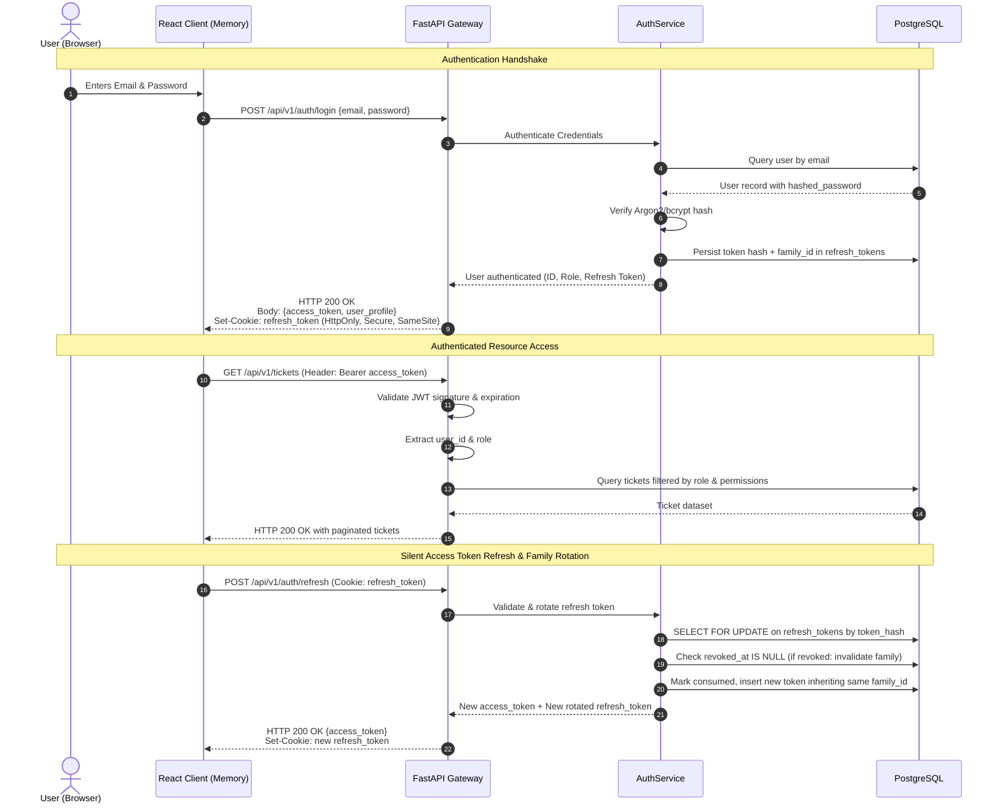

# System Architecture — CampusFix

| Document Version | 1.1.0 |
| :--- | :--- |
| **Status** | Approved Baseline (Phase 0) |
| **Maintainer** | Software Architect |
| **Last Updated** | 2026-10-27 (UTC) |

---

## 1. System Overview & Architecture Diagram

CampusFix is architected as a decoupled, multi-tier web application adhering to the **Modular Monolith** pattern. The application cleanly separates presentation concerns (React Single Page Application) from business domain logic and persistence (FastAPI REST service with PostgreSQL).

```mermaid
graph TD
    subgraph Client Tier ["Client Tier (Browser)"]
        SPA["React 18+ SPA (Vite + TypeScript + Tailwind)"]
        MemoryState["In-Memory Auth State (Access Token)"]
        CookieStore["Secure HttpOnly Cookie (Refresh Token)"]
    end

    subgraph Transport_Security ["Transport & Security Gateway"]
        HTTPS["HTTPS / TLS 1.3"]
        CORS["Strict CORS Middleware (Explicit Origins)"]
        RateLimiter["Rate Limiting Middleware (/auth, /tickets)"]
    end

    subgraph Application Tier ["Application Tier (FastAPI Modular Monolith)"]
        Router["API Routers (/api/v1)"]
        Deps["Dependency Injection (Auth, RBAC, DB Session)"]
        PydanticLayer["Pydantic v2 Schema Validation"]
        
        subgraph Domain Services ["Domain Services Layer"]
            AuthSvc["AuthService (Argon2id, JWT, Cookie Mgmt)"]
            TicketSvc["TicketService (FSM Lifecycle & Audit)"]
            UserSvc["UserService (Roles & Directory)"]
            CategorySvc["CategoryService (Facility Taxonomy)"]
        end
    end

    subgraph Persistence Tier ["Persistence Tier (PostgreSQL 15+)"]
        ORM["SQLAlchemy 2.0 Async Declarative ORM"]
        Alembic["Alembic Versioned Migrations"]
        PG[(PostgreSQL Relational ACID Store)]
    end

    SPA -->|REST API Calls (Bearer JWT)| HTTPS
    HTTPS --> CORS
    CORS --> RateLimiter
    RateLimiter --> Router
    Router --> Deps
    Deps --> PydanticLayer
    PydanticLayer --> DomainServices
    DomainServices --> ORM
    ORM --> PG
    Alembic -->|DDL Schema Sync| PG
```

---

## 2. Component Responsibilities

The system divides functional responsibilities across distinct, decoupled layers:

### 2.1 Frontend Components (React 18 + TypeScript + Vite)
- **Presentation Layer (`src/components/ui`, `src/pages`)**: Renders semantic, accessible HTML views (Student portal, Staff workbench, Admin dashboard). Enforces WCAG 2.1 AA contrast and screen-reader accessibility.
- **State Management & Hooks (`src/hooks`)**: Manages in-memory authentication state (access token, user identity) via React Context (`AuthContext`). Handles client caching and optimistic UI state.
- **API Client Layer (`src/api`)**: Encapsulates typed HTTP requests with automatic `Authorization: Bearer <token>` attachment and handles silent 401 token refresh retries.
- **Type Definitions (`src/types`)**: Maintains strict TypeScript interfaces synchronized with backend Pydantic schemas.

### 2.2 Backend Application Layer (FastAPI + Pydantic v2)
- **Routing & Controllers (`app/api/v1`)**: Exposes RESTful endpoints, handles HTTP parameter parsing, and invokes dependency injection guards.
- **Security & Authorization Dependencies (`app/api/deps.py`)**: Authoritatively verifies JWT tokens, extracts actor identity, and enforces role boundaries (`require_role("STAFF")`, `require_role("ADMINISTRATOR")`).
- **Data Validation Layer (`app/schemas`)**: Validates payload structure, string lengths, priority enums, and rejects malformed or malicious inputs before they reach business logic.
- **Domain Services (`app/services`)**: Implements authoritative business rules, state transition validation, optimistic version checking, and atomic transaction execution.

### 2.3 Persistence Layer (SQLAlchemy 2.0 + PostgreSQL 15+)
- **ORM Models (`app/models`)**: Defines relational tables, foreign key constraints, default timestamps, and optimistic locking version counters.
- **Database Migrations (`alembic/`)**: Provides version-controlled, forward-compatible schema evolution run during deployment.
- **Relational Storage (`PostgreSQL`)**: Guarantees ACID transactional semantics, row-level concurrency locks (`SELECT FOR UPDATE`), and indexed query performance.

---

## 3. Monorepo Directory Organization

```text
c:\Sagar Project\CampusFix\
├── docs/                        # Architectural, functional & operational specs
│   ├── PROJECT_CHARTER.md
│   ├── REQUIREMENTS.md
│   ├── DECISION_LOG.md
│   ├── ARCHITECTURE.md
│   ├── DATABASE_DESIGN.md
│   ├── API_SPECIFICATION.md
│   ├── UI_UX_SPECIFICATION.md
│   ├── TESTING_STRATEGY.md
│   ├── SECURITY.md
│   ├── DEPLOYMENT.md
│   └── PROJECT_STATUS.md
├── backend/                     # Python 3.11+ / FastAPI Service
│   ├── app/
│   │   ├── api/                 # Endpoint routing & dependency injection
│   │   │   ├── deps.py          # Auth dependencies, DB session inject
│   │   │   └── v1/
│   │   │       ├── auth.py      # /login, /refresh, /logout, /me
│   │   │       ├── users.py     # User administration endpoints
│   │   │       ├── categories.py# Issue category management
│   │   │       ├── tickets.py   # Ticket CRUD, assignment & status updates
│   │   │       └── admin.py     # Operations dashboard metrics
│   │   ├── core/                # System configuration & security primitives
│   │   │   ├── config.py        # Pydantic BaseSettings (.env loading)
│   │   │   ├── security.py      # Password hashing, JWT encode/decode
│   │   │   └── database.py      # Async SQLAlchemy engine & session factory
│   │   ├── models/              # SQLAlchemy 2.0 Declarative ORM models
│   │   ├── schemas/             # Pydantic v2 request/response schemas
│   │   ├── services/            # Domain business logic & state machine
│   │   └── main.py              # Application factory & middleware mounts
│   ├── alembic/                 # Database migration versions & env
│   ├── tests/                   # Pytest test suites (unit, API, security)
│   ├── pyproject.toml           # Project dependencies & Ruff tool configuration
│   └── .env.example             # Documented environment variables
├── frontend/                    # React / Vite / TypeScript Client
│   ├── src/
│   │   ├── api/                 # Typed Axios/Fetch client with interceptors
│   │   ├── components/          # Reusable accessible UI components
│   │   ├── hooks/               # Custom React hooks (useAuth, useTickets)
│   │   ├── pages/               # Routed page views by role
│   │   ├── types/               # TypeScript interfaces matching backend schemas
│   │   ├── App.tsx              # Application shell & route provider
│   │   └── main.tsx             # DOM mount point & global styles
│   ├── tests/                   # Vitest & Testing Library tests
│   ├── package.json             # NPM dependencies & scripts
│   ├── tailwind.config.js       # Design tokens & responsive breakpoints
│   └── vite.config.ts           # Bundler configuration
├── README.md                    # Project README & getting started guide
└── .gitignore                   # Ignore rules for Python, Node & environment files
```

---

## 4. API Communication & Authentication Flow



---

## 5. Major System Data Flows

### 5.1 Ticket Intake Data Flow
1. Student fills out ticket submission form in React client.
2. Form validates field constraints locally (e.g. title length, category selected).
3. Client dispatches `POST /api/v1/tickets` with JWT access token.
4. FastAPI dependency validates JWT, extracts student identity, and binds `creator_id`.
5. Pydantic schema validates all fields.
6. `TicketService` opens database transaction:
   - Inserts ticket record with initial status `SUBMITTED`, `version = 1`, and generates human-readable code `CFX-YYYY-XXXXX`.
   - Inserts initial status audit entry into `ticket_status_history`.
7. Transaction commits atomically; API returns HTTP 201 Created with full ticket payload.

### 5.2 Work Order Triage & Resolution Data Flow
1. Staff member or Admin queries open tickets via `GET /api/v1/tickets?status=SUBMITTED`.
2. Admin assigns ticket to staff member via `POST /api/v1/tickets/{id}/assign`:
   - State transitions to `ASSIGNED`, setting `assigned_staff_id`.
   - Audit history entry written recording `changed_by_user_id` (admin) and `assigned_to_user_id` (staff).
3. Assigned staff starts repair via `POST /api/v1/tickets/{id}/transition` (`target_status = "IN_PROGRESS"`).
4. Physical work is completed; staff submits resolution via `POST /api/v1/tickets/{id}/transition` (`target_status = "RESOLVED"`, mandatory `notes`).
5. `TicketService` executes row lock (`SELECT FOR UPDATE`), verifies state transition rules, saves `resolution_notes`, increments `version`, logs audit entry, and commits.

---

## 6. Finite State Machine (FSM) Lifecycle Matrix

| From State | To State | Authorized Role | Mandatory Requirements / Side Effects |
| :--- | :--- | :--- | :--- |
| *None* | `SUBMITTED` | `STUDENT` | Ticket created; `creator_id` bound to current user; history entry created. |
| `SUBMITTED` | `ASSIGNED` | `ADMINISTRATOR`, `STAFF` | Target `assigned_staff_id` supplied; history logs assigning actor and assigned technician. |
| `SUBMITTED` | `REJECTED` | `ADMINISTRATOR`, `STAFF` | Mandatory `rejection_reason` (min 10 chars); terminal unless reopened by Admin. |
| `SUBMITTED` | `CANCELLED` | `STUDENT` (Owner) | Must be ticket creator; mandatory cancellation note; terminal state. |
| `ASSIGNED` | `IN_PROGRESS` | `STAFF` (Assignee), `ADMINISTRATOR` | Staff begins diagnosis or physical repair; timestamp logged. |
| `ASSIGNED` | `ASSIGNED` | `ADMINISTRATOR` | Reassignment to different staff member; `assigned_to_user_id` updated; logged in history. |
| `ASSIGNED` | `REJECTED` | `ADMINISTRATOR`, `STAFF` | Mandatory `rejection_reason`; terminal unless reopened by Admin. |
| `ASSIGNED` | `CANCELLED` | `STUDENT` (Owner) | Must be ticket creator; terminal state. |
| `IN_PROGRESS` | `RESOLVED` | `STAFF` (Assignee), `ADMINISTRATOR` | Mandatory `resolution_notes` (min 10 chars); terminal unless reopened by Admin. |
| `IN_PROGRESS` | `ASSIGNED` | `ADMINISTRATOR`, `STAFF` | Work paused / ticket reassigned back to queue; reason logged. |
| `IN_PROGRESS` | `REJECTED` | `ADMINISTRATOR` | Requires administrative review & reason; terminal unless reopened by Admin. |
| `RESOLVED` | `ASSIGNED` | `ADMINISTRATOR` | Reopening: requires mandatory `reopening_reason` (min 10 chars); returns ticket to active repair queue. |
| `RESOLVED` | `SUBMITTED` | `ADMINISTRATOR` | Reopening: requires mandatory `reopening_reason` (min 10 chars); returns ticket to triage pool. |
| `REJECTED` | `ASSIGNED` | `ADMINISTRATOR` | Reopening: requires mandatory `reopening_reason` (min 10 chars); restores ticket directly to technician queue. |
| `REJECTED` | `SUBMITTED` | `ADMINISTRATOR` | Reopening: requires mandatory `reopening_reason` (min 10 chars); overturns mistaken rejection back to triage pool. |

---

## 7. Important Technical Trade-offs

1. **Modular Monolith vs. Microservices**:
   - *Choice*: Modular Monolith.
   - *Trade-off*: Eliminates network partition risks, distributed transaction failure modes, and DevOps complexity, at the cost of requiring unified deployments.
2. **In-Memory JWT Access Tokens vs. LocalStorage**:
   - *Choice*: In-memory access tokens with `HttpOnly` refresh cookies.
   - *Trade-off*: Drastically reduces vulnerability to XSS exfiltration, requiring a silent refresh handshake when the browser reloads.
3. **Database Concurrency: Optimistic Versioning vs. Pessimistic Locking**:
   - *Choice*: Hybrid approach (Pessimistic `SELECT FOR UPDATE` during transition transactions + integer `version` field for optimistic client verification).
   - *Trade-off*: Maximum data integrity and zero lost updates, with minimal database locking overhead.
4. **Append-Only In-Database Audit Log vs. External Log Aggregator**:
   - *Choice*: In-database `ticket_status_history` table updated inside the same transaction as the ticket state.
   - *Trade-off*: Guarantees atomic consistency between current ticket status and historical logs, without requiring Kafka, ElasticSearch, or third-party log infrastructure.
