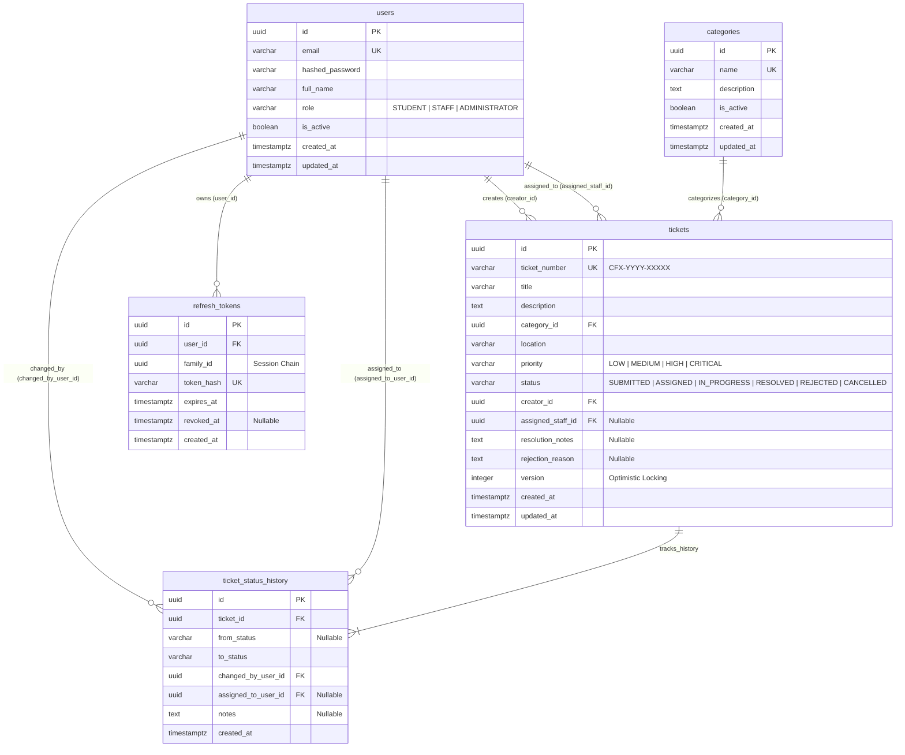

# Database Design — CampusFix

| Document Version | 1.0.0 |
| :--- | :--- |
| **Status** | Approved Baseline (Phase 0) |
| **Maintainer** | Database Architect & Backend Lead |
| **Last Updated** | 2026-10-27 (UTC) |

---

## 1. Principles & Standards

The CampusFix data persistence layer is engineered on **PostgreSQL 15+** adhering to:
1. **Third Normal Form (3NF)**: Redundancy is minimized; relational integrity is enforced via foreign keys.
2. **Deterministic Data Types**: Explicit sizes for character fields, UUIDs for entity identifiers, and ISO-8601 UTC timestamps (`TIMESTAMPTZ`).
3. **Optimistic Locking & Concurrency**: Integer `version` column on mutable transactional entities (`tickets`) to prevent lost updates.
4. **Append-Only Auditing**: Ticket lifecycle changes are captured in an immutable historical ledger (`ticket_status_history`).
5. **No Production Auto-Sync**: Schema creation via `Base.metadata.create_all()` is strictly forbidden in production. All schema changes occur through version-controlled **Alembic** migrations.

---

## 2. Entity-Relationship Diagram (ERD)

---

## 3. Relational Table Specifications

### 3.1 Table: `users`
Stores user identities, credentials, and access roles.

| Column | Type | Constraints | Description |
| :--- | :--- | :--- | :--- |
| `id` | `UUID` | Primary Key, Default: `gen_random_uuid()` | Unique entity identifier. |
| `email` | `VARCHAR(255)` | NOT NULL, UNIQUE, Indexed | Institutional email address. |
| `hashed_password` | `VARCHAR(255)` | NOT NULL | Argon2id or bcrypt password digest. |
| `full_name` | `VARCHAR(150)` | NOT NULL | User's display name. |
| `role` | `VARCHAR(20)` | NOT NULL, CHECK in ('STUDENT', 'STAFF', 'ADMINISTRATOR') | Authorization role. |
| `is_active` | `BOOLEAN` | NOT NULL, Default: `TRUE` | Soft account deactivation flag. |
| `created_at` | `TIMESTAMPTZ` | NOT NULL, Default: `CLOCK_TIMESTAMP()` | Account creation time (UTC). |
| `updated_at` | `TIMESTAMPTZ` | NOT NULL, Default: `CLOCK_TIMESTAMP()` | Account update time (UTC). |

---

### 3.2 Table: `categories`
Defines operational facility domains (e.g., HVAC, Electrical, Audio-Visual, Plumbing).

| Column | Type | Constraints | Description |
| :--- | :--- | :--- | :--- |
| `id` | `UUID` | Primary Key, Default: `gen_random_uuid()` | Unique entity identifier. |
| `name` | `VARCHAR(100)` | NOT NULL, UNIQUE | Category label (e.g., "Classroom AV"). |
| `description` | `TEXT` | NOT NULL | Operational description and examples. |
| `is_active` | `BOOLEAN` | NOT NULL, Default: `TRUE` | Whether available for new ticket intake. |
| `created_at` | `TIMESTAMPTZ` | NOT NULL, Default: `CLOCK_TIMESTAMP()` | Creation timestamp (UTC). |
| `updated_at` | `TIMESTAMPTZ` | NOT NULL, Default: `CLOCK_TIMESTAMP()` | Update timestamp (UTC). |

---

### 3.3 Table: `tickets`
The core transactional entity tracking campus maintenance complaints and resolutions.

| Column | Type | Constraints | Description |
| :--- | :--- | :--- | :--- |
| `id` | `UUID` | Primary Key, Default: `gen_random_uuid()` | Unique entity identifier. |
| `ticket_number` | `VARCHAR(30)` | NOT NULL, UNIQUE, Indexed | Human-readable tracking code (`CFX-YYYY-XXXXX`). |
| `title` | `VARCHAR(120)` | NOT NULL | Brief summary of the facility issue. |
| `description` | `TEXT` | NOT NULL | Comprehensive incident details. |
| `category_id` | `UUID` | NOT NULL, FK → `categories(id)` ON DELETE RESTRICT | Associated facility discipline. |
| `location` | `VARCHAR(100)` | NOT NULL | Physical campus location (e.g., "Eng Block 3, Room 302"). |
| `priority` | `VARCHAR(20)` | NOT NULL, CHECK in ('LOW', 'MEDIUM', 'HIGH', 'CRITICAL') | Triage urgency. |
| `status` | `VARCHAR(20)` | NOT NULL, CHECK in ('SUBMITTED', 'ASSIGNED', 'IN_PROGRESS', 'RESOLVED', 'REJECTED', 'CANCELLED') | Current lifecycle state. |
| `creator_id` | `UUID` | NOT NULL, FK → `users(id)` ON DELETE RESTRICT | User who submitted the ticket. |
| `assigned_staff_id` | `UUID` | NULLABLE, FK → `users(id)` ON DELETE SET NULL | Facilities staff member assigned. |
| `resolution_notes` | `TEXT` | NULLABLE | Mandatory description of repair work upon resolution. |
| `rejection_reason` | `TEXT` | NULLABLE | Mandatory explanation if ticket is rejected. |
| `version` | `INTEGER` | NOT NULL, Default: `1` | Optimistic locking counter. |
| `created_at` | `TIMESTAMPTZ` | NOT NULL, Default: `CLOCK_TIMESTAMP()` | Ticket creation timestamp (UTC). |
| `updated_at` | `TIMESTAMPTZ` | NOT NULL, Default: `CLOCK_TIMESTAMP()` | Last state or metadata modification (UTC). |

---

### 3.4 Table: `ticket_status_history`
Append-only historical audit trail of all state transitions and assignments.

| Column | Type | Constraints | Description |
| :--- | :--- | :--- | :--- |
| `id` | `UUID` | Primary Key, Default: `gen_random_uuid()` | Unique log record identifier. |
| `ticket_id` | `UUID` | NOT NULL, FK → `tickets(id)` ON DELETE CASCADE | Associated ticket. |
| `from_status` | `VARCHAR(20)` | NULLABLE | Source status prior to transition. |
| `to_status` | `VARCHAR(20)` | NOT NULL | Target status after transition. |
| `changed_by_user_id`| `UUID` | NOT NULL, FK → `users(id)` ON DELETE RESTRICT | Actor who initiated the transition. User deletion restricted to preserve audit integrity. |
| `assigned_to_user_id`| `UUID` | NULLABLE, FK → `users(id)` ON DELETE RESTRICT | Facilities staff member assigned during this event. User deletion restricted to preserve audit integrity. |
| `notes` | `TEXT` | NULLABLE | Transition rationale, cancellation, rejection, or resolution notes. |
| `created_at` | `TIMESTAMPTZ` | NOT NULL, Default: `CLOCK_TIMESTAMP()` | Transition event timestamp (UTC). |

---

### 3.5 Table: `refresh_tokens`
Stores cryptographically hashed refresh tokens for session management, single-use token rotation, token-family isolation, and explicit revocation.

| Column | Type | Constraints | Description |
| :--- | :--- | :--- | :--- |
| `id` | `UUID` | Primary Key, Default: `gen_random_uuid()` | Unique session token record identifier. |
| `user_id` | `UUID` | NOT NULL, FK → `users(id)` ON DELETE CASCADE | Associated user account. |
| `family_id` | `UUID` | NOT NULL, Indexed | Identifies the token family / session chain. Minted at initial login; preserved across sequential rotations. |
| `token_hash` | `VARCHAR(255)` | NOT NULL, UNIQUE, Indexed | Cryptographic SHA-256 hash of the issued refresh token. Raw tokens are never stored. |
| `expires_at` | `TIMESTAMPTZ` | NOT NULL | Hard token expiration timestamp (UTC). |
| `revoked_at` | `TIMESTAMPTZ` | NULLABLE | Revocation timestamp if consumed, logged out, or invalidated (UTC). |
| `created_at` | `TIMESTAMPTZ` | NOT NULL, Default: `CLOCK_TIMESTAMP()` | Token issuance timestamp (UTC). |

#### Token-Family Lifecycle & Persistence Rules:
1. **Initial Login (`/auth/login`)**:
   - A new `family_id = gen_random_uuid()` is minted.
   - The SHA-256 hash of the initial refresh token is stored alongside `user_id`, `family_id`, and `expires_at = CLOCK_TIMESTAMP() + INTERVAL '7 days'`.
2. **Rotation (`/auth/refresh`)**:
   - The server acquires a row lock (`SELECT ... FOR UPDATE`) on the matching `token_hash`.
   - Post-lock validation checks that `revoked_at IS NULL` and `expires_at > CLOCK_TIMESTAMP()`.
   - The token is atomically consumed (`revoked_at = CLOCK_TIMESTAMP()`).
   - A new cryptographically random refresh token is generated; its SHA-256 hash is inserted inheriting the exact same `family_id`.
3. **Reuse Detection & Invalidation**:
   - If an incoming token matches a row where `revoked_at IS NOT NULL`, the server detects token reuse (replay attack).
   - The server executes:
     `UPDATE refresh_tokens SET revoked_at = CLOCK_TIMESTAMP() WHERE family_id = :family_id AND revoked_at IS NULL;`
   - All active tokens in that specific family are immediately invalidated.
   - **Session Isolation**: Unrelated device sessions for the same user (having different `family_id` values) remain active and undisturbed.
4. **Logout (`/auth/logout`)**:
   - Explicitly sets `revoked_at = CLOCK_TIMESTAMP()` for the current token or all active tokens within the session's `family_id`.

---

## 4. Indexing Strategy

To maintain sub-100ms query performance as the ticket volume scales, the following indexes are specified:

1. `users_email_idx`: `CREATE UNIQUE INDEX idx_users_email ON users(email);`
2. `tickets_number_idx`: `CREATE UNIQUE INDEX idx_tickets_number ON tickets(ticket_number);`
3. `tickets_creator_idx`: `CREATE INDEX idx_tickets_creator_created ON tickets(creator_id, created_at DESC);` (Fast retrieval of student tickets).
4. `tickets_assigned_idx`: `CREATE INDEX idx_tickets_assigned_status ON tickets(assigned_staff_id, status);` (Staff queue filtering).
5. `tickets_status_category_idx`: `CREATE INDEX idx_tickets_status_category ON tickets(status, category_id);` (Admin triage queries).
6. `history_ticket_idx`: `CREATE INDEX idx_history_ticket_created ON ticket_status_history(ticket_id, created_at ASC);` (Chronological audit reconstruction).
7. `history_assigned_idx`: `CREATE INDEX idx_history_assigned_to ON ticket_status_history(assigned_to_user_id);` (Technician assignment history lookups).
8. `refresh_token_hash_idx`: `CREATE UNIQUE INDEX idx_refresh_tokens_hash ON refresh_tokens(token_hash);` (Instant token lookup during refresh/revocation).
9. `refresh_token_user_idx`: `CREATE INDEX idx_refresh_tokens_user ON refresh_tokens(user_id);` (User session enumeration and global administrative revocation).
10. `refresh_token_family_idx`: `CREATE INDEX idx_refresh_tokens_family ON refresh_tokens(family_id);` (Instant family-wide revocation on token reuse detection).

---

## 5. Migration & Seeding Lifecycle

- **Alembic Environment**: Configured in `backend/alembic` using async SQLAlchemy migration context.
- **Migration Commands**:
  - `alembic revision --autogenerate -m "create_initial_schema"`
  - `alembic upgrade head`
- **Synthetic Seed Protocol**:
  - Seed execution via `python -m app.scripts.seed`.
  - Populates standard facility categories (HVAC, Electrical, Plumbing, Furniture, AV, Network).
  - Populates 3 deterministic test accounts (`student.demo@campusfix.local`, `staff.demo@campusfix.local`, `admin.demo@campusfix.local`) with securely hashed passwords.
  - Generates 15 synthetic tickets spanning all valid statuses for local development testing.
