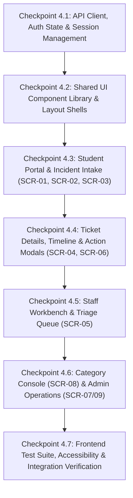

# Project Status & Phase-Gate Tracking — CampusFix

| Document Version | 2.12.0 |
| :--- | :--- |
| **Current Active Phase** | **Phase 4: Client Interfaces (Student, Staff, Admin) & API Integration** |
| **Active Checkpoint** | **Checkpoint 4.5: Staff Workbench Queue and Work Execution — Complete** |
| **Phase 4 Gate Status** | **Checkpoint 4.5 Complete — Awaiting Project Owner Authorization for Checkpoint 4.6 (Category Management Console)** |
| **Maintainer** | Project Lead & Software Architect |
| **Last Updated** | 2026-11-02 (UTC) |

---

## 1. Executive Status Summary

Phase 0 (Requirements & Architecture), Phase 1 (UI/UX Design, Design System & Wireframe Specifications), Phase 2 (Repository Foundations, Tooling, Database Connectivity & Migrations), and Phase 3 (Core Domain Models, Auth Engine, Ticket State Machine & REST APIs) have been fully completed, reviewed, and audited.

The Project Owner formally authorized execution of **Phase 4, Checkpoint 4.5: Staff Workbench Queue and Work Execution**.

**Checkpoint 4.5 Status**: **Complete**.
- **Screen SCR-05: Staff Workbench Queue (`frontend/src/pages/staff/StaffQueuePage.tsx`)**:
  - Staff-only protected route `/staff/queue` enforced with `RoleRoute allowedRoles={['STAFF']}` inside the authenticated `AppShell`.
  - Accessible tab switcher with live badge counts:
    - **Tab 1: "Assigned to Me"**: queries `GET /api/v1/tickets?assigned_staff_id=me&status=ASSIGNED,IN_PROGRESS` (with optional category and priority filters).
    - **Tab 2: "Unassigned Queue"**: queries `GET /api/v1/tickets?status=SUBMITTED` (awaiting triage/pickup).
  - High-efficiency operational queue controls:
    - Category filter dropdown loaded from `categoriesApi.listCategories()`.
    - Urgency tier filter dropdown (`LOW`, `MEDIUM`, `HIGH`, `CRITICAL`).
    - Sort selector: Newest first (default), Oldest first, and Priority High-to-Low (`CRITICAL > HIGH > MEDIUM > LOW`).
  - Technician-optimized operational columns and cards:
    - Ticket ID reference code (`CFX-YYYY-XXXXX`) with priority badge.
    - Facility location and defect summary title.
    - Facility category pill badge.
    - Status pill badge.
    - Submission date.
    - Quick Actions column:
      - **"Claim Ticket"** (on Unassigned Queue): fetches fresh ticket by UUID to obtain authoritative `version`, invokes `ticketsApi.assignTicket(id, { staff_id: user.id, expected_version })`, presents success feedback, and reloads queue.
      - **"Start Work"** (on Assigned tab for `ASSIGNED` status): fetches fresh ticket version, invokes `ticketsApi.transitionTicket(id, { target_status: 'IN_PROGRESS', expected_version })`, presents success feedback, and moves ticket to `IN_PROGRESS`.
      - **"Resolve Work >"** (on Assigned tab for `IN_PROGRESS` status): navigates to `/tickets/:id` where resolution notes are gathered in the modal dialog.
      - **"Open Work >"**: navigates directly to `/tickets/:id`.
  - Optimistic Concurrency Conflict Handling (HTTP 409):
    - Concurrency conflicts on claim or start-work catch `ApiError` with `status === 409`, display an `AlertBanner` warning, and immediately trigger a full queue refresh to synchronize UI with database reality.
  - Action In-Flight Guards:
    - Disables action buttons while an operation is in progress (`actionLoadingId !== null`) to eliminate duplicate clicks.
  - Contextual Empty States:
    - Assigned tab: "No Assigned Work Orders" with "Check Unassigned Queue" CTA button that switches active tab.
    - Unassigned tab: "Queue Clear" stating all incoming reports have been dispatched.
  - Accessible loading skeletons, error banner with retry trigger, and server-side pagination with `PaginationBar`.
- **Route & Navigation Shell Integration (`frontend/src/App.tsx`)**:
  - Wired `/staff/queue` wrapped in `<RoleRoute allowedRoles={['STAFF']}>`.
  - Root redirect for authenticated staff automatically lands on `/staff/queue`.
- **Quality Gates & Automated Verification**:
  - 11 new Vitest unit and integration tests added in `frontend/tests/pages/StaffQueuePage.test.tsx` covering all operational flows, tabs, quick-actions, HTTP 409 conflict recovery, empty states, client sorting, and error retries.
  - Total frontend test suite: **119/119 tests passing across 19 test files** (100% passing).
  - TypeScript strict typecheck (`tsc --noEmit` via build): **0 errors**.
  - ESLint check (`eslint .`): **0 errors, 0 warnings**.
  - Production bundle build (`vite build`): **Clean compilation**.
  - Backend regression test suite (`backend/.venv/Scripts/pytest.exe`): **277/277 passed in 11.17s**.
  - Catches HTTP 409 `CONCURRENCY_CONFLICT` on stale ticket updates.
  - Closes the action dialog without silent retries.
  - Displays a high-visibility warning `AlertBanner` explaining the concurrency conflict.
  - Automatically re-fetches the latest ticket details and audit history from the server.
  - Updates displayed version, status, and timeline in place, requiring the user to review before attempting another action.
- **Comprehensive Quality & Test Verification**:
  - Frontend Vitest suite: **108 tests passed across 18 test files** (100% passing in 56.49s):
    - `tests/pages/TicketDetailPage.test.tsx` (14 tests, up from 10): ticket details and metadata rendering, timeline display, invalid UUID format rejection, 404 error state, role-governed actions across roles, complete cancellation permission regression matrix, HTTP 409 concurrency recovery, and back navigation.
    - `tests/components/TicketTransitionModals.test.tsx` (7 tests): RESOLVE note validation (min 10 chars), REJECT reason validation (min 10 chars), CLAIM assignment, ASSIGN staff UUID validation, REOPEN submission, HTTP 409 concurrency delegation, and error banner display.
    - All 87 existing unit/integration tests from Checkpoints 4.1 – 4.3 passing.
  - TypeScript strict compilation: `tsc -p frontend/tsconfig.json --noEmit` clean (0 errors).
  - ESLint code quality: `npm run lint` clean (0 errors, 0 warnings).
  - Vite production build: `npm run build` succeeds (assets generated in `frontend/dist/` in 5.22s).
  - Backend regression: 277 / 277 pytest tests pass in 4.83s with zero regressions.
- **Strict Scope Boundaries Maintained**:
  - Zero new dependencies added.
  - In-memory access token storage and HttpOnly refresh cookies strictly preserved.
  - Staff Workbench Queue deferred to Checkpoint 4.5.
  - Category Management Console deferred to Checkpoint 4.6.
  - Missing administrative backend endpoints (`/api/v1/admin/*`) remain strictly untouched.
- **Prior Checkpoint 4.3 (Auth, Student Dashboard & Ticket Submission Flow)**:
  - **Screen SCR-01: Authentication Portal (`frontend/src/pages/auth/`)**:
  - `LoginPage.tsx` (`/login`): Clean email and password inputs, client-side format validation, loading state on submit button, high-visibility error alert banner on rejected credentials, in-memory auth context integration, and role-based redirects (STUDENT -> `/student/tickets`, STAFF -> `/staff/queue`, ADMINISTRATOR -> `/admin/categories`).
  - `RegisterPage.tsx` (`/register`): Student registration form with strict password complexity validation (min 8 chars, >=1 uppercase, >=1 lowercase, >=1 digit), seamless automatic login upon registration, accessible API error handling, and redirection to `/student/tickets`.
- **Screen SCR-02: Student Portal / My Tickets (`frontend/src/pages/student/StudentTicketsPage.tsx`)**:
  - Route `/student/tickets`: Renders ticket summary table with ticket number (`CFX-YYYY-XXXXX`), title, category, priority badge, status badge, and formatted submission date.
  - Interactive status filter tab bar (`ALL`, `SUBMITTED`, `ASSIGNED`, `IN_PROGRESS`, `RESOLVED`, `REJECTED`, `CANCELLED`) re-querying the backend API with `status` filter.
  - Server-driven pagination via `PaginationBar`.
  - Layout-preserving loading skeleton state (`isLoading={true}`).
  - Contextual empty state with "Report Your First Issue" CTA button when no tickets exist.
  - Error state with clear alert banner and "Retry Request" trigger.
  - Row click navigation routing to ticket detail URL using ticket UUID (`/tickets/:id`).
- **Screen SCR-03: Ticket Submission Flow (`frontend/src/pages/tickets/TicketCreatePage.tsx`)**:
  - Route `/tickets/new`: Accessible incident reporting form.
  - Category dropdown dynamically loaded from `GET /api/v1/categories` with loading and fallback handling.
  - Validations: Title (>= 5 chars), Description (>= 10 chars with character counter), Category selection, Location (>= 3 chars), and Priority selector with `MEDIUM` as default.
  - Submitting state disabling form inputs and showing spinner to prevent duplicate submissions.
  - Contextual error banners for network or backend API errors.
  - Successful submission redirects the student directly to `/tickets/:id` using the newly created ticket UUID.
- **Routing & Shell Wiring (`frontend/src/App.tsx`)**:
  - Integrated `BrowserRouter`, `AuthProvider`, `PublicOnlyRoute` (`/login`, `/register`), `ProtectedRoute` + `AppShell` (`/student/tickets`, `/tickets/new`, placeholder `/tickets/:id`), and `RootRedirect` routing.
- **Comprehensive Quality & Test Verification**:
  - Frontend Vitest suite: **87 tests passed across 16 test files** (100% passing in 9.60s):
    - `tests/pages/LoginPage.test.tsx` (6 tests): field rendering, email format validation, password validation, error alerts, and role-based redirecting for students and staff.
    - `tests/pages/RegisterPage.test.tsx` (5 tests): form rendering, password complexity enforcement, submission, automatic login, and conflict error handling.
    - `tests/pages/StudentTicketsPage.test.tsx` (5 tests): ticket table rendering, status filtering, empty state with CTA, API error with retry, and UUID row click navigation.
    - `tests/pages/TicketCreatePage.test.tsx` (4 tests): category dropdown loading, field length validation, submission and UUID redirect, and submission failure alerts.
    - All existing unit tests from Checkpoint 4.1 and 4.2 passing (87 total).
  - TypeScript strict compilation: `tsc -p frontend/tsconfig.json --noEmit` clean (0 errors).
  - ESLint code quality: `npm run lint` clean (0 errors, 0 warnings).
  - Vite production build: `npm run build` succeeds (assets generated in `frontend/dist/` in 1.50s).
  - Backend regression: 277 / 277 pytest tests pass in 5.20s with zero regressions.
- **Strict Scope Boundaries Maintained**:
  - Zero new dependencies added.
  - Tokens kept strictly in-memory; refresh tokens managed via existing HttpOnly cookie mechanism.
  - No ticket state transitions or detail audit timeline implemented (deferred to Checkpoint 4.4).
  - Staff Workbench Queue deferred to Checkpoint 4.5.
  - Missing administrative backend endpoints (`/api/v1/admin/*`) remain strictly untouched.
- **Domain & API Type Synchronizations (`frontend/src/types/index.ts`)**:
  - Authored TypeScript interfaces and union types strictly synchronized with backend Pydantic v2 schemas: `UserRole`, `User`, `UserSummary`, `UserCreatePayload`, `UserLoginPayload`, `TokenResponse`, `LoginResponseData`, `Category`, `CategorySummary`, `Ticket`, `TicketSummary`, `TicketCreatePayload`, `TicketAssignPayload`, `TicketTransitionPayload`, `TicketHistoryItem`, `PaginationMeta`, `SuccessEnvelope<T>`, `PaginatedResponse<T>`, `ErrorEnvelope`, `ErrorDetail`, and `ValidationErrorItem`.
- **Typed HTTP Client with Single-Flight Refresh Mutex (`frontend/src/api/client.ts`)**:
  - Implemented `ApiClient` wrapping native `fetch` with zero new runtime dependencies.
  - Implemented strict in-memory JWT access token management (`setAccessToken`, `getAccessToken`).
  - Transmits `credentials: 'include'` on all network calls ensuring secure `HttpOnly` refresh cookie delivery to `/api/v1/auth`.
  - Implemented single-flight refresh mutex/promise queue: if multiple concurrent API calls receive HTTP 401, exactly ONE network call to `/auth/refresh` is dispatched; all waiting requests await that same promise and seamlessly replay with the rotated access token, preventing session family revocation.
  - Implemented `ApiError` class decoding standard backend `ErrorEnvelope` payloads with `status`, `code`, `message`, `details`, and `timestamp`.
  - Implemented session expiry and token rotation event listeners.
- **Authentication Service Client (`frontend/src/api/auth.ts`)**:
  - Implemented `authApi` wrapping all 5 authentication endpoints: `register` (assigns `STUDENT` role), `login` (stores token in memory), `refresh` (token rotation), `logout` (revokes session family and clears cookie), and `getMe` (retrieves user profile).
- **React Authentication Context & Hook (`frontend/src/context/`, `frontend/src/hooks/useAuth.ts`)**:
  - Implemented `AuthContext`, `useAuth`, and `AuthProvider` managing `user`, `accessToken`, `isLoading`, and `isAuthenticated`.
  - Configured automatic silent session restoration on mount via HttpOnly cookie (`autoBootstrap: true`), keeping `isLoading: true` until verified.
  - Bound session expiration listeners to immediately clean up client state when a refresh token expires or is revoked.
- **Role-Based Route Guards (`frontend/src/components/auth/`)**:
  - `ProtectedRoute`: Renders accessible loading skeleton while verifying session, redirects unauthenticated users to `/login` with `state.from`, or renders protected child routes.
  - `RoleRoute`: Enforces role-based access control on the presentation tier, rendering an accessible WCAG 2.1 AA 403 Access Restricted alert with return button if role is unauthorized.
  - `PublicOnlyRoute`: Prevents authenticated users from viewing `/login` or `/register`, automatically routing them to their role home (`/student/tickets`, `/staff/queue`, or `/admin/dashboard`).
- **Comprehensive Test Suite & Quality Verification**:
  - Frontend Vitest suite: **25 tests passed across 5 test files** (100% passing in 3.62s):
    - `tests/api/client.test.ts` (8 tests): in-memory token storage, Bearer attachment, credentials inclusion, error decoding, 401 single-flight coalescence, and session expiry notifications.
    - `tests/api/auth.test.ts` (4 tests): register, login, logout, getMe.
    - `tests/context/AuthContext.test.tsx` (5 tests): silent bootstrap on mount, failure handling, login, logout, and provider enforcement.
    - `tests/components/RouteGuards.test.tsx` (7 tests): loading indicator, redirect to `/login`, authenticated rendering, role allowance, 403 alert, and public route redirects.
    - `tests/App.test.tsx` (1 test): foundation smoke test.
  - TypeScript strict compilation: `npx tsc --noEmit` clean (0 errors).
  - ESLint code quality: `eslint .` clean (0 errors, 0 warnings).
  - Production build: `npm run build` succeeds (assets generated in `frontend/dist/`).
  - Backend regression: 277 / 277 tests pass in 6.42s with zero regressions.
- **Strict Scope Boundaries Maintained**:
  - Zero new dependencies added (used native browser `fetch` and existing toolchain).
  - Zero backend code, database models, schemas, or migrations touched.
  - The missing administrative endpoints (`/api/v1/admin/*`) remain strictly untouched per instructions.
  - **Terminal State Immutability**: Confirmed that `CANCELLED` tickets cannot be transitioned or reopened (HTTP 422 `TERMINAL_STATE`).
  - **Concurrency Conflict Mapping**: Verified that optimistic concurrency mismatches (`expected_version != ticket.version`) on assignment and transition return HTTP 409 `CONCURRENCY_CONFLICT` with `expected_version` and `actual_version` in error details.
  - **Input Robustness & Information Leakage**: Verified that malformed UUID path parameters, invalid pagination numbers, invalid status filters, and unexpected fields are rejected with HTTP 422 standard validation envelopes without leaking stack traces or SQL details.
- **Ticket Transition Schema Hardening**:
  - Enhanced `TicketTransition` schema (`backend/app/schemas/ticket.py`) to accept optional `assigned_staff_id: uuid.UUID | None` for administrative reopening directly to `ASSIGNED`, forwarded in `backend/app/api/v1/tickets.py`.
- **Test Suite Metrics**:
  - Backend pytest suite: **277 total tests**: **277 passed**, **0 failed**, **0 skipped** (100% passing).
  - All 4 previously blocked live PostgreSQL integration test suites are now **UNBLOCKED & PASSED** against the dedicated test database (`campusfix_test`):
    1. `test_live_postgresql_user_email_unique_constraint` (`PASSED`)
    2. `test_live_postgresql_refresh_token_concurrency` (`PASSED`)
    3. `test_live_postgresql_ticket_concurrency_and_row_locking` (`PASSED`)
    4. `test_live_postgresql_migration` (`PASSED`)
  - Dedicated test database `campusfix_test` migrated to baseline revision `0c98aec98ce5` with 6 tables, 17 indexes, and 17 constraints.
  - Development/production database `campusfix` confirmed pristine and untouched (0 public tables).
  - Ruff linter (`ruff check .`) and code formatter (`ruff format --check .`) are 100% clean across all 51 Python files.
  - FastAPI OpenAPI 3.1.0 specification verified to generate all 15 versioned REST route operations across 12 unique paths (`/api/v1/auth/*`, `/api/v1/categories/*`, `/api/v1/tickets/*`) cleanly.
- **Frontend Regression Suite**:
  - Verified 100% clean: `npm test -- --run` (1/1 passed), `npx tsc --noEmit` (0 errors), `npm run lint` (0 errors), `npm run build` (production assets built successfully).
- **Strict Scope Boundaries Maintained**:
  - Zero dashboard or metrics routes introduced.
  - Zero new product features or frontend screens built.
  - Approved roles (`STUDENT`, `STAFF`, `ADMINISTRATOR`) and ticket statuses (`SUBMITTED`, `ASSIGNED`, `IN_PROGRESS`, `RESOLVED`, `REJECTED`, `CANCELLED`) preserved.
  - Zero unapproved database schema changes or migrations.
  - No SQLite substituted for PostgreSQL concurrency/locking tests.

---

## 2. Deliverables Completed

| Deliverable Document | Primary Content & Purpose | Status |
| :--- | :--- | :--- |
| [**`README.md`**](file:///c:/Sagar%20Project/CampusFix/README.md) | Project introduction, disclaimer, tech stack, roadmap, repository layout, prerequisites, and setup instructions. | **Completed (v2.1)** |
| [**`.gitignore`**](file:///c:/Sagar%20Project/CampusFix/.gitignore) | Git ignore rules for Python, Node, Vite, virtual environments, build artifacts, and secrets. | **Completed** |
| [**`.env.example`**](file:///c:/Sagar%20Project/CampusFix/.env.example) | Monorepo root environment configuration template with safe placeholders. | **Completed** |
| [**`backend/.env.example`**](file:///c:/Sagar%20Project/CampusFix/backend/.env.example) | Backend environment configuration template (FastAPI, SQLAlchemy, JWT, CORS). | **Completed** |
| [**`backend/pyproject.toml`**](file:///c:/Sagar%20Project/CampusFix/backend/pyproject.toml) | Python packaging manifest, bounded runtime and dev dependencies, Ruff and pytest configs. | **Completed (Checkpoint 2.2 / 2.4)** |
| [**`backend/.venv/`**](file:///c:/Sagar%20Project/CampusFix/backend/.venv) | Isolated Python 3.13.7 virtual environment with installed runtime and dev dependencies. | **Configured (Local/Ignored)** |
| [**`backend/app/core/config.py`**](file:///c:/Sagar%20Project/CampusFix/backend/app/core/config.py) | Pydantic Settings class with async database validation and safe credential masking. | **Completed (Checkpoint 2.4)** |
| [**`backend/app/core/database.py`**](file:///c:/Sagar%20Project/CampusFix/backend/app/core/database.py) | Async SQLAlchemy 2.0 engine, sessionmaker factory, DeclarativeBase, and get_db_session generator. | **Completed (Checkpoint 2.4)** |
| [**`backend/app/api/deps.py`**](file:///c:/Sagar%20Project/CampusFix/backend/app/api/deps.py) | FastAPI dependency injection provider (`get_db`). | **Completed (Checkpoint 2.4)** |
| [**`backend/alembic.ini`**](file:///c:/Sagar%20Project/CampusFix/backend/alembic.ini) | Alembic migration configuration without static credentials. | **Completed (Checkpoint 2.4)** |
| [**`backend/alembic/env.py`**](file:///c:/Sagar%20Project/CampusFix/backend/alembic/env.py) | Async Alembic migration runner bound to application settings and DeclarativeBase metadata. | **Completed (Checkpoint 2.4)** |
| [**`backend/alembic/script.py.mako`**](file:///c:/Sagar%20Project/CampusFix/backend/alembic/script.py.mako) | Revision script template for future schema migrations. | **Completed (Checkpoint 2.4)** |
| [**`backend/tests/unit/test_config.py`**](file:///c:/Sagar%20Project/CampusFix/backend/tests/unit/test_config.py) | Unit tests verifying configuration defaults, validation rules, CORS parsing, and secret masking. | **Completed (Checkpoint 2.4)** |
| [**`backend/tests/unit/test_database.py`**](file:///c:/Sagar%20Project/CampusFix/backend/tests/unit/test_database.py) | Unit tests asserting lazy engine construction, pool parameters, empty metadata, and generator signatures. | **Completed (Checkpoint 2.4 / 2.5)** |
| [**`backend/app/models/user.py`**](file:///c:/Sagar%20Project/CampusFix/backend/app/models/user.py) | User account model, UserRole enum, check constraint, and relationship definitions. | **Completed (Checkpoint 2.5)** |
| [**`backend/app/models/category.py`**](file:///c:/Sagar%20Project/CampusFix/backend/app/models/category.py) | Facility category discipline model and relationship definitions. | **Completed (Checkpoint 2.5)** |
| [**`backend/app/models/ticket.py`**](file:///c:/Sagar%20Project/CampusFix/backend/app/models/ticket.py) | Maintenance ticket transactional model, TicketPriority/TicketStatus enums, check constraints, indexes, versioning. | **Completed (Checkpoint 2.5)** |
| [**`backend/app/models/ticket_history.py`**](file:///c:/Sagar%20Project/CampusFix/backend/app/models/ticket_history.py) | Append-only status and assignment transition audit log model with cascade and restrict FKs. | **Completed (Checkpoint 2.5)** |
| [**`backend/app/models/refresh_token.py`**](file:///c:/Sagar%20Project/CampusFix/backend/app/models/refresh_token.py) | Refresh token model supporting token-family tracking, hash storage, and reuse invalidation. | **Completed (Checkpoint 2.5)** |
| [**`backend/app/models/__init__.py`**](file:///c:/Sagar%20Project/CampusFix/backend/app/models/__init__.py) | Models package manifest registering all entities onto Base.metadata. | **Completed (Checkpoint 2.5)** |
| [**`backend/app/core/security.py`**](file:///c:/Sagar%20Project/CampusFix/backend/app/core/security.py) | Argon2id password hashing and PyJWT access token encoding and claim verification utilities. | **Completed (Checkpoint 3.1)** |
| [**`backend/tests/unit/test_security.py`**](file:///c:/Sagar%20Project/CampusFix/backend/tests/unit/test_security.py) | Unit tests verifying Argon2id hashing, salt uniqueness, verification, JWT creation, claim checks, and rejection. | **Completed (Checkpoint 3.1)** |
| [**`backend/app/services/refresh_token_service.py`**](file:///c:/Sagar%20Project/CampusFix/backend/app/services/refresh_token_service.py) | Refresh token lifecycle service: random generation, SHA-256 hash storage, atomic rotation, reuse detection, and session revocation. | **Completed (Checkpoint 3.2)** |
| [**`backend/app/services/__init__.py`**](file:///c:/Sagar%20Project/CampusFix/backend/app/services/__init__.py) | Services package manifest exporting RefreshTokenService, result structures, and exceptions. | **Completed (Checkpoint 3.2)** |
| [**`backend/tests/unit/test_refresh_token_service.py`**](file:///c:/Sagar%20Project/CampusFix/backend/tests/unit/test_refresh_token_service.py) | Unit tests verifying token issuance, hash persistence, atomic rotation, expired rejection, reuse detection, and family revocation. | **Completed (Checkpoint 3.2)** |
| [**`backend/tests/integration/test_refresh_tokens_pg.py`**](file:///c:/Sagar%20Project/CampusFix/backend/tests/integration/test_refresh_tokens_pg.py) | Live PostgreSQL concurrency and row-locking integration test harness (verified passing against campusfix_test). | **Completed & Verified (Checkpoint 3.7)** |
| [**`backend/alembic/versions/0c98aec98ce5_create_initial_schema.py`**](file:///c:/Sagar%20Project/CampusFix/backend/alembic/versions/0c98aec98ce5_create_initial_schema.py) | Initial Alembic schema migration defining all 5 tables, check constraints, foreign keys, and 10 indexes. | **Completed & Applied to campusfix_test** |
| [**`backend/tests/unit/test_models.py`**](file:///c:/Sagar%20Project/CampusFix/backend/tests/unit/test_models.py) | Unit tests asserting all model tables, columns, constraints, foreign keys, indexes, and relationships. | **Completed (Checkpoint 2.5)** |
| [**`backend/tests/unit/test_migrations.py`**](file:///c:/Sagar%20Project/CampusFix/backend/tests/unit/test_migrations.py) | Unit tests asserting revision discovery, offline SQL generation for upgrade/downgrade, and live Postgres check. | **Completed & Verified (Checkpoint 3.7)** |
| [**`backend/app/schemas/common.py`**](file:///c:/Sagar%20Project/CampusFix/backend/app/schemas/common.py) | Common schemas: PaginationMeta, PaginationParams, SuccessEnvelope, PaginatedResponse, MessageResponse. | **Completed (Checkpoint 3.3)** |
| [**`backend/app/schemas/error.py`**](file:///c:/Sagar%20Project/CampusFix/backend/app/schemas/error.py) | Standard error envelope, ErrorDetail, ValidationErrorItem, and RFC 7807 ProblemDetails model. | **Completed (Checkpoint 3.3)** |
| [**`backend/app/schemas/user.py`**](file:///c:/Sagar%20Project/CampusFix/backend/app/schemas/user.py) | User account schemas: UserCreate, UserLogin, UserResponse, UserSummary, UserRoleUpdate, UserQueryParams. | **Completed (Checkpoint 3.3)** |
| [**`backend/app/schemas/auth.py`**](file:///c:/Sagar%20Project/CampusFix/backend/app/schemas/auth.py) | Authentication token schemas: TokenResponse, LoginResponseData, RefreshTokenRequest, TokenPayload. | **Completed (Checkpoint 3.3)** |
| [**`backend/app/schemas/category.py`**](file:///c:/Sagar%20Project/CampusFix/backend/app/schemas/category.py) | Category schemas: CategoryCreate, CategoryUpdate, CategoryResponse, CategorySummary. | **Completed (Checkpoint 3.3)** |
| [**`backend/app/schemas/ticket.py`**](file:///c:/Sagar%20Project/CampusFix/backend/app/schemas/ticket.py) | Ticket schemas: TicketCreate, TicketAssign, TicketTransition, TicketResponse, TicketSummaryResponse, TicketHistoryResponse, TicketFilterParams, AdminMetricsResponseData. | **Completed (Checkpoint 3.3)** |
| [**`backend/app/schemas/__init__.py`**](file:///c:/Sagar%20Project/CampusFix/backend/app/schemas/__init__.py) | Schemas package manifest cleanly re-exporting all API contracts. | **Completed (Checkpoint 3.3)** |
| [**`backend/tests/unit/test_schemas.py`**](file:///c:/Sagar%20Project/CampusFix/backend/tests/unit/test_schemas.py) | Comprehensive test suite for all Pydantic schemas, validation rules, boundary caps, extra field rejection, and RFC 7807 serialization (54 tests). | **Completed (Checkpoint 3.3)** |
| [**`backend/app/services/auth_service.py`**](file:///c:/Sagar%20Project/CampusFix/backend/app/services/auth_service.py) | Authentication domain service: registration with Argon2id, credential verification, login, session refresh rotation, logout, and user retrieval. | **Completed (Checkpoint 3.4)** |
| [**`backend/app/api/deps.py`**](file:///c:/Sagar%20Project/CampusFix/backend/app/api/deps.py) | Dependency injection providers: database session generator, get_current_user (JWT claim and DB check), and get_current_active_user. | **Completed (Checkpoint 3.4)** |
| [**`backend/app/api/v1/auth.py`**](file:///c:/Sagar%20Project/CampusFix/backend/app/api/v1/auth.py) | REST API endpoints: POST /register, POST /login, POST /refresh, POST /logout, GET /me with HttpOnly cookies. | **Completed (Checkpoint 3.4)** |
| [**`backend/app/api/v1/__init__.py`**](file:///c:/Sagar%20Project/CampusFix/backend/app/api/v1/__init__.py) | API v1 router package aggregating versioned endpoints. | **Completed (Checkpoint 3.4)** |
| [**`backend/app/main.py`**](file:///c:/Sagar%20Project/CampusFix/backend/app/main.py) | FastAPI application factory, CORS middleware, standardized error envelope exception handlers, and lifespan lifecycle. | **Completed (Checkpoint 3.4)** |
| [**`backend/tests/unit/test_auth_service.py`**](file:///c:/Sagar%20Project/CampusFix/backend/tests/unit/test_auth_service.py) | Unit test suite for AuthService registration, authentication, login, token rotation, and logout (9 tests). | **Completed (Checkpoint 3.4)** |
| [**`backend/tests/unit/test_auth_api.py`**](file:///c:/Sagar%20Project/CampusFix/backend/tests/unit/test_auth_api.py) | Unit test suite for /auth REST endpoints covering HTTP status codes, envelopes, cookie attributes, and security boundaries (18 tests). | **Completed (Checkpoint 3.4)** |
| [**`backend/tests/integration/test_auth_endpoints_pg.py`**](file:///c:/Sagar%20Project/CampusFix/backend/tests/integration/test_auth_endpoints_pg.py) | PostgreSQL integration test verifying database uniqueness constraint on email (verified passing against campusfix_test). | **Completed & Verified (Checkpoint 3.7)** |
| [**`backend/app/services/ticket_fsm.py`**](file:///c:/Sagar%20Project/CampusFix/backend/app/services/ticket_fsm.py) | Deterministic Ticket Finite State Machine enforcing transition matrix, role authorization, commentary rules, and reopening boundaries. | **Completed (Checkpoint 3.5)** |
| [**`backend/app/services/ticket_service.py`**](file:///c:/Sagar%20Project/CampusFix/backend/app/services/ticket_service.py) | Ticket domain service orchestrating creation, CFX code sequencing, assignment, FSM status transitions, and atomic audit logging. | **Completed (Checkpoint 3.5)** |
| [**`backend/tests/unit/test_ticket_fsm.py`**](file:///c:/Sagar%20Project/CampusFix/backend/tests/unit/test_ticket_fsm.py) | Unit test suite for TicketFSM covering all permitted/prohibited transitions, commentary validation, role permissions, and terminal states (52 tests). | **Completed (Checkpoint 3.5)** |
| [**`backend/tests/unit/test_ticket_service.py`**](file:///c:/Sagar%20Project/CampusFix/backend/tests/unit/test_ticket_service.py) | Unit test suite for TicketService covering creation, assignment, transitions, version increments, concurrency conflicts, and IDOR isolation (25 tests). | **Completed (Checkpoint 3.5)** |
| [**`backend/tests/integration/test_ticket_concurrency_pg.py`**](file:///c:/Sagar%20Project/CampusFix/backend/tests/integration/test_ticket_concurrency_pg.py) | Live PostgreSQL concurrency test verifying row locking (`SELECT FOR UPDATE`) and version conflict detection (verified passing against campusfix_test). | **Completed & Verified (Checkpoint 3.7)** |
| [**`backend/app/services/category_service.py`**](file:///c:/Sagar%20Project/CampusFix/backend/app/services/category_service.py) | Category domain service managing facility categories, duplicate name checks, and active filtering. | **Completed (Checkpoint 3.6)** |
| [**`backend/app/api/v1/categories.py`**](file:///c:/Sagar%20Project/CampusFix/backend/app/api/v1/categories.py) | REST API endpoints for Category operations: GET /, GET /{id}, POST / (admin), PATCH /{id} (admin). | **Completed (Checkpoint 3.6)** |
| [**`backend/app/api/v1/tickets.py`**](file:///c:/Sagar%20Project/CampusFix/backend/app/api/v1/tickets.py) | REST API endpoints for Ticket management: POST /, GET /, GET /{id}, POST /{id}/assign, POST /{id}/transition, GET /{id}/history. | **Completed (Checkpoint 3.6)** |
| [**`backend/tests/unit/test_categories_api.py`**](file:///c:/Sagar%20Project/CampusFix/backend/tests/unit/test_categories_api.py) | Unit and contract test suite for /categories endpoints covering listing, retrieval, admin creation/mutation, and duplicate rejection (12 tests). | **Completed (Checkpoint 3.6)** |
| [**`backend/tests/unit/test_tickets_api.py`**](file:///c:/Sagar%20Project/CampusFix/backend/tests/unit/test_tickets_api.py) | Unit and contract test suite for /tickets endpoints covering creation, listing, IDOR isolation, assignment, transitions, and history (21 tests). | **Completed (Checkpoint 3.6)** |
| [**`backend/tests/unit/test_security_rbac_audit.py`**](file:///c:/Sagar%20Project/CampusFix/backend/tests/unit/test_security_rbac_audit.py) | Comprehensive security and RBAC audit suite testing unauthenticated sweep, token invalidation, role isolation, IDOR masking, admin reopening, concurrency conflicts, and malformed inputs (22 tests). | **Completed (Checkpoint 3.7)** |
| [**`frontend/package.json`**](file:///c:/Sagar%20Project/CampusFix/frontend/package.json) | Frontend NPM manifest with React 18, Vite 5, Tailwind 3.4, Vitest, and RTL. | **Completed (Checkpoint 2.3)** |
| [**`frontend/tsconfig.json`**](file:///c:/Sagar%20Project/CampusFix/frontend/tsconfig.json) | Strict TypeScript compiler configuration. | **Completed (Checkpoint 2.3)** |
| [**`frontend/vite.config.ts`**](file:///c:/Sagar%20Project/CampusFix/frontend/vite.config.ts) | Vite bundler and Vitest jsdom runner configuration. | **Completed (Checkpoint 2.3)** |
| [**`frontend/tailwind.config.js`**](file:///c:/Sagar%20Project/CampusFix/frontend/tailwind.config.js) | Design tokens and semantic color mappings from Design System. | **Completed (Checkpoint 2.3)** |
| [**`frontend/eslint.config.js`**](file:///c:/Sagar%20Project/CampusFix/frontend/eslint.config.js) | Modern flat ESLint configuration with TypeScript and React Hooks linting. | **Completed (Checkpoint 2.3)** |
| [**`frontend/src/App.tsx`**](file:///c:/Sagar%20Project/CampusFix/frontend/src/App.tsx) | Minimal neutral foundation scaffolding smoke-test view. | **Completed (Checkpoint 2.3)** |
| [**`frontend/tests/App.test.tsx`**](file:///c:/Sagar%20Project/CampusFix/frontend/tests/App.test.tsx) | Automated Vitest + RTL smoke test asserting foundation view renders. | **Completed (Checkpoint 2.3)** |
| [**`frontend/.env.example`**](file:///c:/Sagar%20Project/CampusFix/frontend/.env.example) | Frontend environment configuration template (`VITE_API_BASE_URL`). | **Completed** |
| [**`docs/PROJECT_CHARTER.md`**](file:///c:/Sagar%20Project/CampusFix/docs/PROJECT_CHARTER.md) | Vision, problem statement, users, solution, goals, constraints, risks, and exclusions. | **Completed (Phase 0)** |
| [**`docs/REQUIREMENTS.md`**](file:///c:/Sagar%20Project/CampusFix/docs/REQUIREMENTS.md) | 28 Functional Requirements, 16 NFRs, MoSCoW priorities, 14 user stories with Given-When-Then criteria. | **Completed (Phase 0)** |
| [**`docs/DECISION_LOG.md`**](file:///c:/Sagar%20Project/CampusFix/docs/DECISION_LOG.md) | ADR-001 through ADR-008 documenting stack, monolith, FSM, token rotation/revocation, and concurrency. | **Completed (Phase 0)** |
| [**`docs/ARCHITECTURE.md`**](file:///c:/Sagar%20Project/CampusFix/docs/ARCHITECTURE.md) | Modular monolith architecture, component responsibilities, Mermaid diagrams, API flows, data flows, and FSM rules. | **Completed (Phase 0)** |
| [**`docs/DATABASE_DESIGN.md`**](file:///c:/Sagar%20Project/CampusFix/docs/DATABASE_DESIGN.md) | PostgreSQL 3NF models, ERD diagram, tables, UUIDs, constraints, indexes, versioning, and Alembic migrations. | **Completed (Phase 0)** |
| [**`docs/API_SPECIFICATION.md`**](file:///c:/Sagar%20Project/CampusFix/docs/API_SPECIFICATION.md) | REST standards, envelopes, Auth/Category/Ticket/Admin complete endpoint schemas with payloads and RBAC rules. | **Completed (Phase 0)** |
| [**`docs/DESIGN_SYSTEM.md`**](file:///c:/Sagar%20Project/CampusFix/docs/DESIGN_SYSTEM.md) | Tokenized colors, WCAG 2.1 AA contrast matrix, typography, 4px grid, component blueprints, role navigation shells. | **Completed (Phase 1)** |
| [**`docs/PHASE_1_WIREFRAMES.md`**](file:///c:/Sagar%20Project/CampusFix/docs/PHASE_1_WIREFRAMES.md) | Exhaustive specifications, desktop and mobile ASCII wireframes for SCR-01 through SCR-09. | **Completed (Phase 1)** |
| [**`docs/USER_FLOWS.md`**](file:///c:/Sagar%20Project/CampusFix/docs/USER_FLOWS.md) | End-to-end user journeys for Student submission, Staff queue, Admin dispatch, and token refresh. | **Completed (Phase 1)** |
| [**`docs/PHASE_1_ACCEPTANCE.md`**](file:///c:/Sagar%20Project/CampusFix/docs/PHASE_1_ACCEPTANCE.md) | Comprehensive acceptance criteria and testable verification matrix for SCR-01 to SCR-09. | **Completed (Phase 1)** |
| [**`docs/TESTING_STRATEGY.md`**](file:///c:/Sagar%20Project/CampusFix/docs/TESTING_STRATEGY.md) | Testing pyramid, backend pytest harness, SQLite unit restriction, PostgreSQL integration requirement. | **Completed (Phase 0)** |
| [**`docs/SECURITY.md`**](file:///c:/Sagar%20Project/CampusFix/docs/SECURITY.md) | Threat model, OWASP Top 10 mitigations, Argon2id hashing, short-lived tokens, HttpOnly cookies, and token rotation. | **Completed (Phase 0)** |
| [**`docs/DEPLOYMENT.md`**](file:///c:/Sagar%20Project/CampusFix/docs/DEPLOYMENT.md) | Hosting topology (Vercel + Container/PaaS + Managed PostgreSQL), environment variables, and health probes. | **Completed (Phase 0)** |
| [**`docs/PROJECT_STATUS.md`**](file:///c:/Sagar%20Project/CampusFix/docs/PROJECT_STATUS.md) | Phase matrix, checkpoint criteria, audit remediation tracking, risks, and phased implementation plan. | **Updated (v1.6.0)** |

---

## 3. Outstanding Decisions

The following architectural and operational decisions remain documented as pending post-MVP investigation:
1. **Attachment Object Storage Service**: Post-MVP decision regarding Cloudflare R2 vs. AWS S3 vs. MinIO for photo evidence uploads.
2. **Notification Delivery Channel**: Post-MVP selection of transactional email provider (e.g. Resend / SendGrid) vs. web push notifications for status updates.
3. **University Identity Integration (SSO)**: Potential Phase 7 pilot integration with university identity providers (SAML 2.0 / Shibboleth / Google Workspace).

---

## 4. Risks and Blockers

### Current Blockers:
- **None**: Checkpoint 2.4 is complete. Work is halted awaiting Project Owner review before initiating Checkpoint 2.5.

### Active Risk Register:

| Risk ID | Description | Severity | Probability | Status | Mitigation Strategy |
| :--- | :--- | :--- | :--- | :--- | :--- |
| **RSK-01** | Scope Creep (Premature addition of attachments or AI) | High | Medium | Managed | Strict MVP boundaries in Charter and Requirements; non-core features deferred. |
| **RSK-02** | Stale / Concurrent Ticket Status Mutations | High | Medium | Managed | Concurrency control via DB row locking (`SELECT FOR UPDATE`) and optimistic `version` column. |
| **RSK-03** | Unauthorized Cross-User Ticket Access (IDOR) | Critical | Low | Managed | Server-side enforcement of `creator_id == current_user.id` on all student read endpoints. |
| **RSK-04** | Accidental Leakage of Real Student/Campus Data | Critical | Low | Managed | Zero-real-data policy. Development strictly uses synthetic seed fixtures (`*.local` emails). |
| **RSK-05** | Fragile Client-Side Authorization Assumptions | High | Low | Managed | Client role checks are purely for UI presentation; 100% of permissions are enforced on the backend. |

---

## 5. Acceptance Criteria Verification

### Phase 0: Requirements, Scope & Architecture Baseline
- [x] Workspace inspected and verified without destructive modifications.
- [x] Project Charter created covering vision, problem statement, users, solution, goals, constraints, risks, and exclusions.
- [x] Requirements specification created with unique IDs (`FR-001` to `FR-028`, `NFR-001` to `NFR-016`), MoSCoW priorities, user stories (`US-001` to `US-014`), acceptance criteria, and unvalidated assumptions.
- [x] System architecture specified with modular monolith layout, component responsibilities, API flows, data flows, FSM matrix with reopening rules, trade-offs, and Mermaid diagrams.
- [x] Decision log published with ADR-001 through ADR-008.
- [x] Database design complete with 3NF schemas, ERD, indexes, `refresh_tokens` table with `family_id`, and `assigned_to_user_id` history foreign key.
- [x] API specification complete with full request/response schemas for all endpoints.
- [x] Testing strategy includes PostgreSQL mandate for integration, SQLite unit scoping, and performance verification methodology.
- [x] Security architecture defines token-family rotation, atomic row locking (`SELECT FOR UPDATE`), reuse detection, and CSRF defense-in-depth.
- [x] Phase 0 approved by Project Owner.

### Phase 1: UI/UX Design, Design System & Wireframe Specifications
- [x] Design system specification published in `docs/DESIGN_SYSTEM.md` with tokenized colors, WCAG 2.1 AA contrast matrix, typography scales, 4px grid, and component blueprints.
- [x] Screen blueprints and ASCII wireframes published in `docs/PHASE_1_WIREFRAMES.md` covering all nine screens (`SCR-01` through `SCR-09`) across desktop (1280px) and mobile (375px) viewports.
- [x] Deterministic UI states (Loading, Empty, Validation Error, Server Error, Success) specified for all views.
- [x] Keyboard focus rings, tab navigation, screen-reader semantics documented.
- [x] End-to-end user journeys published in `docs/USER_FLOWS.md` covering all 5 core workflows across Student, Staff, and Administrator roles.
- [x] Testable acceptance criteria matrix published in `docs/PHASE_1_ACCEPTANCE.md`.
- [x] Phase 1 approved by Project Owner.

### Phase 2: Repository Setup, Backend & Frontend Foundations, Migrations & Test Infrastructure
- [x] **Checkpoint 2.1: Repository Initialization, Folder Structure & Tooling** *(Completed)*
  - [x] Git repository initialized on branch `main` without overwriting or discarding existing files.
  - [x] Monorepo directory structure established (`backend/`, `frontend/`, `docs/`).
  - [x] Root `.gitignore` created covering secrets, Python virtualenvs/caches, Node modules/builds, and IDE files.
  - [x] Environment templates created with safe placeholders only (`.env.example`, `backend/.env.example`, `frontend/.env.example`).
  - [x] Documentation suite under `docs/` fully preserved.
  - [x] `README.md` updated with system overview, architecture, prerequisites, setup instructions, and Phase 2 checkpoint status.
  - [x] Strict scope boundary enforced: zero business logic, routes, components, database models, migrations, or dependencies prematurely introduced.
- [x] **Checkpoint 2.2: Backend Tooling, Linting & Python Dependencies** *(Completed)*
  - [x] Target Python version verified (Python 3.13.7 >= 3.11).
  - [x] Virtual environment created at `backend/.venv/` and verified to remain excluded from Git.
  - [x] `backend/pyproject.toml` created with PEP 621 metadata, pinned/bounded stack dependencies, Ruff configuration, and pytest discovery options.
  - [x] Dependencies installed into virtual environment without conflict.
  - [x] Ruff verified functioning and clean.
  - [x] Pytest verified functioning with test discovery active.
  - [x] Credential safety preserved: `.env.example` remains a placeholder template; real secrets remain ignored.
  - [x] Zero application routes, models, services, or frontend files modified.
- [x] **Checkpoint 2.3: Frontend Tooling, Linting & TypeScript Environment** *(Completed)*
  - [x] Node.js and npm runtime verified (`Node v22.20.0`, `npm 10.9.3`).
  - [x] Frontend package manifest (`frontend/package.json`) created with React 18, strict TypeScript, Vite, Tailwind 3.4, React Router v6, Vitest, and React Testing Library.
  - [x] TypeScript configured in `frontend/tsconfig.json` with strict mode enabled.
  - [x] Vite bundler and Vitest jsdom test runner configured in `frontend/vite.config.ts`.
  - [x] Tailwind CSS v3.4 tokens and PostCSS configured in `frontend/tailwind.config.js` and `frontend/postcss.config.js`.
  - [x] Flat ESLint configuration (`frontend/eslint.config.js`) established.
  - [x] Neutral temporary scaffolding smoke-test view created in `frontend/src/App.tsx`.
  - [x] Automated Vitest + RTL smoke test created in `frontend/tests/App.test.tsx` and verified passing.
  - [x] Production build verified passing with minified assets in `frontend/dist/`.
  - [x] Ignored files verified: `frontend/node_modules/`, `frontend/dist/`, and local `.env` are excluded from Git.
  - [x] Strict scope boundary observed: zero CampusFix screens, authentication, ticket workflow, or admin logic implemented.
- [x] **Checkpoint 2.4: Database Connection Pool & Alembic Migration Baseline** *(Completed)*
  - [x] Pydantic Settings configured with async driver enforcement and masked database URL property.
  - [x] Async SQLAlchemy 2.0 engine, DeclarativeBase, and get_db_session generator implemented with lazy connection behavior.
  - [x] FastAPI dependency injection provider created in `backend/app/api/deps.py`.
  - [x] Alembic configured with dynamic settings injection in `env.py` and empty baseline revisions.
  - [x] Module import checks confirm zero database connections opened upon import.
  - [x] Unit test suite created covering configuration and database infrastructure (10/10 passed).
  - [x] Ruff lint and formatting checks clean.
  - [x] Strict scope boundary preserved: zero business models, zero tables created, zero migrations applied.
- [x] **Checkpoint 2.5: Database Models and Initial Schema Migration** *(Completed)*
  - [x] SQLAlchemy 2.0 models implemented with typed mappings: `User`, `Category`, `Ticket`, `TicketStatusHistory`, `RefreshToken`.
  - [x] Documented field names, types, nullability, defaults, UUIDs, and timezone-aware timestamps matched exactly.
  - [x] Foreign keys configured with appropriate deletion behaviors (`RESTRICT` on creators/categories/audit, `SET NULL` on assigned staff, `CASCADE` on ticket history and refresh tokens).
  - [x] FSM check constraints and role constraints implemented (`ck_users_role`, `ck_tickets_priority`, `ck_tickets_status`).
  - [x] Indexes matching Section 4 of `DATABASE_DESIGN.md` created (10 indexes total across all tables).
  - [x] Initial Alembic schema migration authored (`backend/alembic/versions/0c98aec98ce5_create_initial_schema.py`) and verified with offline SQL generation for upgrade and downgrade.
  - [x] Model unit tests created covering metadata registration, columns, constraints, foreign keys, indexes, relationships, and enums (23 passed, 1 skipped/blocked).
  - [x] Live PostgreSQL migration test skipped and explicitly marked **BLOCKED** due to local development credentials unconfigured, avoiding live credential leakage.
- [x] **Checkpoint 2.6: Integrated Smoke Test Harness & Phase 2 Gate Review** *(Completed)*
  - [x] Repository technical audit completed across all backend, frontend, and governance files.
  - [x] Backend test harness executed: 24 tests discovered, 23 passed, 1 skipped/blocked.
  - [x] Backend linting and formatting checked: `ruff check .` clean, `ruff format --check .` clean (19 files).
  - [x] Module import verification confirmed: zero database connections opened upon import (`pool.checkedout() == 0`, `pool.checkedin() == 0`).
  - [x] Alembic migration checks: revision `0c98aec98ce5` head discovered, offline SQL upgrade and downgrade validated.
  - [x] Frontend test and build harness executed: `npm ci` passed (345 packages), `npx tsc --noEmit` passed, `npm run lint` clean, `npm run test` passed (1/1), `npm run build` passed.
  - [x] Integration and secret safety reviewed: zero hardcoded secrets, environment templates synchronized.
  - [x] PostgreSQL migration rechecked: default credentials fail authentication on port 5432; live migration remains explicitly marked **BLOCKED** without inventing credentials or substituting SQLite.
  - [x] Phase 2 Gate Review evaluated: all six checkpoints verified, Phase 2 marked **READY FOR PHASE 3 WITH BLOCKERS**.

---

## 6. Phased Implementation Plan (Phases 0 through 7)

```mermaid
graph LR
    P0["Phase 0: Specs (Complete)"] --> P1["Phase 1: Wireframes (Complete)"]
    P1 --> P2["Phase 2: Foundations & Models (Complete)"]
    P2 --> P3["Phase 3: Core Domain & APIs (In Progress)"]
    P3 --> P4["Phase 4: Client Interfaces & UI"]
    P4 --> P5["Phase 5: Verification & Hardening"]
    P5 --> P6["Phase 6: CI/CD & Deployment"]
    P6 --> P7["Phase 7: Pilot & Evaluation"]
```

### Phase 3 Checkpoint Breakdown:
- **Checkpoint 3.1 (Complete)**: Authentication Foundations — Argon2id password hashing and safe verification, PyJWT access token generation and claims enforcement, and production secret key validation.
- **Checkpoint 3.2 (Complete)**: Refresh Token Service & Session Family Security — Cryptographic token generation, SHA-256 hash storage, atomic single-use rotation with row-level locking (`SELECT ... FOR UPDATE`), replay reuse detection, and session family revocation.
- **Checkpoint 3.3 (Complete)**: Pydantic Validation Schemas & Error Models — User registration/login payloads, ticket creation/mutation schemas, and RFC 7807/envelope response schemas.
- **Checkpoint 3.4 (Complete)**: Authentication & Profile REST Endpoints (`/api/v1/auth`) — Public registration, login, refresh, logout, and `/me` endpoints.
- **Checkpoint 3.5 (Complete)**: Ticket State Machine & Domain Service — Strict FSM transition enforcement, optimistic locking (`version`), mandatory transition commentary, and audit logging.
- **Checkpoint 3.6 (Complete)**: Category & Ticket REST Endpoints (`/api/v1/categories`, `/api/v1/tickets`) — Role-based ticket CRUD, assignment, resolution, and student IDOR isolation.
- **Checkpoint 3.7 (Complete)**: Backend Integration & Security Testing — Comprehensive verification of authentication, session management, RBAC, IDOR masking, FSM lifecycle, reopening rules, concurrency conflicts, and API robustness.

---

## 7. Phase 4 Kickoff Readiness Audit Results

A rigorous, read-only audit of the repository, documentation baseline (`docs/ARCHITECTURE.md`, `docs/API_SPECIFICATION.md`, `docs/UI_UX_SPECIFICATION.md`, `docs/DESIGN_SYSTEM.md`, `docs/PHASE_1_ACCEPTANCE.md`, `docs/USER_FLOWS.md`), and actual backend and frontend implementations was conducted prior to Phase 4 kickoff.

### 7.1 Verified Findings vs. Assumptions

| Dimension | Classification | Verified Finding / Technical Fact | Architectural Implication |
| :--- | :--- | :--- | :--- |
| **Backend Test Suite** | **VERIFIED** | 277 / 277 pytest tests pass in 4.74s across unit, FSM, security/RBAC, and live PostgreSQL suites. | Backend domain logic, FSM state machine, and database constraints are robust and stable. |
| **Frontend Toolchain** | **VERIFIED** | Node v22.20.0, npm 10.9.3, React 18.3.1, TypeScript 5.6.3, Vite 5.4.11, Tailwind 3.4.16. `npm test` passes (1/1), `npx tsc --noEmit` clean, `npm run lint` clean, `npm run build` succeeds. | Frontend build and test infrastructure is 100% operational and ready for feature implementation. |
| **Existing Backend Endpoints** | **VERIFIED** | Exactly 15 REST operations across 12 paths are mounted in `backend/app/main.py`: `/api/v1/auth/*` (register, login, refresh, logout, me), `/api/v1/categories/*` (list, get, create, update), `/api/v1/tickets/*` (create, list, get, assign, transition, history). | Student, Staff, and Category Management flows are backed by fully verified endpoints. |
| **Missing Admin Endpoints** | **VERIFIED** | Backend has **NO** `admin.py` router or `user_service.py`. The endpoints `GET /api/v1/admin/dashboard/metrics`, `GET /api/v1/admin/users`, and `PATCH /api/v1/admin/users/{id}/role` described in `API_SPECIFICATION.md` Section 3.4 **DO NOT EXIST** in code. | SCR-07 (Admin Dashboard metrics), SCR-09 (User Directory), and SCR-07 dispatch staff selection cannot connect to real backend endpoints without new API development or client-side fallbacks. |
| **Ticket Identifier in URLs** | **VERIFIED** | Backend endpoints `GET /tickets/{id}`, `POST /tickets/{id}/assign`, `POST /tickets/{id}/transition`, `GET /tickets/{id}/history` declare `id: uuid.UUID` and strictly reject non-UUID strings with HTTP 422 `VALIDATION_ERROR`. `USER_FLOWS.md` diagrams used `/tickets/CFX-2026-00042`. | Frontend React Router paths must use `/tickets/:id` where `:id` is the ticket UUID, displaying `ticket_number` on screen and in headers. |
| **Session & Token Architecture** | **VERIFIED** | Access token is short-lived (15 min) returned in JSON body. Refresh token is 7-day single-use, set by backend in `HttpOnly`, `SameSite=Lax` cookie at `/api/v1/auth`. Token reuse triggers atomic session family revocation. | Frontend must store access token strictly **in-memory** (React Context), transmit `credentials: 'include'` on all API calls, and implement a single-flight queue on silent refresh to prevent concurrent 401 refresh storms. |
| **Optimistic Concurrency** | **VERIFIED** | Assignment and transition endpoints enforce `expected_version: int`. Concurrency mismatch returns HTTP 409 `CONCURRENCY_CONFLICT` with `expected_version` and `actual_version`. | Frontend action dialogs must supply `expected_version` and implement a dedicated 409 conflict UI state prompting the user to reload the ticket. |
| **Frontend Icon Library** | **VERIFIED** | No icon package is installed in `package.json` (`dependencies` contains only `react`, `react-dom`, `react-router-dom`). | Per the strict constraint against adding dependencies, all icons (status dots, chevrons, spinners, role icons) must be crafted as lightweight, accessible inline SVG components. |
| **Role Routing Guard Assumption** | **ASSUMPTION** | Assumed client-side role guards are purely presentation convenience. Verified: Backend enforces 100% of role and IDOR restrictions authoritatively. | Client-side routing must reflect server roles gracefully while trusting server-side enforcement. |

---

### 7.2 Screen-to-API Mapping & Capability Matrix

| Screen ID | Screen Name | Required Access Role | Backend Endpoint(s) | Implementation Status in Backend | Gaps / Conflicts Identified |
| :--- | :--- | :--- | :--- | :--- | :--- |
| **SCR-01** | **Authentication Portal** (`/login`, `/register`) | Public | `POST /api/v1/auth/register` `POST /api/v1/auth/login` `GET /api/v1/auth/me` | **Fully Implemented** | None. Registration strictly creates `STUDENT` accounts; login returns access token and sets `HttpOnly` refresh cookie. |
| **SCR-02** | **Student Portal / My Tickets** (`/student/tickets`) | `STUDENT` | `GET /api/v1/tickets?page=1&page_size=20&status=...` | **Fully Implemented** | None. Backend query planner unconditionally enforces `WHERE creator_id = current_user.id` for student tokens (strict IDOR isolation). |
| **SCR-03** | **Ticket Submission Flow** (`/tickets/new`) | `STUDENT`, `ADMIN` | `GET /api/v1/categories` `POST /api/v1/tickets` | **Fully Implemented** | None. Categories endpoint returns active categories; creation endpoint automatically binds creator identity and sets initial status `SUBMITTED`, `version = 1`. |
| **SCR-04** | **Ticket Detail & Timeline** (`/tickets/:id`) | All (Role-gated) | `GET /api/v1/tickets/{id}` `GET /api/v1/tickets/{id}/history` `POST /api/v1/tickets/{id}/transition` | **Fully Implemented** | **Routing parameter conflict**: URL must use UUID primary key (`:id`), as backend rejects `CFX-YYYY-XXXXX` codes with HTTP 422. `ticket_number` is rendered on screen. |
| **SCR-05** | **Staff Workbench Queue** (`/staff/queue`) | `STAFF` | `GET /api/v1/tickets?assigned_staff_id=me&status=ASSIGNED,IN_PROGRESS` `GET /api/v1/tickets?status=SUBMITTED` `POST /api/v1/tickets/{id}/assign` `POST /api/v1/tickets/{id}/transition` | **Fully Implemented** | None. `assigned_staff_id=me` is supported; self-claim via `/assign` and starting work via `/transition` (`target_status = "IN_PROGRESS"`) are verified. |
| **SCR-06** | **Resolution & Note Dialogs** (Modal Overlays) | `STAFF`, `ADMIN`, `STUDENT` | `POST /api/v1/tickets/{id}/transition` | **Fully Implemented** | None. Dialogs must validate min 10 chars client-side (matching backend `MissingTransitionCommentaryError`) and pass `expected_version`. |
| **SCR-07** | **Admin Operations Dashboard** (`/admin/dashboard`) | `ADMINISTRATOR` | `GET /api/v1/admin/dashboard/metrics` `GET /api/v1/admin/users?role=STAFF` `GET /api/v1/tickets` `POST /api/v1/tickets/{id}/assign` | **Partially Missing in Backend** | **CRITICAL GAP**: `GET /api/v1/admin/dashboard/metrics` and `GET /api/v1/admin/users` do not exist in backend. Global ticket listing and dispatch assignment `/assign` exist, but metrics and staff list have no backend endpoints. |
| **SCR-08** | **Category Management Console** (`/admin/categories`) | `ADMINISTRATOR` | `GET /api/v1/categories?include_inactive=true` `POST /api/v1/categories` `PATCH /api/v1/categories/{id}` | **Fully Implemented** | None. Backend supports listing inactive categories for admins, creating categories, and updating name/description/active status with duplicate name conflict handling. |
| **SCR-09** | **User Directory & Role Manager** (`/admin/users`) | `ADMINISTRATOR` | `GET /api/v1/admin/users` `PATCH /api/v1/admin/users/{id}/role` | **Missing in Backend** | **CRITICAL GAP**: Neither user listing nor role mutation endpoint exists in backend. |

---

### 7.3 Identified Gaps, Architectural Inconsistencies & Resolution Strategies

1. **Missing Administrative Endpoints (`SCR-07` & `SCR-09`)**:
   - *Finding*: `backend/app/api/v1/admin.py` was never created during Phase 3, preserving the strict scope boundary documented in `docs/PROJECT_STATUS.md` line 50 ("Zero dashboard or metrics routes introduced").
   - *Impact*: SCR-07 cannot fetch pre-computed dashboard metrics; SCR-09 cannot list users or patch roles; SCR-07 cannot populate the technician dropdown with live staff records.
   - *Recommended Resolution*: 
     - Execute Phase 4 in two prioritized tranches:
       - **Tranche 1 (Checkpoints 4.1 – 4.5)**: Implement the complete Core Domain UI: Auth Portal (SCR-01), Student Portal (SCR-02), Submission Flow (SCR-03), Ticket Detail & Timeline (SCR-04), Staff Workbench (SCR-05), Transition Dialogs (SCR-06), and Category Management (SCR-08). All of these map 100% to verified backend endpoints.
       - **Tranche 2 (Checkpoint 4.6)**: For SCR-07 and SCR-09, if backend scope expansion is approved by the Project Owner, implement the missing administrative backend endpoints or implement client-side metric aggregations from `GET /api/v1/tickets` as a non-breaking bridge.
2. **URL Route Parameter: UUID vs Ticket Number**:
   - *Finding*: Backend requires UUID for all resource paths (`/tickets/{id}`). `USER_FLOWS.md` diagrams depicted `/tickets/CFX-2026-00042`.
   - *Resolution*: React Router routes will declare `/tickets/:id` where `:id` is the UUID. The UI header and breadcrumbs will render the human-readable `CFX-YYYY-XXXXX` ticket number extracted from the ticket payload.
3. **In-Memory JWT Access Token Storage & Silent Bootstrap Refresh**:
   - *Finding*: Security specifications require access tokens to remain in memory (never `localStorage` or `sessionStorage`).
   - *Resolution*: On application startup (mount of `AuthProvider`), client immediately dispatches `POST /api/v1/auth/refresh` with `credentials: 'include'`. If a valid `refresh_token` cookie exists, the session is silently restored, `GET /api/v1/auth/me` verifies identity, and user state is populated. If 401 is received, user remains unauthenticated.
4. **Token Refresh Race Condition Defense**:
   - *Finding*: Because backend refresh tokens are single-use and rotate atomically under row-level locks, two concurrent refresh calls presenting the same cookie will trigger `TOKEN_REUSE_DETECTED` and revoke the entire session family!
   - *Resolution*: The frontend HTTP client interceptor must use a single-flight mutex/promise queue. If an access token expires while multiple API calls are in flight, exactly ONE refresh request is dispatched; all other calls await that promise and replay with the new access token.
5. **Deterministic UI State Quadrant Enforced**:
   - *Finding*: Phase 1 specifications demand that every data-driven view render:
     1. **Loading State**: Accessible skeleton components matching target layout without layout shift.
     2. **Empty State**: Friendly SVG graphic + contextual message + actionable CTA button.
     3. **Error State**: Non-blocking alert banner with human-readable error code and "Retry" button.
     4. **Success State**: Immediate toast or notification banner confirming mutation.
   - *Resolution*: Reusable UI components (`Skeleton`, `EmptyState`, `AlertBanner`, `Toast`) will be standardized in Checkpoint 4.2.

---

## 8. Proposed Phase 4 Implementation Plan & Checkpoints

The proposed Phase 4 plan decomposes client interface development into seven small, independently testable checkpoints adhering to strict architectural boundaries.

### Checkpoint 4.1: API Client, Authentication State & Session Management
- **Scope**:
  - Implement typed HTTP client (`frontend/src/api/client.ts`) wrapping Fetch/Axios with base URL `VITE_API_BASE_URL`, `credentials: 'include'`, `Authorization: Bearer <token>` attachment, and single-flight 401 refresh interceptor.
  - Create TypeScript API schemas and interfaces in `frontend/src/types/` strictly synchronized with backend Pydantic models.
  - Implement `AuthContext` and `useAuth` hook (`frontend/src/hooks/useAuth.ts`): in-memory token storage, login, register, logout, silent bootstrap refresh on mount, and session teardown.
  - Implement `ProtectedRoute` and `RoleRoute` components in `frontend/src/components/auth/` for role-based navigation guards.
- **Acceptance Criteria & Verification**:
  - Unit tests verify client attaches Bearer token to headers.
  - Unit tests verify single-flight refresh queue prevents concurrent `/refresh` calls.
  - Unit tests verify `AuthContext` correctly handles login (saves token to memory), logout (clears state), and silent refresh on mount.
  - Vitest test suite passes 100%.

### Checkpoint 4.2: Shared Accessible UI Component Library & Navigation Shells
- **Scope**:
  - Build atomic, WCAG 2.1 AA accessible UI components in `frontend/src/components/ui/`:
    - `Button` (primary, secondary, danger, ghost, loading spinner state)
    - `Input`, `Select`, `Textarea` (with programmatic `<label>`, `aria-describedby` error links, character counters)
    - `Badge` (status pill with colored dot, priority pill)
    - `Modal` / `Dialog` (accessible focus trap, `role="dialog"`, `Escape` key listener, backdrop)
    - `AlertBanner` (error, warning, success, info variants)
    - `DataTable` & `PaginationBar` (responsive layout collapsing to cards on `< 768px`)
    - `Skeleton` & `EmptyState` (accessible loading and empty states)
  - Build responsive Navigation Shells in `frontend/src/components/layout/`:
    - Topbar (64px, brand logo, role indicator badge, quick action CTA, user profile menu with logout)
    - Role-specific sub-nav / sidebar navigation
    - Mobile bottom bar (sticky 60px, 48px touch zones)
- **Acceptance Criteria & Verification**:
  - Component tests in Vitest verify button click, disabled state, and spinner.
  - Modal test verifies keyboard focus trap and `Escape` key dismissal.
  - Contrast ratios verified against design system tokens (>= 4.5:1 for text, >= 3.0:1 for UI elements).

### Checkpoint 4.3: Student Portal & Incident Reporting Flow (SCR-01, SCR-02, SCR-03)
- **Scope**:
  - Implement **SCR-01: Authentication Portal** (`/login`, `/register`) with client validation, password rules (< 8 chars, uppercase, lowercase, numbers), and role redirect (`AC-SCR01-01` through `05`).
  - Implement **SCR-02: Student Portal / My Tickets** (`/student/tickets`) with status filter tabs, search/pagination, loading skeleton, and empty state with "+ Report Issue" CTA (`AC-SCR02-01` through `05`).
  - Implement **SCR-03: Ticket Submission Flow** (`/tickets/new`) with category dropdown loading from `GET /categories`, location, priority selector (default `MEDIUM`), title (min 5 chars), description (min 10 chars), debounce protection, and redirect to detail view (`AC-SCR03-01` through `05`).
- **Acceptance Criteria & Verification**:
  - Tests verify registration blocks weak passwords.
  - Tests verify unauthenticated users redirect to `/login`.
  - Tests verify successful ticket creation dispatches `POST /api/v1/tickets` and navigates to `/tickets/:id`.

### Checkpoint 4.4: Ticket Details, Audit Timeline & State Transition Modals (SCR-04, SCR-06)
- **Scope**:
  - Implement **SCR-04: Ticket Detail & Timeline** (`/tickets/:id`):
    - Incident summary banner, status badge, priority pill, location, and assigned technician.
    - Chronological audit timeline rendering `GET /tickets/{id}/history` with status transitions, author, timestamp, and notes (`AC-SCR04-03`).
    - Dynamic action buttons based on user role and ticket status (Cancel for Student if `SUBMITTED`/`ASSIGNED`; Begin Work for Staff if `ASSIGNED`; Resolve for Staff if `IN_PROGRESS`; Reopen for Admin if `RESOLVED`/`REJECTED`).
    - Resolution notes callout box (green banner) when status is `RESOLVED` (`AC-SCR04-04`).
  - Implement **SCR-06: Resolution & Note Dialogs**:
    - Resolution modal (mandatory notes >= 10 chars).
    - Cancellation modal (student confirmation + reason).
    - Reopen modal (admin target status selection `ASSIGNED` or `SUBMITTED` + reason >= 10 chars).
    - Concurrency conflict handling (HTTP 409 displays warning banner to reload ticket) (`AC-SCR06-01` through `04`).
- **Acceptance Criteria & Verification**:
  - Tests verify "Cancel Ticket" is hidden/disabled when status is `IN_PROGRESS`.
  - Tests verify modal submit button is disabled when notes < 10 characters.
  - Tests verify HTTP 409 conflict renders inline reload alert without crashing.

### Checkpoint 4.5: Staff Workbench Queue & Work Execution (SCR-05)
- **Scope**:
  - Implement **SCR-05: Staff Workbench Queue** (`/staff/queue`):
    - Dual tabs: "Assigned to Me" (`GET /tickets?assigned_staff_id=me&status=ASSIGNED,IN_PROGRESS`) and "Unassigned Pool" (`GET /tickets?status=SUBMITTED`) (`AC-SCR05-02`).
    - Quick actions: "Claim Ticket" (dispatches `POST /tickets/{id}/assign` with technician ID and `expected_version`, shifting ticket to assigned tab) (`AC-SCR05-03`).
    - "Start Work" action button (dispatches `POST /tickets/{id}/transition` with `target_status = "IN_PROGRESS"`) (`AC-SCR05-04`).
    - Role guard: requests by `STUDENT` role strictly forbidden (`AC-SCR05-01`).
- **Acceptance Criteria & Verification**:
  - Tests verify student access to `/staff/queue` is blocked with 403 Forbidden view.
  - Tests verify claiming a ticket updates tab counts and moves item to "Assigned to Me".
  - Tests verify starting work transitions status to `IN_PROGRESS`.

### Checkpoint 4.6: Category Management Console (SCR-08) & Administrative Operations
- **Scope**:
  - Implement **SCR-08: Category Management Console** (`/admin/categories`):
    - Table of categories with name, description, active status badge, and ticket count.
    - Add Category dialog (dispatches `POST /api/v1/categories`, handles 409 duplicate name error).
    - Edit / Deactivate Category modal (dispatches `PATCH /api/v1/categories/{id}`).
  - Administrative Operations Handling:
    - If Project Owner approves backend addition of `/api/v1/admin/*`, implement SCR-07 (Dashboard metrics) and SCR-09 (User directory).
    - If backend remains strictly frozen, implement SCR-07 with operational ticket triage list + client-side status metric calculation from `GET /api/v1/tickets`, and render an informative administrative placeholder for SCR-09.
- **Acceptance Criteria & Verification**:
  - Tests verify administrator can create, edit, and deactivate categories.
  - Tests verify non-administrators are blocked from `/admin/*` routes.

### Checkpoint 4.7: Frontend Test Suite, Accessibility & Integration Verification
- **Scope**:
  - Comprehensive automated test suite in Vitest + React Testing Library:
    - Route protection tests for all 9 screens across Student, Staff, Admin, and Anonymous roles.
    - Form validation tests (empty inputs, length bounds, debouncing).
    - Concurrency conflict recovery tests.
  - Accessibility audit (WCAG 2.1 AA):
    - Contrast ratio checks, visible focus ring audit, keyboard-only navigation flow test, screen-reader attribute inspection (`aria-describedby`, `aria-modal`, `<label>`).
  - Responsive audit across breakpoints: mobile (375px), tablet (768px), desktop (1024px+).
  - Production build verification (`npm run build`, `npm run lint`, `npx tsc --noEmit`).
- **Acceptance Criteria & Verification**:
  - 100% of frontend tests pass.
  - TypeScript compiler reports 0 errors in strict mode.
  - ESLint reports 0 errors or warnings.
  - Production bundle generated without warnings.

---

### 7.4 Pre-Implementation Dependencies & Technical Risks

| Risk / Dependency | Severity | Mitigation Strategy |
| :--- | :--- | :--- |
| **Missing Backend Admin Endpoints** | High | Scope Checkpoints 4.1 – 4.5 to fully functional existing endpoints. Request explicit Project Owner guidance on whether to add `/api/v1/admin/*` to backend before Checkpoint 4.6. |
| **Token Family Revocation on Concurrent Refresh** | High | Implement strict single-flight mutex/promise in HTTP client interceptor to guarantee that at most one `/refresh` call is made regardless of how many requests fail with 401 simultaneously. |
| **UUID vs Ticket Number Confusion** | Medium | Use `/tickets/:id` (UUID) for internal routing and API queries. Display `ticket_number` (`CFX-YYYY-XXXXX`) prominently in the UI. |
| **Accidental LocalStorage Credential Leak** | High | Enforce strict rule: access tokens stored ONLY in React Context memory state; refresh tokens stored ONLY in HttpOnly cookies managed by browser. |
| **Icon Package Dependency Temptation** | Low | Implement inline, lightweight, accessible SVG icon primitives in `frontend/src/components/ui/icons.tsx` to strictly observe the zero-new-dependencies rule. |

---

## 8. Next Action & Entry Conditions for Checkpoint 4.6

With **Checkpoint 4.5: Staff Workbench Queue and Work Execution** successfully completed:
1. **Checkpoint 4.5 Work Complete**:
   - `frontend/src/pages/staff/StaffQueuePage.tsx`: SCR-05 Staff Workbench Queue with tab switcher ("Assigned to Me" and "Unassigned Queue"), badge counts, category and priority filters, client-side sorting (Newest, Oldest, Priority), quick-actions ("Claim Ticket", "Start Work", "Resolve Work >", "Open Work >"), HTTP 409 concurrency conflict detection and automatic queue reload, duplicate-click prevention, contextual empty states, and pagination.
   - `frontend/src/App.tsx`: Wired staff route `/staff/queue` protected by `<RoleRoute allowedRoles={['STAFF']}>`.
   - `frontend/tests/pages/StaffQueuePage.test.tsx`: 11 unit and integration tests covering all operational workbench flows, quick-actions, HTTP 409 conflict recovery, empty states, client sorting, and error retries.
   - Vitest test suite: **119/119 tests passing across 19 test files** (100% passing).
   - Strict TypeScript compiler (`tsc --noEmit`), ESLint, and Vite production build verified clean.
   - Pytest backend test suite verified clean (**277/277 passed in 11.17s**).
2. **Next Milestone**: **Checkpoint 4.6: Category Management Console (SCR-08: Facility Categories)**.
3. **Execution Status**: In accordance with the sequential checkpoint execution rules, work is currently **STOPPED** awaiting the Project Owner's explicit authorization to proceed with Checkpoint 4.6.

