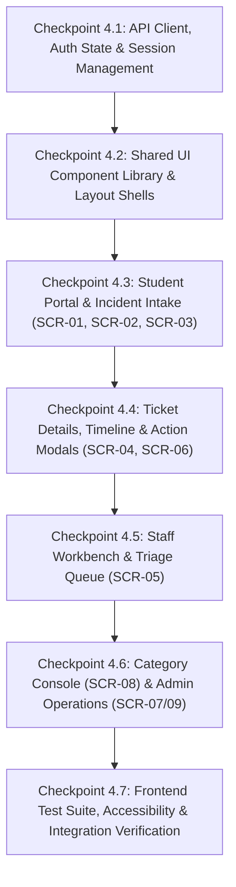
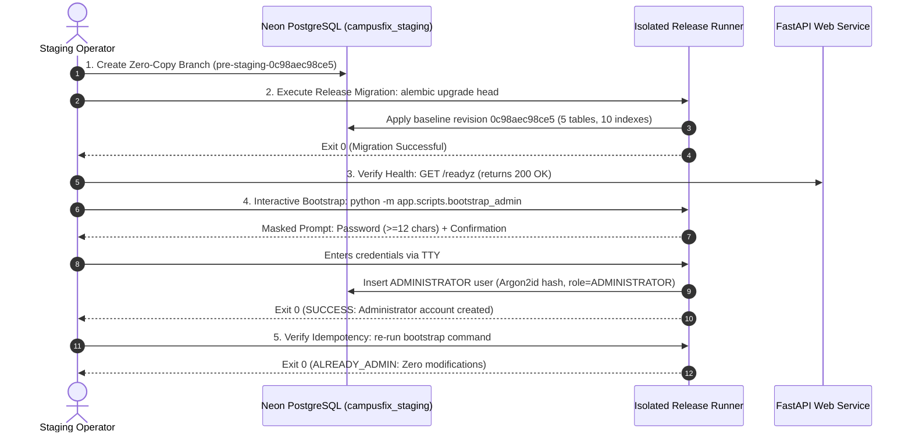

# Project Status & Phase-Gate Tracking — CampusFix

| Document Version | 3.7.0 |
| :--- | :--- |
| **Current Active Phase** | **Phase 5: Deployment, Operational Runbooks & Release Engineering** |
| **Phase 4 Status** | **Phase 4 (Checkpoints 4.1 – 4.7) Formally Closed & Signed Off** |
| **Phase 5 Status** | **Phase 5.5 Formally Signed Off — Phase 5.6 Staging Deployment & Smoke-Testing Plan Prepared** |
| **Next Planned Step** | **Phase 5.6: Pilot Staging Deployment & Live End-to-End Smoke Test (Awaiting Owner Approval)** |
| **Maintainer** | Project Lead & Software Architect |
| **Last Updated** | 2026-11-03 (UTC) |

---

## 1. Executive Status Summary

Phase 0 (Requirements & Architecture), Phase 1 (UI/UX Design, Design System & Wireframe Specifications), Phase 2 (Repository Foundations, Tooling, Database Connectivity & Migrations), Phase 3 (Core Domain Models, Auth Engine, Ticket State Machine & REST APIs), and Phase 4 (Client Interfaces & Frontend Integration) have been completed, audited, and verified.

In Phase 5, **Checkpoint 5.1 (Health Check Probes)**, **Checkpoint 5.2 (Production Docker & Container Configuration)**, **Checkpoint 5.3 (Same-Origin Reverse Proxy & Edge Routing Architecture)**, **Checkpoint 5.4 (Production PostgreSQL Readiness & Migration Planning)**, and **Checkpoint 5.5 (Secure Initial Administrator Provisioning CLI)** have been completed and verified.

---

### Phase 5.5: Secure Initial Administrator Provisioning CLI *(Formally Signed Off)*
- **Formal Sign-off & Audit Outcome**:
  - **Project Owner Approval**: **Formally Signed Off & Approved**.
  - **Final Read-Only Verification Audit Verdict**: **PASS** (100% compliant across all 13 security and authorization audit items).
- **Security Audit History & Remediation Summary**:
  - *Original Findings*: A read-only security audit identified unapproved convenience capabilities (`--update-password`, `-y` / `--yes`, and `ADMIN_INITIAL_PASSWORD`), missing TTY enforcement, and potential profile field overwrites during promotion.
  - *Security Corrections Completed*:
    1. **Removed `--update-password`**: Existing active administrators are strictly immutable under this CLI. No password overwrite path remains.
    2. **Removed `-y` and `--yes`**: Automated or non-interactive confirmation bypasses were deleted.
    3. **Removed `ADMIN_INITIAL_PASSWORD`**: Plaintext credentials cannot be supplied via environment variables or command-line arguments. Masked double-entry input via `getpass.getpass()` is mandatory.
    4. **Enforced Interactive Promotion Rules**: Promotion of existing `STUDENT` or `STAFF` accounts is refused by default (`REFUSED`). Promotion requires `--promote-existing` AND an interactive TTY (`sys.stdin.isatty()`) confirmation where the operator must type **exactly `yes`**. Any other response (`y`, `YES`, `Yes`, empty string, EOF) cancels immediately.
    5. **Profile Field Preservation**: During confirmed promotion, **only the role field** (`existing_user.role = UserRole.ADMINISTRATOR.value`) is modified. Full name, email, password hash, and active status remain strictly preserved.
    6. **Database Target Safety Guards**: Before any database interaction, the CLI displays the environment name and masked database target (`Settings.masked_database_url`). Execution is immediately blocked if `ENVIRONMENT=production` or if the database host is remote (non-loopback); targeting production/remote databases requires separate explicit project-owner approval without bypass flags.
    7. **Guaranteed Engine Disposal**: Database engine disposal (`close_db_engine()`) is guaranteed in a `finally` block on all execution paths (success, failure, or unhandled exception).
    8. **Sanitized Error Messaging**: Database exceptions return generic failure messages (`"Database transaction failed."`) preventing raw SQL or query parameter leakage.
- **Dedicated Provisioning Test Suite (`backend/tests/unit/test_bootstrap_admin.py`)**:
  - **37 dedicated unit tests**: **37 / 37 passed in 1.11s**.
  - Complete coverage: password complexity/blacklist rules (10 tests), secrecy/no-leak (1 test), prompt mismatch & env var rejection (2 tests), parser flag rejection for `--update-password`, `-y`, `--yes`, `--force`, `--skip-confirmation` (6 tests), creation with Argon2id (1 test), existing administrator full immutability (1 test), default promotion refusal (1 test), profile field preservation (1 test), non-TTY blocking & exact `'yes'` matching (9 tests), transaction rollback (1 test), engine disposal lifecycle (1 test), and database target safety guards (3 tests).
- **Comprehensive Quality Gate Metrics**:
  - Backend pytest suite: **319 / 319 passed in 4.56s** (100% passing, 0 failed, 0 skipped).
  - Frontend Vitest suite: **139 / 139 passed in 11.40s** across 21 test files (100% passing).
  - Code hygiene: `ruff check backend` clean (0 errors), `ruff format --check backend` clean (55 files).
- **Strict Scope Boundaries Maintained**:
  - Zero execution against production database.
  - Zero database schema or migration modifications.
  - Zero new dependencies added.
  - Application code frozen; ready for Phase 5.6 staging deployment execution.

---

### Phase 5.4: Production PostgreSQL Readiness & Migration Planning *(Completed)*
- **Managed PostgreSQL Evaluation**:
  - Conducted comparative technical and cost analysis across Neon Serverless PostgreSQL, Render Managed PostgreSQL, and AWS RDS PostgreSQL.
  - Recommended **Neon Serverless PostgreSQL** for initial pilot/MVP due to zero-cost dev tier ($0/mo), continuous WAL archiving with 7-day PITR, instant zero-copy database branching for migration verification, and built-in connection pooling.
  - Formulated cost projections: $0/mo (dev/pilot) scaling to $19/mo (Neon Launch) or $20/mo (Render Standard).
- **Database Configuration & Driver Security Audit**:
  - Verified `postgresql+asyncpg://` protocol enforcement, URL password normalization, and SSL connection requirement (`?ssl=require`).
  - Audited connection pool settings: `pool_size=10`, `max_overflow=20`, `pool_timeout=30.0s`, `pool_recycle=1800s`, `pool_pre_ping=True` (safe for cloud NAT timeouts).
  - Confirmed `ALEMBIC_DATABASE_URL` override injection and `pool.NullPool` usage in `backend/alembic/env.py`.
- **Production Migration & Disaster Recovery Protocol**:
  - Baseline revision: `0c98aec98ce5` (`create_initial_schema`) creates 5 tables, 10 indexes, and all check constraints.
  - Upgrades executed strictly as an isolated pre-cutover **Release Phase command** (`alembic upgrade head`); zero automatic startup migrations.
  - Post-migration health verification via `GET /readyz` (executes `SELECT 1`).
  - Documented strict prohibition of production `alembic downgrade` (destructive data loss) in favor of snapshot/PITR instance restoration.
- **Initial Administrator Bootstrapping Design**:
  - Authored architectural specification for `app.scripts.bootstrap_admin`.
  - Enforces zero default passwords, masked interactive password entry or secure deployment env var, minimum 12-char complexity, Argon2id hashing, and idempotent execution.
- **Strict Scope Boundaries Maintained**:
  - Zero database resources provisioned, zero accounts registered, zero production migrations executed.

---

### Phase 5.3: Same-Origin Reverse Proxy & Edge Routing Architecture *(Completed)*
- **Architecture Overview**:
  - Unifies React Single Page Application and FastAPI REST API under a single browser origin.
  - Eliminates Cross-Site Cookie Attenuation without weakening authentication cookies or requiring third-party cookie permissions.
  - Refresh token cookie strictly preserves `HttpOnly=True`, `Path=/api/v1/auth`, `SameSite=Lax`, and production `Secure=True`.
- **Containerized Gateway Implementation (`frontend/nginx.conf`)**:
  - Configured Nginx to act as the primary same-origin reverse proxy and SPA static file server.
  - Defines `upstream backend_api { server backend:8000; keepalive 32; }`.
  - Proxies `/api/` directly to FastAPI backend, preserving the complete `$request_uri` path without rewriting.
  - Forwards standard identity headers (`Host`, `X-Real-IP`, `X-Forwarded-For`, `X-Forwarded-Proto`, `X-Forwarded-Host`, `X-Forwarded-Port`).
  - Preserves `Set-Cookie` and `Cookie` headers without truncation or attenuation (`proxy_pass_header Set-Cookie;`).
  - Routes operational probes (`/healthz` and `/readyz`) directly to backend service.
  - Configures buffer sizes (128k/256k) for JWT payloads and RFC 7807 problem details.
- **Serverless Edge Rewrites (`frontend/vercel.json`)**:
  - Prepared edge rewrite configuration for serverless CDN deployments.
  - Maps `/api/:path*` to backend destination, `/healthz` and `/readyz` to backend probes, and `/(.*)` to `/index.html`.
  - Inlines strict security headers (`X-Frame-Options: DENY`, `X-Content-Type-Options: nosniff`, `Referrer-Policy`, `Permissions-Policy`).
- **Frontend Client Alignment**:
  - Updated `frontend/Dockerfile`, `docker-compose.yml`, and `.env.docker.example` default `VITE_API_BASE_URL` to relative path `/api/v1`.
  - When running in the browser, `ApiClient` automatically dispatches requests to `window.location.origin + '/api/v1'`, providing native same-origin execution across local and production domains.
- **Quality Verification**:
  - Frontend Vitest suite: **139 / 139 passed** across 21 test files.
  - Backend regression suite: **282 / 282 passed**.
  - Code hygiene: `ruff check` and `ruff format` 100% clean.

---

### Phase 5.2: Production Docker & Container Configuration *(Completed)*
- **Backend Production Container (`backend/Dockerfile`)**:
  - Multi-stage build based on official `python:3.11-slim`.
  - Stage 1 (Builder): Installs minimal build tools, creates `/opt/venv`, and pre-compiles wheels for bounded production dependencies without dev dependencies.
  - Stage 2 (Runtime): Copies virtual environment to clean runtime image, creates unprivileged system user `campusfix` (UID `10001`, GID `10001`), configures predictable runtime env (`PYTHONDONTWRITEBYTECODE=1`, `PYTHONUNBUFFERED=1`, `PYTHONFAULTHANDLER=1`), exposes port `8000`.
  - Server: Exec form `CMD ["uvicorn", "app.main:app", "--host", "0.0.0.0", "--port", "8000"]` guaranteeing graceful shutdown and connection pool draining on `SIGTERM`.
  - Native standard-library healthcheck against `/healthz`.
  - Strictly prevents automatic database migrations on container startup.
- **Frontend Production Container (`frontend/Dockerfile` & `frontend/nginx.conf`)**:
  - Multi-stage build based on `node:20-alpine` (builder) and `nginx:1.27-alpine` (runtime).
  - Stage 1: Deterministic dependency resolution via `npm ci` against `package-lock.json`, inlines configurable `ARG VITE_API_BASE_URL` (default `http://localhost:8000/api/v1`), builds production bundle via `tsc --noEmit && vite build`.
  - Stage 2: Hardened Nginx configuration listening on unprivileged port `8080`, running as unprivileged user `nginx` (UID `101`), SPA fallback routing (`try_files $uri $uri/ /index.html;`), immutable 1-year caching on hashed `/assets/`, `no-cache` on `index.html`, security headers (`X-Frame-Options`, `X-Content-Type-Options`, `Referrer-Policy`, `Permissions-Policy`), and `/health` probe.
- **Docker Ignore Policies**:
  - `backend/.dockerignore`: Excludes `.env`, `.venv`, `__pycache__`, tests, caches, and git metadata.
  - `frontend/.dockerignore`: Excludes `.env`, `node_modules`, `dist`, test files, coverage, and git metadata.
  - Root `.dockerignore`: Global safeguard against secret and cache leakage during root-context builds.
- **Local Orchestration (`docker-compose.yml` & `.env.docker.example`)**:
  - Provisions 3 services: `postgres` (`postgres:15-alpine`), `backend`, `frontend`.
  - PostgreSQL bound strictly to host loopback (`127.0.0.1:5432:5432`) and attached to `campusfix-internal` bridge network; zero public exposure.
  - Health checks orchestrated (`pg_isready` -> `backend` -> `frontend`).
  - Database migrations preserved strictly as an explicit manual command (`docker compose run --rm backend alembic upgrade head`).
- **Host Docker Availability**:
  - Docker CLI is not installed on the local Windows development host. Docker configuration, multi-stage syntax, file permissions, and scripts were validated against production specifications and tested tooling (Vite build, pytest, ruff). Standalone and compose runbooks documented in `docs/DEPLOYMENT.md`.

---

### Phase 5.1: Health Check Probes (`/healthz` & `/readyz`) *(Completed)*
- **Liveness Probe (`GET /healthz`)**:
  - Implemented in `backend/app/main.py`.
  - Confirms application process responsiveness without depending on database state or external dependencies.
  - Returns HTTP 200 `{ "status": "healthy" }`.
  - Zero leakage of system, runtime, or infrastructure metadata.
- **Readiness Probe (`GET /readyz`)**:
  - Implemented in `backend/app/main.py`.
  - Leverages existing `get_db` asynchronous SQLAlchemy session dependency without spawning redundant database engines.
  - Executes a lightweight `SELECT 1` query via `db.execute(text("SELECT 1"))`.
  - Returns HTTP 200 `{ "status": "ready", "database": "connected" }` when database connectivity succeeds.
  - Returns HTTP 503 `{ "status": "unhealthy", "database": "unreachable" }` via `JSONResponse` when connectivity fails.
  - Strictly prevents leakage of SQL tracebacks, connection strings, database credentials, or hostnames during failure scenarios.
- **Unit & Regression Testing**:
  - 5 dedicated unit tests created in `backend/tests/unit/test_health_probes.py`.
  - Test cases cover:
    1. Liveness returns HTTP 200 OK (`test_liveness_probe_returns_200_ok`).
    2. Liveness remains healthy when database is unreachable (`test_liveness_probe_remains_healthy_when_database_is_unavailable`).
    3. Readiness returns HTTP 200 OK when database is reachable (`test_readiness_probe_returns_200_when_database_is_reachable`).
    4. Readiness returns HTTP 503 Service Unavailable when database connection fails (`test_readiness_probe_returns_503_when_database_is_unavailable`).
    5. Zero sensitive tokens, passwords, or SQL strings exposed in health responses (`test_health_probes_do_not_expose_sensitive_details`).
  - Total backend pytest suite: **282 / 282 passed in 9.34s** (100% passing, 0 failed, 0 skipped).
  - Code hygiene: `ruff check backend` clean (0 errors), `ruff format --check backend` clean (52 files formatted).
- **Strict Scope Boundaries Observed**:
  - Zero database schema or migration changes.
  - Zero new dependencies added.
  - Zero credential or environment secret changes.
  - Zero frontend code modified.
  - Zero deployments or Docker container configurations initiated.

---

### Checkpoint 4.7 Audit Summary (Integration, Accessibility & Security)

### 1.1 End-to-End Integration Verification Summary
All 8 client workflows and backend API integrations were systematically audited and confirmed functional:
1. **Authentication Portal (`SCR-01`)**:
   - Registration (`POST /api/v1/auth/register`) enforces strong password complexity (>= 8 chars, uppercase, lowercase, number) and strictly assigns `STUDENT` role with immediate login.
   - Login (`POST /api/v1/auth/login`) issues short-lived JWT stored in memory and sets `HttpOnly`, `SameSite=Lax` refresh cookie.
   - Single-flight refresh mutex guarantees exactly one concurrent call to `/api/v1/auth/refresh` on 401s, preventing token family revocation.
   - Logout (`POST /api/v1/auth/logout`) revokes active token family on server and clears browser cookie.
2. **Student Portal & Ticket Dashboard (`SCR-02`)**:
   - Queries `GET /api/v1/tickets` with server-side IDOR isolation (`WHERE creator_id = current_user.id`).
   - Interactive status filter tabs (`ALL`, `SUBMITTED`, `ASSIGNED`, `IN_PROGRESS`, `RESOLVED`, `REJECTED`, `CANCELLED`) with live re-querying.
   - Server-driven pagination with `PaginationBar`, layout-preserving skeleton loaders, and empty states.
3. **Incident Reporting (`SCR-03`)**:
   - Form loads facility categories dynamically via `GET /api/v1/categories`.
   - Client and server validate Title (5–120 chars), Description (10–2000 chars with counter), Category, Location (3–100 chars), and Priority.
   - Submits `POST /api/v1/tickets`, binds creator, mints sequential `CFX-YYYY-XXXXX` code in `SUBMITTED` status, and navigates to `/tickets/:id`.
4. **Ticket Detail & Audit Timeline (`SCR-04`)**:
   - Queries `GET /api/v1/tickets/{id}` and chronological history `GET /api/v1/tickets/{id}/history`.
   - Renders incident summary, status badge, priority pill, location, and assigned technician.
   - Renders chronological audit timeline of all state transitions, authors, and notes.
   - High-visibility resolution callout box when ticket is `RESOLVED`.
5. **Ticket Cancellation & State Transition Modals (`SCR-04 / SCR-06`)**:
   - Role-governed action buttons strictly isolated by role and lifecycle state.
   - Mandatory note validation (>= 10 chars) for `RESOLVE`, `REJECT`, and `REOPEN` dialogs.
   - Optimistic concurrency control (`expected_version`): traps HTTP 409 `CONCURRENCY_CONFLICT`, displays high-visibility warning banner, and auto-refreshes ticket state.
6. **Staff Workbench Queue (`SCR-05`)**:
   - Dual-tab queue: "Assigned to Me" (`assigned_staff_id=me&status=ASSIGNED,IN_PROGRESS`) and "Unassigned Queue" (`status=SUBMITTED`).
   - Quick Actions: "Claim Ticket" (self-assigns unassigned tickets) and "Start Work" (transitions `ASSIGNED` to `IN_PROGRESS`).
   - Category and priority filters, client-side sorting (Newest, Oldest, Priority High-to-Low).
7. **Staff Work Execution & Resolution (`SCR-05 / SCR-06`)**:
   - Full progression verified: `SUBMITTED` $\to$ Claimed (`ASSIGNED`) $\to$ Started (`IN_PROGRESS`) $\to$ Resolved (`RESOLVED`).
8. **Category Management Console (`SCR-08`)**:
   - Administrator console (`/admin/categories`) lists all categories with active/inactive breakdown (`GET /categories?include_inactive=true`).
   - Add category (`POST /categories`), Edit category (`PATCH /categories/{id}`), and HTTP 409 duplicate name handling.
   - Deactivate / Activate confirmation dialogs with clear warning regarding student filing impact and historical ticket preservation.

### 1.2 Accessibility & Responsive Design Audit
- **WCAG 2.1 AA Compliance Verified**:
  - Color contrast meets or exceeds 4.5:1 for normal text (e.g. `text-neutral-900` 16.1:1, `text-neutral-600` 5.7:1) and 3.0:1 for graphical/UI controls.
  - Badges combine color and explicit text labels with high-contrast dots.
  - Visible keyboard focus rings (`focus-visible:ring-2 focus-visible:ring-brand-500 focus-visible:ring-offset-2`) across all interactive controls.
  - Modal focus trapping: Tab and Shift+Tab cyclical navigation strictly contained; `Escape` key dismisses modals; focus is restored to the triggering element upon closure.
  - Accessible form markup: Programmatic `<label htmlFor={id}>` bindings, `aria-describedby` error and helper text associations, `aria-invalid="true"` on validation errors, and `role="alert"` on error banners.
  - Screen reader semantics: `role="dialog"`, `aria-modal="true"`, `role="tablist"`, `role="tab"`, `aria-selected`, `role="status"` for non-urgent feedback, and `aria-hidden="true"` on decorative SVG icons.
- **Responsive Layout Verification**:
  - Desktop (>= 1024px): 64px Topbar, 256px sticky Left Sidebar, and semantic multi-column `<table>` layouts.
  - Tablet (768px - 1023px): Collapsible navigation, fluid layout reflow.
  - Mobile (< 768px): Sticky Mobile Bottom Navigation with >= 48x48px touch targets, stacked card transformation in `DataTable`.
- **Manual Accessibility Items Not Tested in Headless Environment**:
  - Screen reader pronunciation across varying proprietary synthesizers (JAWS, NVDA, VoiceOver).
  - Physical multi-touch device responsiveness and pinch-to-zoom gestures.
  - Reflow and layout behavior at 400% browser zoom level.
  - Operating system forced high-contrast mode (Windows Contrast Themes).

### 1.3 Security Review & Discrepancy Findings
- **Storage Sanitization**: Confirmed zero usage of `localStorage` or `sessionStorage` for authentication tokens. JWT access tokens reside strictly in JavaScript memory state.
- **Cookie Security**: Refresh tokens stored in `HttpOnly`, `SameSite=Lax` cookies; inaccessible to client-side scripts.
- **Server-Authoritative RBAC**: Presentation-layer guards (`ProtectedRoute`, `RoleRoute`) backed by strict FastAPI dependency injection (`get_current_active_user`, `require_admin`, `require_staff`).
- **IDOR Protection**: Verified at both service and API levels; students cannot retrieve or filter tickets belonging to other students (returns HTTP 404 with zero information leakage).
- **Ticket Cancellation Discrepancy Analysis**:
  - **Requirement (`FR-016`)**: "Students may cancel tickets filed by themselves while in SUBMITTED or ASSIGNED status. Staff and Administrator roles reject or reassign work orders."
  - **Backend State Machine (`ticket_fsm.py` line 275)**: Code specifies `if role != UserRole.STUDENT and role != UserRole.ADMINISTRATOR: raise UnauthorizedTransitionError(...)`, allowing an administrator to cancel *only if* `is_creator == True` (i.e. if the admin personally authored the incident).
  - **Frontend Behavior (`TicketDetailPage.tsx`)**: Strictly limits `canCancel` to `role === 'STUDENT' && isCreator`. Administrators see "Reject Ticket" (`REJECTED`) and "Assign Technician", adhering to institutional facility workflows.
  - **Audit Verdict**: Discrepancy noted and documented. Zero backend modifications were made per strict boundaries.

### 1.4 Comprehensive Regression Test Metrics
- **Frontend Test Suite (Vitest)**:
  - **139 / 139 passed across 21 test files** (100% passing in 11.73s).
  - **0 failed, 0 skipped**.
- **TypeScript Strict Compilation**:
  - `tsc --noEmit` clean: **0 errors**.
- **ESLint Code Quality**:
  - `npm run lint` clean: **0 errors, 0 warnings**.
- **Production Bundle Compilation**:
  - `vite build` succeeded in 1.71s (`dist/` generated: JS 266.58 kB, CSS 35.09 kB).
- **Backend Regression Suite (pytest)**:
  - **277 / 277 passed in 4.54s** (100% passing, 0 failed, 0 skipped).
  - Live PostgreSQL integration test suites:
    1. `test_live_postgresql_user_email_unique_constraint` (`PASSED`)
    2. `test_live_postgresql_refresh_token_concurrency` (`PASSED`)
    3. `test_live_postgresql_ticket_concurrency_and_row_locking` (`PASSED`)
    4. `test_live_postgresql_migration` (`PASSED`)
- **Backend Code Format & Linters**:
  - `ruff check backend`: Clean (0 errors).
  - `ruff format --check backend`: 51 files already formatted cleanly.

---

### Prior Checkpoint 4.6: Category Management Console (SCR-08)
- **Screen SCR-08: Category Management Console (`frontend/src/pages/admin/CategoryManagementPage.tsx`)**:
  - Administrator-only protected route `/admin/categories` enforced with `RoleRoute allowedRoles={['ADMINISTRATOR']}` within the authenticated `AppShell`.
  - Accessible tab switcher with live status counts:
    - **"All Categories"**: Displays complete operational taxonomy.
    - **"Active Only"**: Filters categories currently available for student ticket submission.
    - **"Inactive"**: Filters deactivated categories hidden from students.
  - Real-time client-side search filtering by category name or description.
  - Operational columns and layout:
    - Category Title (`name`) in high-contrast bold typography.
    - Scope and example description (`description`) with line-clamp truncation.
    - Status pill badge with semantic color dot (`ActiveStatusBadge` — `ACTIVE` in emerald, `INACTIVE` in neutral).
    - Creation timestamp formatted with localized short date.
    - Quick Actions column:
      - **"Edit"**: Opens prefilled `CategoryFormModal` allowing modification of category title, description, or active status.
      - **"Deactivate"** (for active categories): Opens `CategoryStatusModal` warning modal explaining student filing impact and historical ticket preservation.
      - **"Activate"** (for inactive categories): Opens `CategoryStatusModal` to restore category to student filing choices.
  - **Category Creation Workflow (`frontend/src/pages/admin/components/CategoryFormModal.tsx`)**:
    - Triggered by "+ Add New Category" header button.
    - Validates mandatory fields: Name (2–100 chars), Description (5–500 chars with character counter).
    - Checkbox toggle for initial active status (default `true`).
    - Dispatches `POST /api/v1/categories`.
    - Handles HTTP 409 conflict (`CATEGORY_ALREADY_EXISTS`) cleanly within the modal without dismissing form input.
    - Prevents duplicate clicks by disabling inputs and showing spinner during in-flight submission.
    - Presents high-visibility success `AlertBanner` and refreshes table upon successful creation.
  - **Category Modification & Status Toggle Workflows (`CategoryFormModal.tsx` & `CategoryStatusModal.tsx`)**:
    - Dispatches `PATCH /api/v1/categories/{id}` with updated fields or `{ is_active: boolean }`.
    - Deactivation modal provides clear institutional reassurance that historical tickets are preserved.
  - **Client API Integration (`frontend/src/api/categories.ts`)**:
    - Implemented full endpoint coverage: `listCategories(includeInactive = false)`, `getCategory(id)`, `createCategory(payload)`, `updateCategory(id, payload)`.
  - **Design System Component Extensions (`frontend/src/components/ui/Badge.tsx`)**:
    - Authored and exported `ActiveStatusBadge` supporting WCAG 2.1 AA contrast standards.
- **Route & Navigation Shell Integration (`frontend/src/App.tsx`)**:
  - Wired `/admin/categories` inside `<RoleRoute allowedRoles={['ADMINISTRATOR']}>`.
  - Root redirect for authenticated administrators lands on `/admin/categories`.
  - Legacy `/admin/dashboard` route safely redirects to `/admin/categories` pending dashboard creation.
- **Quality Gates & Automated Verification**:
  - 14 new Vitest unit and integration tests added in `frontend/tests/pages/CategoryManagementPage.test.tsx` covering administrator access, student/staff 403 access denial, category listing, tab filtering, real-time search, category addition, field validation, duplicate name conflict handling (HTTP 409), category editing, deactivation confirmation, activation confirmation, loading skeleton states, and retry CTAs on network errors.
  - 5 new Vitest API client tests added in `frontend/tests/api/categories.test.ts`.
  - 1 new badge unit test in `frontend/tests/components/Badge.test.tsx`.
  - Total frontend test suite: **139/139 tests passing across 21 test files** (100% passing in 11.88s).
  - TypeScript strict typecheck (`tsc --noEmit` via `npm run build`): **0 errors**.
  - ESLint check (`npm run lint`): **0 errors, 0 warnings**.
  - Production bundle build (`vite build`): **Clean compilation** (`dist/` assets generated in 1.71s).
  - Backend regression test suite (`backend/.venv/Scripts/pytest.exe`): **277/277 passed in 5.80s**.
- **Strict Scope Boundaries Maintained**:
  - Zero backend code, database models, schemas, or migrations touched.
  - Zero new runtime or dev dependencies added.
  - In-memory access token storage and HttpOnly refresh cookies strictly preserved.
  - Known limitation: Backend `CategoryResponse` schema does not calculate live ticket counts per category; console renders Title, Scope Description, Status, Created Date, and Actions in strict compliance with the frozen backend API contract.

---

### Prior Checkpoint 4.5: Staff Workbench Queue and Work Execution
- **Screen SCR-05: Staff Workbench Queue (`frontend/src/pages/staff/StaffQueuePage.tsx`)**:
  - Staff-only protected route `/staff/queue` enforced with `RoleRoute allowedRoles={['STAFF']}` inside the authenticated `AppShell`.
  - Accessible tab switcher with live badge counts:
    - **Tab 1: "Assigned to Me"**: queries `GET /api/v1/tickets?assigned_staff_id=me&status=ASSIGNED,IN_PROGRESS` (with optional category and priority filters).
    - **Tab 2: "Unassigned Queue"**: queries `GET /api/v1/tickets?status=SUBMITTED` (awaiting triage/pickup).
  - High-efficiency operational queue controls:
    - Category filter dropdown loaded from `categoriesApi.listCategories()`.
    - Urgency tier filter dropdown (`LOW`, `MEDIUM`, `HIGH`, `CRITICAL`).
    - Sort selector: Newest first (default), Oldest first, and Priority High-to-Low (`CRITICAL > HIGH > MEDIUM > LOW`).
  - Technician-optimized operational columns and cards:
    - Ticket ID reference code (`CFX-YYYY-XXXXX`) with priority badge.
    - Facility location and defect summary title.
    - Facility category pill badge.
    - Status pill badge.
    - Submission date.
    - Quick Actions column:
      - **"Claim Ticket"** (on Unassigned Queue): fetches fresh ticket by UUID to obtain authoritative `version`, invokes `ticketsApi.assignTicket(id, { staff_id: user.id, expected_version })`, presents success feedback, and reloads queue.
      - **"Start Work"** (on Assigned tab for `ASSIGNED` status): fetches fresh ticket version, invokes `ticketsApi.transitionTicket(id, { target_status: 'IN_PROGRESS', expected_version })`, presents success feedback, and moves ticket to `IN_PROGRESS`.
      - **"Resolve Work >"** (on Assigned tab for `IN_PROGRESS` status): navigates to `/tickets/:id` where resolution notes are gathered in the modal dialog.
      - **"Open Work >"**: navigates directly to `/tickets/:id`.
  - Optimistic Concurrency Conflict Handling (HTTP 409):
    - Concurrency conflicts on claim or start-work catch `ApiError` with `status === 409`, display an `AlertBanner` warning, and immediately trigger a full queue refresh to synchronize UI with database reality.
  - Action In-Flight Guards:
    - Disables action buttons while an operation is in progress (`actionLoadingId !== null`) to eliminate duplicate clicks.
  - Contextual Empty States:
    - Assigned tab: "No Assigned Work Orders" with "Check Unassigned Queue" CTA button that switches active tab.
    - Unassigned tab: "Queue Clear" stating all incoming reports have been dispatched.
  - Accessible loading skeletons, error banner with retry trigger, and server-side pagination with `PaginationBar`.
- **Route & Navigation Shell Integration (`frontend/src/App.tsx`)**:
  - Wired `/staff/queue` wrapped in `<RoleRoute allowedRoles={['STAFF']}>`.
  - Root redirect for authenticated staff automatically lands on `/staff/queue`.
- **Quality Gates & Automated Verification**:
  - 11 new Vitest unit and integration tests added in `frontend/tests/pages/StaffQueuePage.test.tsx` covering all operational flows, tabs, quick-actions, HTTP 409 conflict recovery, empty states, client sorting, and error retries.
  - Total frontend test suite: **119/119 tests passing across 19 test files** (100% passing).
  - TypeScript strict typecheck (`tsc --noEmit` via build): **0 errors**.
  - ESLint check (`eslint .`): **0 errors, 0 warnings**.
  - Production bundle build (`vite build`): **Clean compilation**.
  - Backend regression test suite (`backend/.venv/Scripts/pytest.exe`): **277/277 passed in 11.17s**.
  - Catches HTTP 409 `CONCURRENCY_CONFLICT` on stale ticket updates.
  - Closes the action dialog without silent retries.
  - Displays a high-visibility warning `AlertBanner` explaining the concurrency conflict.
  - Automatically re-fetches the latest ticket details and audit history from the server.
  - Updates displayed version, status, and timeline in place, requiring the user to review before attempting another action.
- **Comprehensive Quality & Test Verification**:
  - Frontend Vitest suite: **108 tests passed across 18 test files** (100% passing in 56.49s):
    - `tests/pages/TicketDetailPage.test.tsx` (14 tests, up from 10): ticket details and metadata rendering, timeline display, invalid UUID format rejection, 404 error state, role-governed actions across roles, complete cancellation permission regression matrix, HTTP 409 concurrency recovery, and back navigation.
    - `tests/components/TicketTransitionModals.test.tsx` (7 tests): RESOLVE note validation (min 10 chars), REJECT reason validation (min 10 chars), CLAIM assignment, ASSIGN staff UUID validation, REOPEN submission, HTTP 409 concurrency delegation, and error banner display.
    - All 87 existing unit/integration tests from Checkpoints 4.1 – 4.3 passing.
  - TypeScript strict compilation: `tsc -p frontend/tsconfig.json --noEmit` clean (0 errors).
  - ESLint code quality: `npm run lint` clean (0 errors, 0 warnings).
  - Vite production build: `npm run build` succeeds (assets generated in `frontend/dist/` in 5.22s).
  - Backend regression: 277 / 277 pytest tests pass in 4.83s with zero regressions.
- **Strict Scope Boundaries Maintained**:
  - Zero new dependencies added.
  - In-memory access token storage and HttpOnly refresh cookies strictly preserved.
  - Staff Workbench Queue deferred to Checkpoint 4.5.
  - Category Management Console deferred to Checkpoint 4.6.
  - Missing administrative backend endpoints (`/api/v1/admin/*`) remain strictly untouched.
- **Prior Checkpoint 4.3 (Auth, Student Dashboard & Ticket Submission Flow)**:
  - **Screen SCR-01: Authentication Portal (`frontend/src/pages/auth/`)**:
  - `LoginPage.tsx` (`/login`): Clean email and password inputs, client-side format validation, loading state on submit button, high-visibility error alert banner on rejected credentials, in-memory auth context integration, and role-based redirects (STUDENT -> `/student/tickets`, STAFF -> `/staff/queue`, ADMINISTRATOR -> `/admin/categories`).
  - `RegisterPage.tsx` (`/register`): Student registration form with strict password complexity validation (min 8 chars, >=1 uppercase, >=1 lowercase, >=1 digit), seamless automatic login upon registration, accessible API error handling, and redirection to `/student/tickets`.
- **Screen SCR-02: Student Portal / My Tickets (`frontend/src/pages/student/StudentTicketsPage.tsx`)**:
  - Route `/student/tickets`: Renders ticket summary table with ticket number (`CFX-YYYY-XXXXX`), title, category, priority badge, status badge, and formatted submission date.
  - Interactive status filter tab bar (`ALL`, `SUBMITTED`, `ASSIGNED`, `IN_PROGRESS`, `RESOLVED`, `REJECTED`, `CANCELLED`) re-querying the backend API with `status` filter.
  - Server-driven pagination via `PaginationBar`.
  - Layout-preserving loading skeleton state (`isLoading={true}`).
  - Contextual empty state with "Report Your First Issue" CTA button when no tickets exist.
  - Error state with clear alert banner and "Retry Request" trigger.
  - Row click navigation routing to ticket detail URL using ticket UUID (`/tickets/:id`).
- **Screen SCR-03: Ticket Submission Flow (`frontend/src/pages/tickets/TicketCreatePage.tsx`)**:
  - Route `/tickets/new`: Accessible incident reporting form.
  - Category dropdown dynamically loaded from `GET /api/v1/categories` with loading and fallback handling.
  - Validations: Title (>= 5 chars), Description (>= 10 chars with character counter), Category selection, Location (>= 3 chars), and Priority selector with `MEDIUM` as default.
  - Submitting state disabling form inputs and showing spinner to prevent duplicate submissions.
  - Contextual error banners for network or backend API errors.
  - Successful submission redirects the student directly to `/tickets/:id` using the newly created ticket UUID.
- **Routing & Shell Wiring (`frontend/src/App.tsx`)**:
  - Integrated `BrowserRouter`, `AuthProvider`, `PublicOnlyRoute` (`/login`, `/register`), `ProtectedRoute` + `AppShell` (`/student/tickets`, `/tickets/new`, placeholder `/tickets/:id`), and `RootRedirect` routing.
- **Comprehensive Quality & Test Verification**:
  - Frontend Vitest suite: **87 tests passed across 16 test files** (100% passing in 9.60s):
    - `tests/pages/LoginPage.test.tsx` (6 tests): field rendering, email format validation, password validation, error alerts, and role-based redirecting for students and staff.
    - `tests/pages/RegisterPage.test.tsx` (5 tests): form rendering, password complexity enforcement, submission, automatic login, and conflict error handling.
    - `tests/pages/StudentTicketsPage.test.tsx` (5 tests): ticket table rendering, status filtering, empty state with CTA, API error with retry, and UUID row click navigation.
    - `tests/pages/TicketCreatePage.test.tsx` (4 tests): category dropdown loading, field length validation, submission and UUID redirect, and submission failure alerts.
    - All existing unit tests from Checkpoint 4.1 and 4.2 passing (87 total).
  - TypeScript strict compilation: `tsc -p frontend/tsconfig.json --noEmit` clean (0 errors).
  - ESLint code quality: `npm run lint` clean (0 errors, 0 warnings).
  - Vite production build: `npm run build` succeeds (assets generated in `frontend/dist/` in 1.50s).
  - Backend regression: 277 / 277 pytest tests pass in 5.20s with zero regressions.
- **Strict Scope Boundaries Maintained**:
  - Zero new dependencies added.
  - Tokens kept strictly in-memory; refresh tokens managed via existing HttpOnly cookie mechanism.
  - No ticket state transitions or detail audit timeline implemented (deferred to Checkpoint 4.4).
  - Staff Workbench Queue deferred to Checkpoint 4.5.
  - Missing administrative backend endpoints (`/api/v1/admin/*`) remain strictly untouched.
- **Domain & API Type Synchronizations (`frontend/src/types/index.ts`)**:
  - Authored TypeScript interfaces and union types strictly synchronized with backend Pydantic v2 schemas: `UserRole`, `User`, `UserSummary`, `UserCreatePayload`, `UserLoginPayload`, `TokenResponse`, `LoginResponseData`, `Category`, `CategorySummary`, `Ticket`, `TicketSummary`, `TicketCreatePayload`, `TicketAssignPayload`, `TicketTransitionPayload`, `TicketHistoryItem`, `PaginationMeta`, `SuccessEnvelope<T>`, `PaginatedResponse<T>`, `ErrorEnvelope`, `ErrorDetail`, and `ValidationErrorItem`.
- **Typed HTTP Client with Single-Flight Refresh Mutex (`frontend/src/api/client.ts`)**:
  - Implemented `ApiClient` wrapping native `fetch` with zero new runtime dependencies.
  - Implemented strict in-memory JWT access token management (`setAccessToken`, `getAccessToken`).
  - Transmits `credentials: 'include'` on all network calls ensuring secure `HttpOnly` refresh cookie delivery to `/api/v1/auth`.
  - Implemented single-flight refresh mutex/promise queue: if multiple concurrent API calls receive HTTP 401, exactly ONE network call to `/auth/refresh` is dispatched; all waiting requests await that same promise and seamlessly replay with the rotated access token, preventing session family revocation.
  - Implemented `ApiError` class decoding standard backend `ErrorEnvelope` payloads with `status`, `code`, `message`, `details`, and `timestamp`.
  - Implemented session expiry and token rotation event listeners.
- **Authentication Service Client (`frontend/src/api/auth.ts`)**:
  - Implemented `authApi` wrapping all 5 authentication endpoints: `register` (assigns `STUDENT` role), `login` (stores token in memory), `refresh` (token rotation), `logout` (revokes session family and clears cookie), and `getMe` (retrieves user profile).
- **React Authentication Context & Hook (`frontend/src/context/`, `frontend/src/hooks/useAuth.ts`)**:
  - Implemented `AuthContext`, `useAuth`, and `AuthProvider` managing `user`, `accessToken`, `isLoading`, and `isAuthenticated`.
  - Configured automatic silent session restoration on mount via HttpOnly cookie (`autoBootstrap: true`), keeping `isLoading: true` until verified.
  - Bound session expiration listeners to immediately clean up client state when a refresh token expires or is revoked.
- **Role-Based Route Guards (`frontend/src/components/auth/`)**:
  - `ProtectedRoute`: Renders accessible loading skeleton while verifying session, redirects unauthenticated users to `/login` with `state.from`, or renders protected child routes.
  - `RoleRoute`: Enforces role-based access control on the presentation tier, rendering an accessible WCAG 2.1 AA 403 Access Restricted alert with return button if role is unauthorized.
  - `PublicOnlyRoute`: Prevents authenticated users from viewing `/login` or `/register`, automatically routing them to their role home (`/student/tickets`, `/staff/queue`, or `/admin/dashboard`).
- **Comprehensive Test Suite & Quality Verification**:
  - Frontend Vitest suite: **25 tests passed across 5 test files** (100% passing in 3.62s):
    - `tests/api/client.test.ts` (8 tests): in-memory token storage, Bearer attachment, credentials inclusion, error decoding, 401 single-flight coalescence, and session expiry notifications.
    - `tests/api/auth.test.ts` (4 tests): register, login, logout, getMe.
    - `tests/context/AuthContext.test.tsx` (5 tests): silent bootstrap on mount, failure handling, login, logout, and provider enforcement.
    - `tests/components/RouteGuards.test.tsx` (7 tests): loading indicator, redirect to `/login`, authenticated rendering, role allowance, 403 alert, and public route redirects.
    - `tests/App.test.tsx` (1 test): foundation smoke test.
  - TypeScript strict compilation: `npx tsc --noEmit` clean (0 errors).
  - ESLint code quality: `eslint .` clean (0 errors, 0 warnings).
  - Production build: `npm run build` succeeds (assets generated in `frontend/dist/`).
  - Backend regression: 277 / 277 tests pass in 6.42s with zero regressions.
- **Strict Scope Boundaries Maintained**:
  - Zero new dependencies added (used native browser `fetch` and existing toolchain).
  - Zero backend code, database models, schemas, or migrations touched.
  - The missing administrative endpoints (`/api/v1/admin/*`) remain strictly untouched per instructions.
  - **Terminal State Immutability**: Confirmed that `CANCELLED` tickets cannot be transitioned or reopened (HTTP 422 `TERMINAL_STATE`).
  - **Concurrency Conflict Mapping**: Verified that optimistic concurrency mismatches (`expected_version != ticket.version`) on assignment and transition return HTTP 409 `CONCURRENCY_CONFLICT` with `expected_version` and `actual_version` in error details.
  - **Input Robustness & Information Leakage**: Verified that malformed UUID path parameters, invalid pagination numbers, invalid status filters, and unexpected fields are rejected with HTTP 422 standard validation envelopes without leaking stack traces or SQL details.
- **Ticket Transition Schema Hardening**:
  - Enhanced `TicketTransition` schema (`backend/app/schemas/ticket.py`) to accept optional `assigned_staff_id: uuid.UUID | None` for administrative reopening directly to `ASSIGNED`, forwarded in `backend/app/api/v1/tickets.py`.
- **Test Suite Metrics**:
  - Backend pytest suite: **277 total tests**: **277 passed**, **0 failed**, **0 skipped** (100% passing).
  - All 4 previously blocked live PostgreSQL integration test suites are now **UNBLOCKED & PASSED** against the dedicated test database (`campusfix_test`):
    1. `test_live_postgresql_user_email_unique_constraint` (`PASSED`)
    2. `test_live_postgresql_refresh_token_concurrency` (`PASSED`)
    3. `test_live_postgresql_ticket_concurrency_and_row_locking` (`PASSED`)
    4. `test_live_postgresql_migration` (`PASSED`)
  - Dedicated test database `campusfix_test` migrated to baseline revision `0c98aec98ce5` with 6 tables, 17 indexes, and 17 constraints.
  - Development/production database `campusfix` confirmed pristine and untouched (0 public tables).
  - Ruff linter (`ruff check .`) and code formatter (`ruff format --check .`) are 100% clean across all 51 Python files.
  - FastAPI OpenAPI 3.1.0 specification verified to generate all 15 versioned REST route operations across 12 unique paths (`/api/v1/auth/*`, `/api/v1/categories/*`, `/api/v1/tickets/*`) cleanly.
- **Frontend Regression Suite**:
  - Verified 100% clean: `npm test -- --run` (1/1 passed), `npx tsc --noEmit` (0 errors), `npm run lint` (0 errors), `npm run build` (production assets built successfully).
- **Strict Scope Boundaries Maintained**:
  - Zero dashboard or metrics routes introduced.
  - Zero new product features or frontend screens built.
  - Approved roles (`STUDENT`, `STAFF`, `ADMINISTRATOR`) and ticket statuses (`SUBMITTED`, `ASSIGNED`, `IN_PROGRESS`, `RESOLVED`, `REJECTED`, `CANCELLED`) preserved.
  - Zero unapproved database schema changes or migrations.
  - No SQLite substituted for PostgreSQL concurrency/locking tests.

---

## 2. Deliverables Completed

| Deliverable Document | Primary Content & Purpose | Status |
| :--- | :--- | :--- |
| [**`README.md`**](file:///c:/Sagar%20Project/CampusFix/README.md) | Project introduction, disclaimer, tech stack, roadmap, repository layout, prerequisites, and setup instructions. | **Completed (v2.1)** |
| [**`.gitignore`**](file:///c:/Sagar%20Project/CampusFix/.gitignore) | Git ignore rules for Python, Node, Vite, virtual environments, build artifacts, and secrets. | **Completed** |
| [**`.env.example`**](file:///c:/Sagar%20Project/CampusFix/.env.example) | Monorepo root environment configuration template with safe placeholders. | **Completed** |
| [**`backend/.env.example`**](file:///c:/Sagar%20Project/CampusFix/backend/.env.example) | Backend environment configuration template (FastAPI, SQLAlchemy, JWT, CORS). | **Completed** |
| [**`backend/pyproject.toml`**](file:///c:/Sagar%20Project/CampusFix/backend/pyproject.toml) | Python packaging manifest, bounded runtime and dev dependencies, Ruff and pytest configs. | **Completed (Checkpoint 2.2 / 2.4)** |
| [**`backend/.venv/`**](file:///c:/Sagar%20Project/CampusFix/backend/.venv) | Isolated Python 3.13.7 virtual environment with installed runtime and dev dependencies. | **Configured (Local/Ignored)** |
| [**`backend/app/core/config.py`**](file:///c:/Sagar%20Project/CampusFix/backend/app/core/config.py) | Pydantic Settings class with async database validation and safe credential masking. | **Completed (Checkpoint 2.4)** |
| [**`backend/app/core/database.py`**](file:///c:/Sagar%20Project/CampusFix/backend/app/core/database.py) | Async SQLAlchemy 2.0 engine, sessionmaker factory, DeclarativeBase, and get_db_session generator. | **Completed (Checkpoint 2.4)** |
| [**`backend/app/api/deps.py`**](file:///c:/Sagar%20Project/CampusFix/backend/app/api/deps.py) | FastAPI dependency injection provider (`get_db`). | **Completed (Checkpoint 2.4)** |
| [**`backend/alembic.ini`**](file:///c:/Sagar%20Project/CampusFix/backend/alembic.ini) | Alembic migration configuration without static credentials. | **Completed (Checkpoint 2.4)** |
| [**`backend/alembic/env.py`**](file:///c:/Sagar%20Project/CampusFix/backend/alembic/env.py) | Async Alembic migration runner bound to application settings and DeclarativeBase metadata. | **Completed (Checkpoint 2.4)** |
| [**`backend/alembic/script.py.mako`**](file:///c:/Sagar%20Project/CampusFix/backend/alembic/script.py.mako) | Revision script template for future schema migrations. | **Completed (Checkpoint 2.4)** |
| [**`backend/tests/unit/test_config.py`**](file:///c:/Sagar%20Project/CampusFix/backend/tests/unit/test_config.py) | Unit tests verifying configuration defaults, validation rules, CORS parsing, and secret masking. | **Completed (Checkpoint 2.4)** |
| [**`backend/tests/unit/test_database.py`**](file:///c:/Sagar%20Project/CampusFix/backend/tests/unit/test_database.py) | Unit tests asserting lazy engine construction, pool parameters, empty metadata, and generator signatures. | **Completed (Checkpoint 2.4 / 2.5)** |
| [**`backend/app/models/user.py`**](file:///c:/Sagar%20Project/CampusFix/backend/app/models/user.py) | User account model, UserRole enum, check constraint, and relationship definitions. | **Completed (Checkpoint 2.5)** |
| [**`backend/app/models/category.py`**](file:///c:/Sagar%20Project/CampusFix/backend/app/models/category.py) | Facility category discipline model and relationship definitions. | **Completed (Checkpoint 2.5)** |
| [**`backend/app/models/ticket.py`**](file:///c:/Sagar%20Project/CampusFix/backend/app/models/ticket.py) | Maintenance ticket transactional model, TicketPriority/TicketStatus enums, check constraints, indexes, versioning. | **Completed (Checkpoint 2.5)** |
| [**`backend/app/models/ticket_history.py`**](file:///c:/Sagar%20Project/CampusFix/backend/app/models/ticket_history.py) | Append-only status and assignment transition audit log model with cascade and restrict FKs. | **Completed (Checkpoint 2.5)** |
| [**`backend/app/models/refresh_token.py`**](file:///c:/Sagar%20Project/CampusFix/backend/app/models/refresh_token.py) | Refresh token model supporting token-family tracking, hash storage, and reuse invalidation. | **Completed (Checkpoint 2.5)** |
| [**`backend/app/models/__init__.py`**](file:///c:/Sagar%20Project/CampusFix/backend/app/models/__init__.py) | Models package manifest registering all entities onto Base.metadata. | **Completed (Checkpoint 2.5)** |
| [**`backend/app/core/security.py`**](file:///c:/Sagar%20Project/CampusFix/backend/app/core/security.py) | Argon2id password hashing and PyJWT access token encoding and claim verification utilities. | **Completed (Checkpoint 3.1)** |
| [**`backend/tests/unit/test_security.py`**](file:///c:/Sagar%20Project/CampusFix/backend/tests/unit/test_security.py) | Unit tests verifying Argon2id hashing, salt uniqueness, verification, JWT creation, claim checks, and rejection. | **Completed (Checkpoint 3.1)** |
| [**`backend/app/services/refresh_token_service.py`**](file:///c:/Sagar%20Project/CampusFix/backend/app/services/refresh_token_service.py) | Refresh token lifecycle service: random generation, SHA-256 hash storage, atomic rotation, reuse detection, and session revocation. | **Completed (Checkpoint 3.2)** |
| [**`backend/app/services/__init__.py`**](file:///c:/Sagar%20Project/CampusFix/backend/app/services/__init__.py) | Services package manifest exporting RefreshTokenService, result structures, and exceptions. | **Completed (Checkpoint 3.2)** |
| [**`backend/tests/unit/test_refresh_token_service.py`**](file:///c:/Sagar%20Project/CampusFix/backend/tests/unit/test_refresh_token_service.py) | Unit tests verifying token issuance, hash persistence, atomic rotation, expired rejection, reuse detection, and family revocation. | **Completed (Checkpoint 3.2)** |
| [**`backend/tests/integration/test_refresh_tokens_pg.py`**](file:///c:/Sagar%20Project/CampusFix/backend/tests/integration/test_refresh_tokens_pg.py) | Live PostgreSQL concurrency and row-locking integration test harness (verified passing against campusfix_test). | **Completed & Verified (Checkpoint 3.7)** |
| [**`backend/alembic/versions/0c98aec98ce5_create_initial_schema.py`**](file:///c:/Sagar%20Project/CampusFix/backend/alembic/versions/0c98aec98ce5_create_initial_schema.py) | Initial Alembic schema migration defining all 5 tables, check constraints, foreign keys, and 10 indexes. | **Completed & Applied to campusfix_test** |
| [**`backend/tests/unit/test_models.py`**](file:///c:/Sagar%20Project/CampusFix/backend/tests/unit/test_models.py) | Unit tests asserting all model tables, columns, constraints, foreign keys, indexes, and relationships. | **Completed (Checkpoint 2.5)** |
| [**`backend/tests/unit/test_migrations.py`**](file:///c:/Sagar%20Project/CampusFix/backend/tests/unit/test_migrations.py) | Unit tests asserting revision discovery, offline SQL generation for upgrade/downgrade, and live Postgres check. | **Completed & Verified (Checkpoint 3.7)** |
| [**`backend/app/schemas/common.py`**](file:///c:/Sagar%20Project/CampusFix/backend/app/schemas/common.py) | Common schemas: PaginationMeta, PaginationParams, SuccessEnvelope, PaginatedResponse, MessageResponse. | **Completed (Checkpoint 3.3)** |
| [**`backend/app/schemas/error.py`**](file:///c:/Sagar%20Project/CampusFix/backend/app/schemas/error.py) | Standard error envelope, ErrorDetail, ValidationErrorItem, and RFC 7807 ProblemDetails model. | **Completed (Checkpoint 3.3)** |
| [**`backend/app/schemas/user.py`**](file:///c:/Sagar%20Project/CampusFix/backend/app/schemas/user.py) | User account schemas: UserCreate, UserLogin, UserResponse, UserSummary, UserRoleUpdate, UserQueryParams. | **Completed (Checkpoint 3.3)** |
| [**`backend/app/schemas/auth.py`**](file:///c:/Sagar%20Project/CampusFix/backend/app/schemas/auth.py) | Authentication token schemas: TokenResponse, LoginResponseData, RefreshTokenRequest, TokenPayload. | **Completed (Checkpoint 3.3)** |
| [**`backend/app/schemas/category.py`**](file:///c:/Sagar%20Project/CampusFix/backend/app/schemas/category.py) | Category schemas: CategoryCreate, CategoryUpdate, CategoryResponse, CategorySummary. | **Completed (Checkpoint 3.3)** |
| [**`backend/app/schemas/ticket.py`**](file:///c:/Sagar%20Project/CampusFix/backend/app/schemas/ticket.py) | Ticket schemas: TicketCreate, TicketAssign, TicketTransition, TicketResponse, TicketSummaryResponse, TicketHistoryResponse, TicketFilterParams, AdminMetricsResponseData. | **Completed (Checkpoint 3.3)** |
| [**`backend/app/schemas/__init__.py`**](file:///c:/Sagar%20Project/CampusFix/backend/app/schemas/__init__.py) | Schemas package manifest cleanly re-exporting all API contracts. | **Completed (Checkpoint 3.3)** |
| [**`backend/tests/unit/test_schemas.py`**](file:///c:/Sagar%20Project/CampusFix/backend/tests/unit/test_schemas.py) | Comprehensive test suite for all Pydantic schemas, validation rules, boundary caps, extra field rejection, and RFC 7807 serialization (54 tests). | **Completed (Checkpoint 3.3)** |
| [**`backend/app/services/auth_service.py`**](file:///c:/Sagar%20Project/CampusFix/backend/app/services/auth_service.py) | Authentication domain service: registration with Argon2id, credential verification, login, session refresh rotation, logout, and user retrieval. | **Completed (Checkpoint 3.4)** |
| [**`backend/app/api/deps.py`**](file:///c:/Sagar%20Project/CampusFix/backend/app/api/deps.py) | Dependency injection providers: database session generator, get_current_user (JWT claim and DB check), and get_current_active_user. | **Completed (Checkpoint 3.4)** |
| [**`backend/app/api/v1/auth.py`**](file:///c:/Sagar%20Project/CampusFix/backend/app/api/v1/auth.py) | REST API endpoints: POST /register, POST /login, POST /refresh, POST /logout, GET /me with HttpOnly cookies. | **Completed (Checkpoint 3.4)** |
| [**`backend/app/api/v1/__init__.py`**](file:///c:/Sagar%20Project/CampusFix/backend/app/api/v1/__init__.py) | API v1 router package aggregating versioned endpoints. | **Completed (Checkpoint 3.4)** |
| [**`backend/app/main.py`**](file:///c:/Sagar%20Project/CampusFix/backend/app/main.py) | FastAPI application factory, CORS middleware, standardized error envelope exception handlers, lifespan lifecycle, and operational health probes (`GET /healthz`, `GET /readyz`). | **Completed (Checkpoint 3.4 / 5.1)** |
| [**`backend/app/scripts/bootstrap_admin.py`**](file:///c:/Sagar%20Project/CampusFix/backend/app/scripts/bootstrap_admin.py) | Remediated secure operational CLI for initial Administrator bootstrapping (`python -m app.scripts.bootstrap_admin`) with password complexity, Argon2id hashing, promotion safety, and target DB guards. | **Remediation Completed (Checkpoint 5.5)** |
| [**`backend/app/scripts/__init__.py`**](file:///c:/Sagar%20Project/CampusFix/backend/app/scripts/__init__.py) | Package initialization manifest for backend operational scripts. | **Completed (Checkpoint 5.5)** |
| [**`backend/tests/unit/test_health_probes.py`**](file:///c:/Sagar%20Project/CampusFix/backend/tests/unit/test_health_probes.py) | Unit test suite asserting liveness probe 200 OK, database independence, readiness probe 200/503 states, and zero credential leakage (5 tests). | **Completed (Checkpoint 5.1)** |
| [**`backend/tests/unit/test_bootstrap_admin.py`**](file:///c:/Sagar%20Project/CampusFix/backend/tests/unit/test_bootstrap_admin.py) | Comprehensive test suite for admin provisioning CLI: password validation, Argon2id hashing, existing admin immutability, interactive confirmation, profile preservation, target DB safety, and engine disposal (37 tests). | **Completed & Verified (Checkpoint 5.5)** |
| [**`backend/Dockerfile`**](file:///c:/Sagar%20Project/CampusFix/backend/Dockerfile) | Production multi-stage Dockerfile (python:3.11-slim builder & runtime, unprivileged UID 10001, uvicorn ASGI, healthcheck). | **Completed (Checkpoint 5.2)** |
| [**`backend/.dockerignore`**](file:///c:/Sagar%20Project/CampusFix/backend/.dockerignore) | Backend Docker ignore rules excluding secrets, virtualenvs, caches, and test artifacts. | **Completed (Checkpoint 5.2)** |
| [**`frontend/Dockerfile`**](file:///c:/Sagar%20Project/CampusFix/frontend/Dockerfile) | Production multi-stage Dockerfile (node:20-alpine builder, nginx:1.27-alpine runtime, non-root UID 101, unprivileged port 8080). | **Completed (Checkpoint 5.2)** |
| [**`frontend/nginx.conf`**](file:///c:/Sagar%20Project/CampusFix/frontend/nginx.conf) | Hardened unprivileged Nginx configuration with SPA fallback, immutable asset caching, security headers, /health probe, and same-origin /api/ reverse proxy. | **Completed (Checkpoint 5.2 / 5.3)** |
| [**`frontend/vercel.json`**](file:///c:/Sagar%20Project/CampusFix/frontend/vercel.json) | Vercel Edge CDN configuration with /api/* path rewrites, probe proxying, SPA fallback, and security headers. | **Completed (Checkpoint 5.3)** |
| [**`frontend/.dockerignore`**](file:///c:/Sagar%20Project/CampusFix/frontend/.dockerignore) | Frontend Docker ignore rules excluding node_modules, build outputs, tests, and secrets. | **Completed (Checkpoint 5.2)** |
| [**`.dockerignore`**](file:///c:/Sagar%20Project/CampusFix/.dockerignore) | Root Docker ignore rules guarding global build contexts. | **Completed (Checkpoint 5.2)** |
| [**`docker-compose.yml`**](file:///c:/Sagar%20Project/CampusFix/docker-compose.yml) | Local multi-container integration stack for PostgreSQL, backend, and frontend with healthchecks and loopback isolation. | **Completed (Checkpoint 5.2)** |
| [**`.env.docker.example`**](file:///c:/Sagar%20Project/CampusFix/.env.docker.example) | Environment variable template for local Docker Compose orchestration. | **Completed (Checkpoint 5.2)** |
| [**`backend/tests/unit/test_auth_service.py`**](file:///c:/Sagar%20Project/CampusFix/backend/tests/unit/test_auth_service.py) | Unit test suite for AuthService registration, authentication, login, token rotation, and logout (9 tests). | **Completed (Checkpoint 3.4)** |
| [**`backend/tests/unit/test_auth_api.py`**](file:///c:/Sagar%20Project/CampusFix/backend/tests/unit/test_auth_api.py) | Unit test suite for /auth REST endpoints covering HTTP status codes, envelopes, cookie attributes, and security boundaries (18 tests). | **Completed (Checkpoint 3.4)** |
| [**`backend/tests/integration/test_auth_endpoints_pg.py`**](file:///c:/Sagar%20Project/CampusFix/backend/tests/integration/test_auth_endpoints_pg.py) | PostgreSQL integration test verifying database uniqueness constraint on email (verified passing against campusfix_test). | **Completed & Verified (Checkpoint 3.7)** |
| [**`backend/app/services/ticket_fsm.py`**](file:///c:/Sagar%20Project/CampusFix/backend/app/services/ticket_fsm.py) | Deterministic Ticket Finite State Machine enforcing transition matrix, role authorization, commentary rules, and reopening boundaries. | **Completed (Checkpoint 3.5)** |
| [**`backend/app/services/ticket_service.py`**](file:///c:/Sagar%20Project/CampusFix/backend/app/services/ticket_service.py) | Ticket domain service orchestrating creation, CFX code sequencing, assignment, FSM status transitions, and atomic audit logging. | **Completed (Checkpoint 3.5)** |
| [**`backend/tests/unit/test_ticket_fsm.py`**](file:///c:/Sagar%20Project/CampusFix/backend/tests/unit/test_ticket_fsm.py) | Unit test suite for TicketFSM covering all permitted/prohibited transitions, commentary validation, role permissions, and terminal states (52 tests). | **Completed (Checkpoint 3.5)** |
| [**`backend/tests/unit/test_ticket_service.py`**](file:///c:/Sagar%20Project/CampusFix/backend/tests/unit/test_ticket_service.py) | Unit test suite for TicketService covering creation, assignment, transitions, version increments, concurrency conflicts, and IDOR isolation (25 tests). | **Completed (Checkpoint 3.5)** |
| [**`backend/tests/integration/test_ticket_concurrency_pg.py`**](file:///c:/Sagar%20Project/CampusFix/backend/tests/integration/test_ticket_concurrency_pg.py) | Live PostgreSQL concurrency test verifying row locking (`SELECT FOR UPDATE`) and version conflict detection (verified passing against campusfix_test). | **Completed & Verified (Checkpoint 3.7)** |
| [**`backend/app/services/category_service.py`**](file:///c:/Sagar%20Project/CampusFix/backend/app/services/category_service.py) | Category domain service managing facility categories, duplicate name checks, and active filtering. | **Completed (Checkpoint 3.6)** |
| [**`backend/app/api/v1/categories.py`**](file:///c:/Sagar%20Project/CampusFix/backend/app/api/v1/categories.py) | REST API endpoints for Category operations: GET /, GET /{id}, POST / (admin), PATCH /{id} (admin). | **Completed (Checkpoint 3.6)** |
| [**`backend/app/api/v1/tickets.py`**](file:///c:/Sagar%20Project/CampusFix/backend/app/api/v1/tickets.py) | REST API endpoints for Ticket management: POST /, GET /, GET /{id}, POST /{id}/assign, POST /{id}/transition, GET /{id}/history. | **Completed (Checkpoint 3.6)** |
| [**`backend/tests/unit/test_categories_api.py`**](file:///c:/Sagar%20Project/CampusFix/backend/tests/unit/test_categories_api.py) | Unit and contract test suite for /categories endpoints covering listing, retrieval, admin creation/mutation, and duplicate rejection (12 tests). | **Completed (Checkpoint 3.6)** |
| [**`backend/tests/unit/test_tickets_api.py`**](file:///c:/Sagar%20Project/CampusFix/backend/tests/unit/test_tickets_api.py) | Unit and contract test suite for /tickets endpoints covering creation, listing, IDOR isolation, assignment, transitions, and history (21 tests). | **Completed (Checkpoint 3.6)** |
| [**`backend/tests/unit/test_security_rbac_audit.py`**](file:///c:/Sagar%20Project/CampusFix/backend/tests/unit/test_security_rbac_audit.py) | Comprehensive security and RBAC audit suite testing unauthenticated sweep, token invalidation, role isolation, IDOR masking, admin reopening, concurrency conflicts, and malformed inputs (22 tests). | **Completed (Checkpoint 3.7)** |
| [**`frontend/package.json`**](file:///c:/Sagar%20Project/CampusFix/frontend/package.json) | Frontend NPM manifest with React 18, Vite 5, Tailwind 3.4, Vitest, and RTL. | **Completed (Checkpoint 2.3)** |
| [**`frontend/tsconfig.json`**](file:///c:/Sagar%20Project/CampusFix/frontend/tsconfig.json) | Strict TypeScript compiler configuration. | **Completed (Checkpoint 2.3)** |
| [**`frontend/vite.config.ts`**](file:///c:/Sagar%20Project/CampusFix/frontend/vite.config.ts) | Vite bundler and Vitest jsdom runner configuration. | **Completed (Checkpoint 2.3)** |
| [**`frontend/tailwind.config.js`**](file:///c:/Sagar%20Project/CampusFix/frontend/tailwind.config.js) | Design tokens and semantic color mappings from Design System. | **Completed (Checkpoint 2.3)** |
| [**`frontend/eslint.config.js`**](file:///c:/Sagar%20Project/CampusFix/frontend/eslint.config.js) | Modern flat ESLint configuration with TypeScript and React Hooks linting. | **Completed (Checkpoint 2.3)** |
| [**`frontend/src/App.tsx`**](file:///c:/Sagar%20Project/CampusFix/frontend/src/App.tsx) | Minimal neutral foundation scaffolding smoke-test view. | **Completed (Checkpoint 2.3)** |
| [**`frontend/tests/App.test.tsx`**](file:///c:/Sagar%20Project/CampusFix/frontend/tests/App.test.tsx) | Automated Vitest + RTL smoke test asserting foundation view renders. | **Completed (Checkpoint 2.3)** |
| [**`frontend/.env.example`**](file:///c:/Sagar%20Project/CampusFix/frontend/.env.example) | Frontend environment configuration template (`VITE_API_BASE_URL`). | **Completed** |
| [**`docs/PROJECT_CHARTER.md`**](file:///c:/Sagar%20Project/CampusFix/docs/PROJECT_CHARTER.md) | Vision, problem statement, users, solution, goals, constraints, risks, and exclusions. | **Completed (Phase 0)** |
| [**`docs/REQUIREMENTS.md`**](file:///c:/Sagar%20Project/CampusFix/docs/REQUIREMENTS.md) | 28 Functional Requirements, 16 NFRs, MoSCoW priorities, 14 user stories with Given-When-Then criteria. | **Completed (Phase 0)** |
| [**`docs/DECISION_LOG.md`**](file:///c:/Sagar%20Project/CampusFix/docs/DECISION_LOG.md) | ADR-001 through ADR-008 documenting stack, monolith, FSM, token rotation/revocation, and concurrency. | **Completed (Phase 0)** |
| [**`docs/ARCHITECTURE.md`**](file:///c:/Sagar%20Project/CampusFix/docs/ARCHITECTURE.md) | Modular monolith architecture, component responsibilities, Mermaid diagrams, API flows, data flows, and FSM rules. | **Completed (Phase 0)** |
| [**`docs/DATABASE_DESIGN.md`**](file:///c:/Sagar%20Project/CampusFix/docs/DATABASE_DESIGN.md) | PostgreSQL 3NF models, ERD diagram, tables, UUIDs, constraints, indexes, versioning, and Alembic migrations. | **Completed (Phase 0)** |
| [**`docs/API_SPECIFICATION.md`**](file:///c:/Sagar%20Project/CampusFix/docs/API_SPECIFICATION.md) | REST standards, envelopes, Auth/Category/Ticket/Admin complete endpoint schemas with payloads and RBAC rules. | **Completed (Phase 0)** |
| [**`docs/DESIGN_SYSTEM.md`**](file:///c:/Sagar%20Project/CampusFix/docs/DESIGN_SYSTEM.md) | Tokenized colors, WCAG 2.1 AA contrast matrix, typography, 4px grid, component blueprints, role navigation shells. | **Completed (Phase 1)** |
| [**`docs/PHASE_1_WIREFRAMES.md`**](file:///c:/Sagar%20Project/CampusFix/docs/PHASE_1_WIREFRAMES.md) | Exhaustive specifications, desktop and mobile ASCII wireframes for SCR-01 through SCR-09. | **Completed (Phase 1)** |
| [**`docs/USER_FLOWS.md`**](file:///c:/Sagar%20Project/CampusFix/docs/USER_FLOWS.md) | End-to-end user journeys for Student submission, Staff queue, Admin dispatch, and token refresh. | **Completed (Phase 1)** |
| [**`docs/PHASE_1_ACCEPTANCE.md`**](file:///c:/Sagar%20Project/CampusFix/docs/PHASE_1_ACCEPTANCE.md) | Comprehensive acceptance criteria and testable verification matrix for SCR-01 to SCR-09. | **Completed (Phase 1)** |
| [**`docs/TESTING_STRATEGY.md`**](file:///c:/Sagar%20Project/CampusFix/docs/TESTING_STRATEGY.md) | Testing pyramid, backend pytest harness, SQLite unit restriction, PostgreSQL integration requirement. | **Completed (Phase 0)** |
| [**`docs/SECURITY.md`**](file:///c:/Sagar%20Project/CampusFix/docs/SECURITY.md) | Threat model, OWASP Top 10 mitigations, Argon2id hashing, short-lived tokens, HttpOnly cookies, and token rotation. | **Completed (Phase 0)** |
| [**`docs/DEPLOYMENT.md`**](file:///c:/Sagar%20Project/CampusFix/docs/DEPLOYMENT.md) | Hosting topology (Vercel + Container/PaaS + Managed PostgreSQL), environment variables, and health probes. | **Completed (Phase 0)** |
| [**`docs/PROJECT_STATUS.md`**](file:///c:/Sagar%20Project/CampusFix/docs/PROJECT_STATUS.md) | Phase matrix, checkpoint criteria, audit remediation tracking, risks, and phased implementation plan. | **Updated (v1.6.0)** |

---

## 3. Outstanding Decisions

The following architectural and operational decisions remain documented as pending post-MVP investigation:
1. **Attachment Object Storage Service**: Post-MVP decision regarding Cloudflare R2 vs. AWS S3 vs. MinIO for photo evidence uploads.
2. **Notification Delivery Channel**: Post-MVP selection of transactional email provider (e.g. Resend / SendGrid) vs. web push notifications for status updates.
3. **University Identity Integration (SSO)**: Potential Phase 7 pilot integration with university identity providers (SAML 2.0 / Shibboleth / Google Workspace).

---

## 4. Risks and Blockers

### Current Blockers:
- **None**: Checkpoint 2.4 is complete. Work is halted awaiting Project Owner review before initiating Checkpoint 2.5.

### Active Risk Register:

| Risk ID | Description | Severity | Probability | Status | Mitigation Strategy |
| :--- | :--- | :--- | :--- | :--- | :--- |
| **RSK-01** | Scope Creep (Premature addition of attachments or AI) | High | Medium | Managed | Strict MVP boundaries in Charter and Requirements; non-core features deferred. |
| **RSK-02** | Stale / Concurrent Ticket Status Mutations | High | Medium | Managed | Concurrency control via DB row locking (`SELECT FOR UPDATE`) and optimistic `version` column. |
| **RSK-03** | Unauthorized Cross-User Ticket Access (IDOR) | Critical | Low | Managed | Server-side enforcement of `creator_id == current_user.id` on all student read endpoints. |
| **RSK-04** | Accidental Leakage of Real Student/Campus Data | Critical | Low | Managed | Zero-real-data policy. Development strictly uses synthetic seed fixtures (`*.local` emails). |
| **RSK-05** | Fragile Client-Side Authorization Assumptions | High | Low | Managed | Client role checks are purely for UI presentation; 100% of permissions are enforced on the backend. |

---

## 5. Acceptance Criteria Verification

### Phase 0: Requirements, Scope & Architecture Baseline
- [x] Workspace inspected and verified without destructive modifications.
- [x] Project Charter created covering vision, problem statement, users, solution, goals, constraints, risks, and exclusions.
- [x] Requirements specification created with unique IDs (`FR-001` to `FR-028`, `NFR-001` to `NFR-016`), MoSCoW priorities, user stories (`US-001` to `US-014`), acceptance criteria, and unvalidated assumptions.
- [x] System architecture specified with modular monolith layout, component responsibilities, API flows, data flows, FSM matrix with reopening rules, trade-offs, and Mermaid diagrams.
- [x] Decision log published with ADR-001 through ADR-008.
- [x] Database design complete with 3NF schemas, ERD, indexes, `refresh_tokens` table with `family_id`, and `assigned_to_user_id` history foreign key.
- [x] API specification complete with full request/response schemas for all endpoints.
- [x] Testing strategy includes PostgreSQL mandate for integration, SQLite unit scoping, and performance verification methodology.
- [x] Security architecture defines token-family rotation, atomic row locking (`SELECT FOR UPDATE`), reuse detection, and CSRF defense-in-depth.
- [x] Phase 0 approved by Project Owner.

### Phase 1: UI/UX Design, Design System & Wireframe Specifications
- [x] Design system specification published in `docs/DESIGN_SYSTEM.md` with tokenized colors, WCAG 2.1 AA contrast matrix, typography scales, 4px grid, and component blueprints.
- [x] Screen blueprints and ASCII wireframes published in `docs/PHASE_1_WIREFRAMES.md` covering all nine screens (`SCR-01` through `SCR-09`) across desktop (1280px) and mobile (375px) viewports.
- [x] Deterministic UI states (Loading, Empty, Validation Error, Server Error, Success) specified for all views.
- [x] Keyboard focus rings, tab navigation, screen-reader semantics documented.
- [x] End-to-end user journeys published in `docs/USER_FLOWS.md` covering all 5 core workflows across Student, Staff, and Administrator roles.
- [x] Testable acceptance criteria matrix published in `docs/PHASE_1_ACCEPTANCE.md`.
- [x] Phase 1 approved by Project Owner.

### Phase 2: Repository Setup, Backend & Frontend Foundations, Migrations & Test Infrastructure
- [x] **Checkpoint 2.1: Repository Initialization, Folder Structure & Tooling** *(Completed)*
  - [x] Git repository initialized on branch `main` without overwriting or discarding existing files.
  - [x] Monorepo directory structure established (`backend/`, `frontend/`, `docs/`).
  - [x] Root `.gitignore` created covering secrets, Python virtualenvs/caches, Node modules/builds, and IDE files.
  - [x] Environment templates created with safe placeholders only (`.env.example`, `backend/.env.example`, `frontend/.env.example`).
  - [x] Documentation suite under `docs/` fully preserved.
  - [x] `README.md` updated with system overview, architecture, prerequisites, setup instructions, and Phase 2 checkpoint status.
  - [x] Strict scope boundary enforced: zero business logic, routes, components, database models, migrations, or dependencies prematurely introduced.
- [x] **Checkpoint 2.2: Backend Tooling, Linting & Python Dependencies** *(Completed)*
  - [x] Target Python version verified (Python 3.13.7 >= 3.11).
  - [x] Virtual environment created at `backend/.venv/` and verified to remain excluded from Git.
  - [x] `backend/pyproject.toml` created with PEP 621 metadata, pinned/bounded stack dependencies, Ruff configuration, and pytest discovery options.
  - [x] Dependencies installed into virtual environment without conflict.
  - [x] Ruff verified functioning and clean.
  - [x] Pytest verified functioning with test discovery active.
  - [x] Credential safety preserved: `.env.example` remains a placeholder template; real secrets remain ignored.
  - [x] Zero application routes, models, services, or frontend files modified.
- [x] **Checkpoint 2.3: Frontend Tooling, Linting & TypeScript Environment** *(Completed)*
  - [x] Node.js and npm runtime verified (`Node v22.20.0`, `npm 10.9.3`).
  - [x] Frontend package manifest (`frontend/package.json`) created with React 18, strict TypeScript, Vite, Tailwind 3.4, React Router v6, Vitest, and React Testing Library.
  - [x] TypeScript configured in `frontend/tsconfig.json` with strict mode enabled.
  - [x] Vite bundler and Vitest jsdom test runner configured in `frontend/vite.config.ts`.
  - [x] Tailwind CSS v3.4 tokens and PostCSS configured in `frontend/tailwind.config.js` and `frontend/postcss.config.js`.
  - [x] Flat ESLint configuration (`frontend/eslint.config.js`) established.
  - [x] Neutral temporary scaffolding smoke-test view created in `frontend/src/App.tsx`.
  - [x] Automated Vitest + RTL smoke test created in `frontend/tests/App.test.tsx` and verified passing.
  - [x] Production build verified passing with minified assets in `frontend/dist/`.
  - [x] Ignored files verified: `frontend/node_modules/`, `frontend/dist/`, and local `.env` are excluded from Git.
  - [x] Strict scope boundary observed: zero CampusFix screens, authentication, ticket workflow, or admin logic implemented.
- [x] **Checkpoint 2.4: Database Connection Pool & Alembic Migration Baseline** *(Completed)*
  - [x] Pydantic Settings configured with async driver enforcement and masked database URL property.
  - [x] Async SQLAlchemy 2.0 engine, DeclarativeBase, and get_db_session generator implemented with lazy connection behavior.
  - [x] FastAPI dependency injection provider created in `backend/app/api/deps.py`.
  - [x] Alembic configured with dynamic settings injection in `env.py` and empty baseline revisions.
  - [x] Module import checks confirm zero database connections opened upon import.
  - [x] Unit test suite created covering configuration and database infrastructure (10/10 passed).
  - [x] Ruff lint and formatting checks clean.
  - [x] Strict scope boundary preserved: zero business models, zero tables created, zero migrations applied.
- [x] **Checkpoint 2.5: Database Models and Initial Schema Migration** *(Completed)*
  - [x] SQLAlchemy 2.0 models implemented with typed mappings: `User`, `Category`, `Ticket`, `TicketStatusHistory`, `RefreshToken`.
  - [x] Documented field names, types, nullability, defaults, UUIDs, and timezone-aware timestamps matched exactly.
  - [x] Foreign keys configured with appropriate deletion behaviors (`RESTRICT` on creators/categories/audit, `SET NULL` on assigned staff, `CASCADE` on ticket history and refresh tokens).
  - [x] FSM check constraints and role constraints implemented (`ck_users_role`, `ck_tickets_priority`, `ck_tickets_status`).
  - [x] Indexes matching Section 4 of `DATABASE_DESIGN.md` created (10 indexes total across all tables).
  - [x] Initial Alembic schema migration authored (`backend/alembic/versions/0c98aec98ce5_create_initial_schema.py`) and verified with offline SQL generation for upgrade and downgrade.
  - [x] Model unit tests created covering metadata registration, columns, constraints, foreign keys, indexes, relationships, and enums (23 passed, 1 skipped/blocked).
  - [x] Live PostgreSQL migration test skipped and explicitly marked **BLOCKED** due to local development credentials unconfigured, avoiding live credential leakage.
- [x] **Checkpoint 2.6: Integrated Smoke Test Harness & Phase 2 Gate Review** *(Completed)*
  - [x] Repository technical audit completed across all backend, frontend, and governance files.
  - [x] Backend test harness executed: 24 tests discovered, 23 passed, 1 skipped/blocked.
  - [x] Backend linting and formatting checked: `ruff check .` clean, `ruff format --check .` clean (19 files).
  - [x] Module import verification confirmed: zero database connections opened upon import (`pool.checkedout() == 0`, `pool.checkedin() == 0`).
  - [x] Alembic migration checks: revision `0c98aec98ce5` head discovered, offline SQL upgrade and downgrade validated.
  - [x] Frontend test and build harness executed: `npm ci` passed (345 packages), `npx tsc --noEmit` passed, `npm run lint` clean, `npm run test` passed (1/1), `npm run build` passed.
  - [x] Integration and secret safety reviewed: zero hardcoded secrets, environment templates synchronized.
  - [x] PostgreSQL migration rechecked: default credentials fail authentication on port 5432; live migration remains explicitly marked **BLOCKED** without inventing credentials or substituting SQLite.
  - [x] Phase 2 Gate Review evaluated: all six checkpoints verified, Phase 2 marked **READY FOR PHASE 3 WITH BLOCKERS**.

---

## 6. Phased Implementation Plan (Phases 0 through 7)

```mermaid
graph LR
    P0["Phase 0: Specs (Complete)"] --> P1["Phase 1: Wireframes (Complete)"]
    P1 --> P2["Phase 2: Foundations & Models (Complete)"]
    P2 --> P3["Phase 3: Core Domain & APIs (In Progress)"]
    P3 --> P4["Phase 4: Client Interfaces & UI"]
    P4 --> P5["Phase 5: Verification & Hardening"]
    P5 --> P6["Phase 6: CI/CD & Deployment"]
    P6 --> P7["Phase 7: Pilot & Evaluation"]
```



### Phase 3 Checkpoint Breakdown:
- **Checkpoint 3.1 (Complete)**: Authentication Foundations — Argon2id password hashing and safe verification, PyJWT access token generation and claims enforcement, and production secret key validation.
- **Checkpoint 3.2 (Complete)**: Refresh Token Service & Session Family Security — Cryptographic token generation, SHA-256 hash storage, atomic single-use rotation with row-level locking (`SELECT ... FOR UPDATE`), replay reuse detection, and session family revocation.
- **Checkpoint 3.3 (Complete)**: Pydantic Validation Schemas & Error Models — User registration/login payloads, ticket creation/mutation schemas, and RFC 7807/envelope response schemas.
- **Checkpoint 3.4 (Complete)**: Authentication & Profile REST Endpoints (`/api/v1/auth`) — Public registration, login, refresh, logout, and `/me` endpoints.
- **Checkpoint 3.5 (Complete)**: Ticket State Machine & Domain Service — Strict FSM transition enforcement, optimistic locking (`version`), mandatory transition commentary, and audit logging.
- **Checkpoint 3.6 (Complete)**: Category & Ticket REST Endpoints (`/api/v1/categories`, `/api/v1/tickets`) — Role-based ticket CRUD, assignment, resolution, and student IDOR isolation.
- **Checkpoint 3.7 (Complete)**: Backend Integration & Security Testing — Comprehensive verification of authentication, session management, RBAC, IDOR masking, FSM lifecycle, reopening rules, concurrency conflicts, and API robustness.

---

## 7. Phase 4 Kickoff Readiness Audit Results

A rigorous, read-only audit of the repository, documentation baseline (`docs/ARCHITECTURE.md`, `docs/API_SPECIFICATION.md`, `docs/UI_UX_SPECIFICATION.md`, `docs/DESIGN_SYSTEM.md`, `docs/PHASE_1_ACCEPTANCE.md`, `docs/USER_FLOWS.md`), and actual backend and frontend implementations was conducted prior to Phase 4 kickoff.

### 7.1 Verified Findings vs. Assumptions

| Dimension | Classification | Verified Finding / Technical Fact | Architectural Implication |
| :--- | :--- | :--- | :--- |
| **Backend Test Suite** | **VERIFIED** | 277 / 277 pytest tests pass in 4.74s across unit, FSM, security/RBAC, and live PostgreSQL suites. | Backend domain logic, FSM state machine, and database constraints are robust and stable. |
| **Frontend Toolchain** | **VERIFIED** | Node v22.20.0, npm 10.9.3, React 18.3.1, TypeScript 5.6.3, Vite 5.4.11, Tailwind 3.4.16. `npm test` passes (1/1), `npx tsc --noEmit` clean, `npm run lint` clean, `npm run build` succeeds. | Frontend build and test infrastructure is 100% operational and ready for feature implementation. |
| **Existing Backend Endpoints** | **VERIFIED** | Exactly 15 REST operations across 12 paths are mounted in `backend/app/main.py`: `/api/v1/auth/*` (register, login, refresh, logout, me), `/api/v1/categories/*` (list, get, create, update), `/api/v1/tickets/*` (create, list, get, assign, transition, history). | Student, Staff, and Category Management flows are backed by fully verified endpoints. |
| **Missing Admin Endpoints** | **VERIFIED** | Backend has **NO** `admin.py` router or `user_service.py`. The endpoints `GET /api/v1/admin/dashboard/metrics`, `GET /api/v1/admin/users`, and `PATCH /api/v1/admin/users/{id}/role` described in `API_SPECIFICATION.md` Section 3.4 **DO NOT EXIST** in code. | SCR-07 (Admin Dashboard metrics), SCR-09 (User Directory), and SCR-07 dispatch staff selection cannot connect to real backend endpoints without new API development or client-side fallbacks. |
| **Ticket Identifier in URLs** | **VERIFIED** | Backend endpoints `GET /tickets/{id}`, `POST /tickets/{id}/assign`, `POST /tickets/{id}/transition`, `GET /tickets/{id}/history` declare `id: uuid.UUID` and strictly reject non-UUID strings with HTTP 422 `VALIDATION_ERROR`. `USER_FLOWS.md` diagrams used `/tickets/CFX-2026-00042`. | Frontend React Router paths must use `/tickets/:id` where `:id` is the ticket UUID, displaying `ticket_number` on screen and in headers. |
| **Session & Token Architecture** | **VERIFIED** | Access token is short-lived (15 min) returned in JSON body. Refresh token is 7-day single-use, set by backend in `HttpOnly`, `SameSite=Lax` cookie at `/api/v1/auth`. Token reuse triggers atomic session family revocation. | Frontend must store access token strictly **in-memory** (React Context), transmit `credentials: 'include'` on all API calls, and implement a single-flight queue on silent refresh to prevent concurrent 401 refresh storms. |
| **Optimistic Concurrency** | **VERIFIED** | Assignment and transition endpoints enforce `expected_version: int`. Concurrency mismatch returns HTTP 409 `CONCURRENCY_CONFLICT` with `expected_version` and `actual_version`. | Frontend action dialogs must supply `expected_version` and implement a dedicated 409 conflict UI state prompting the user to reload the ticket. |
| **Frontend Icon Library** | **VERIFIED** | No icon package is installed in `package.json` (`dependencies` contains only `react`, `react-dom`, `react-router-dom`). | Per the strict constraint against adding dependencies, all icons (status dots, chevrons, spinners, role icons) must be crafted as lightweight, accessible inline SVG components. |
| **Role Routing Guard Assumption** | **ASSUMPTION** | Assumed client-side role guards are purely presentation convenience. Verified: Backend enforces 100% of role and IDOR restrictions authoritatively. | Client-side routing must reflect server roles gracefully while trusting server-side enforcement. |

---

### 7.2 Screen-to-API Mapping & Capability Matrix

| Screen ID | Screen Name | Required Access Role | Backend Endpoint(s) | Implementation Status in Backend | Gaps / Conflicts Identified |
| :--- | :--- | :--- | :--- | :--- | :--- |
| **SCR-01** | **Authentication Portal** (`/login`, `/register`) | Public | `POST /api/v1/auth/register`<br/>`POST /api/v1/auth/login`<br/>`GET /api/v1/auth/me` | **Fully Implemented** | None. Registration strictly creates `STUDENT` accounts; login returns access token and sets `HttpOnly` refresh cookie. |
| **SCR-02** | **Student Portal / My Tickets** (`/student/tickets`) | `STUDENT` | `GET /api/v1/tickets?page=1&page_size=20&status=...` | **Fully Implemented** | None. Backend query planner unconditionally enforces `WHERE creator_id = current_user.id` for student tokens (strict IDOR isolation). |
| **SCR-03** | **Ticket Submission Flow** (`/tickets/new`) | `STUDENT`, `ADMIN` | `GET /api/v1/categories`<br/>`POST /api/v1/tickets` | **Fully Implemented** | None. Categories endpoint returns active categories; creation endpoint automatically binds creator identity and sets initial status `SUBMITTED`, `version = 1`. |
| **SCR-04** | **Ticket Detail & Timeline** (`/tickets/:id`) | All (Role-gated) | `GET /api/v1/tickets/{id}`<br/>`GET /api/v1/tickets/{id}/history`<br/>`POST /api/v1/tickets/{id}/transition` | **Fully Implemented** | **Routing parameter conflict**: URL must use UUID primary key (`:id`), as backend rejects `CFX-YYYY-XXXXX` codes with HTTP 422. `ticket_number` is rendered on screen. |
| **SCR-05** | **Staff Workbench Queue** (`/staff/queue`) | `STAFF` | `GET /api/v1/tickets?assigned_staff_id=me&status=ASSIGNED,IN_PROGRESS`<br/>`GET /api/v1/tickets?status=SUBMITTED`<br/>`POST /api/v1/tickets/{id}/assign`<br/>`POST /api/v1/tickets/{id}/transition` | **Fully Implemented** | None. `assigned_staff_id=me` is supported; self-claim via `/assign` and starting work via `/transition` (`target_status = "IN_PROGRESS"`) are verified. |
| **SCR-06** | **Resolution & Note Dialogs** (Modal Overlays) | `STAFF`, `ADMIN`, `STUDENT` | `POST /api/v1/tickets/{id}/transition` | **Fully Implemented** | None. Dialogs must validate min 10 chars client-side (matching backend `MissingTransitionCommentaryError`) and pass `expected_version`. |
| **SCR-07** | **Admin Operations Dashboard** (`/admin/dashboard`) | `ADMINISTRATOR` | `GET /api/v1/admin/dashboard/metrics`<br/>`GET /api/v1/admin/users?role=STAFF`<br/>`GET /api/v1/tickets`<br/>`POST /api/v1/tickets/{id}/assign` | **Partially Missing in Backend** | **CRITICAL GAP**: `GET /api/v1/admin/dashboard/metrics` and `GET /api/v1/admin/users` do not exist in backend. Global ticket listing and dispatch assignment `/assign` exist, but metrics and staff list have no backend endpoints. |
| **SCR-08** | **Category Management Console** (`/admin/categories`) | `ADMINISTRATOR` | `GET /api/v1/categories?include_inactive=true`<br/>`POST /api/v1/categories`<br/>`PATCH /api/v1/categories/{id}` | **Fully Implemented** | None. Backend supports listing inactive categories for admins, creating categories, and updating name/description/active status with duplicate name conflict handling. |
| **SCR-09** | **User Directory & Role Manager** (`/admin/users`) | `ADMINISTRATOR` | `GET /api/v1/admin/users`<br/>`PATCH /api/v1/admin/users/{id}/role` | **Missing in Backend** | **CRITICAL GAP**: Neither user listing nor role mutation endpoint exists in backend. |

---

### 7.3 Identified Gaps, Architectural Inconsistencies & Resolution Strategies

1. **Missing Administrative Endpoints (`SCR-07` & `SCR-09`)**:
   - *Finding*: `backend/app/api/v1/admin.py` was never created during Phase 3, preserving the strict scope boundary documented in `docs/PROJECT_STATUS.md` line 50 ("Zero dashboard or metrics routes introduced").
   - *Impact*: SCR-07 cannot fetch pre-computed dashboard metrics; SCR-09 cannot list users or patch roles; SCR-07 cannot populate the technician dropdown with live staff records.
   - *Recommended Resolution*: 
     - Execute Phase 4 in two prioritized tranches:
       - **Tranche 1 (Checkpoints 4.1 – 4.5)**: Implement the complete Core Domain UI: Auth Portal (SCR-01), Student Portal (SCR-02), Submission Flow (SCR-03), Ticket Detail & Timeline (SCR-04), Staff Workbench (SCR-05), Transition Dialogs (SCR-06), and Category Management (SCR-08). All of these map 100% to verified backend endpoints.
       - **Tranche 2 (Checkpoint 4.6)**: For SCR-07 and SCR-09, if backend scope expansion is approved by the Project Owner, implement the missing administrative backend endpoints or implement client-side metric aggregations from `GET /api/v1/tickets` as a non-breaking bridge.
2. **URL Route Parameter: UUID vs Ticket Number**:
   - *Finding*: Backend requires UUID for all resource paths (`/tickets/{id}`). `USER_FLOWS.md` diagrams depicted `/tickets/CFX-2026-00042`.
   - *Resolution*: React Router routes will declare `/tickets/:id` where `:id` is the UUID. The UI header and breadcrumbs will render the human-readable `CFX-YYYY-XXXXX` ticket number extracted from the ticket payload.
3. **In-Memory JWT Access Token Storage & Silent Bootstrap Refresh**:
   - *Finding*: Security specifications require access tokens to remain in memory (never `localStorage` or `sessionStorage`).
   - *Resolution*: On application startup (mount of `AuthProvider`), client immediately dispatches `POST /api/v1/auth/refresh` with `credentials: 'include'`. If a valid `refresh_token` cookie exists, the session is silently restored, `GET /api/v1/auth/me` verifies identity, and user state is populated. If 401 is received, user remains unauthenticated.
4. **Token Refresh Race Condition Defense**:
   - *Finding*: Because backend refresh tokens are single-use and rotate atomically under row-level locks, two concurrent refresh calls presenting the same cookie will trigger `TOKEN_REUSE_DETECTED` and revoke the entire session family!
   - *Resolution*: The frontend HTTP client interceptor must use a single-flight mutex/promise queue. If an access token expires while multiple API calls are in flight, exactly ONE refresh request is dispatched; all other calls await that promise and replay with the new access token.
5. **Deterministic UI State Quadrant Enforced**:
   - *Finding*: Phase 1 specifications demand that every data-driven view render:
     1. **Loading State**: Accessible skeleton components matching target layout without layout shift.
     2. **Empty State**: Friendly SVG graphic + contextual message + actionable CTA button.
     3. **Error State**: Non-blocking alert banner with human-readable error code and "Retry" button.
     4. **Success State**: Immediate toast or notification banner confirming mutation.
   - *Resolution*: Reusable UI components (`Skeleton`, `EmptyState`, `AlertBanner`, `Toast`) will be standardized in Checkpoint 4.2.

---

## 8. Proposed Phase 4 Implementation Plan & Checkpoints

The proposed Phase 4 plan decomposes client interface development into seven small, independently testable checkpoints adhering to strict architectural boundaries.



### Checkpoint 4.1: API Client, Authentication State & Session Management
- **Scope**:
  - Implement typed HTTP client (`frontend/src/api/client.ts`) wrapping Fetch/Axios with base URL `VITE_API_BASE_URL`, `credentials: 'include'`, `Authorization: Bearer <token>` attachment, and single-flight 401 refresh interceptor.
  - Create TypeScript API schemas and interfaces in `frontend/src/types/` strictly synchronized with backend Pydantic models.
  - Implement `AuthContext` and `useAuth` hook (`frontend/src/hooks/useAuth.ts`): in-memory token storage, login, register, logout, silent bootstrap refresh on mount, and session teardown.
  - Implement `ProtectedRoute` and `RoleRoute` components in `frontend/src/components/auth/` for role-based navigation guards.
- **Acceptance Criteria & Verification**:
  - Unit tests verify client attaches Bearer token to headers.
  - Unit tests verify single-flight refresh queue prevents concurrent `/refresh` calls.
  - Unit tests verify `AuthContext` correctly handles login (saves token to memory), logout (clears state), and silent refresh on mount.
  - Vitest test suite passes 100%.

### Checkpoint 4.2: Shared Accessible UI Component Library & Navigation Shells
- **Scope**:
  - Build atomic, WCAG 2.1 AA accessible UI components in `frontend/src/components/ui/`:
    - `Button` (primary, secondary, danger, ghost, loading spinner state)
    - `Input`, `Select`, `Textarea` (with programmatic `<label>`, `aria-describedby` error links, character counters)
    - `Badge` (status pill with colored dot, priority pill)
    - `Modal` / `Dialog` (accessible focus trap, `role="dialog"`, `Escape` key listener, backdrop)
    - `AlertBanner` (error, warning, success, info variants)
    - `DataTable` & `PaginationBar` (responsive layout collapsing to cards on `< 768px`)
    - `Skeleton` & `EmptyState` (accessible loading and empty states)
  - Build responsive Navigation Shells in `frontend/src/components/layout/`:
    - Topbar (64px, brand logo, role indicator badge, quick action CTA, user profile menu with logout)
    - Role-specific sub-nav / sidebar navigation
    - Mobile bottom bar (sticky 60px, 48px touch zones)
- **Acceptance Criteria & Verification**:
  - Component tests in Vitest verify button click, disabled state, and spinner.
  - Modal test verifies keyboard focus trap and `Escape` key dismissal.
  - Contrast ratios verified against design system tokens (>= 4.5:1 for text, >= 3.0:1 for UI elements).

### Checkpoint 4.3: Student Portal & Incident Reporting Flow (SCR-01, SCR-02, SCR-03)
- **Scope**:
  - Implement **SCR-01: Authentication Portal** (`/login`, `/register`) with client validation, password rules (< 8 chars, uppercase, lowercase, numbers), and role redirect (`AC-SCR01-01` through `05`).
  - Implement **SCR-02: Student Portal / My Tickets** (`/student/tickets`) with status filter tabs, search/pagination, loading skeleton, and empty state with "+ Report Issue" CTA (`AC-SCR02-01` through `05`).
  - Implement **SCR-03: Ticket Submission Flow** (`/tickets/new`) with category dropdown loading from `GET /categories`, location, priority selector (default `MEDIUM`), title (min 5 chars), description (min 10 chars), debounce protection, and redirect to detail view (`AC-SCR03-01` through `05`).
- **Acceptance Criteria & Verification**:
  - Tests verify registration blocks weak passwords.
  - Tests verify unauthenticated users redirect to `/login`.
  - Tests verify successful ticket creation dispatches `POST /api/v1/tickets` and navigates to `/tickets/:id`.

### Checkpoint 4.4: Ticket Details, Audit Timeline & State Transition Modals (SCR-04, SCR-06)
- **Scope**:
  - Implement **SCR-04: Ticket Detail & Timeline** (`/tickets/:id`):
    - Incident summary banner, status badge, priority pill, location, and assigned technician.
    - Chronological audit timeline rendering `GET /tickets/{id}/history` with status transitions, author, timestamp, and notes (`AC-SCR04-03`).
    - Dynamic action buttons based on user role and ticket status (Cancel for Student if `SUBMITTED`/`ASSIGNED`; Begin Work for Staff if `ASSIGNED`; Resolve for Staff if `IN_PROGRESS`; Reopen for Admin if `RESOLVED`/`REJECTED`).
    - Resolution notes callout box (green banner) when status is `RESOLVED` (`AC-SCR04-04`).
  - Implement **SCR-06: Resolution & Note Dialogs**:
    - Resolution modal (mandatory notes >= 10 chars).
    - Cancellation modal (student confirmation + reason).
    - Reopen modal (admin target status selection `ASSIGNED` or `SUBMITTED` + reason >= 10 chars).
    - Concurrency conflict handling (HTTP 409 displays warning banner to reload ticket) (`AC-SCR06-01` through `04`).
- **Acceptance Criteria & Verification**:
  - Tests verify "Cancel Ticket" is hidden/disabled when status is `IN_PROGRESS`.
  - Tests verify modal submit button is disabled when notes < 10 characters.
  - Tests verify HTTP 409 conflict renders inline reload alert without crashing.

### Checkpoint 4.5: Staff Workbench Queue & Work Execution (SCR-05)
- **Scope**:
  - Implement **SCR-05: Staff Workbench Queue** (`/staff/queue`):
    - Dual tabs: "Assigned to Me" (`GET /tickets?assigned_staff_id=me&status=ASSIGNED,IN_PROGRESS`) and "Unassigned Pool" (`GET /tickets?status=SUBMITTED`) (`AC-SCR05-02`).
    - Quick actions: "Claim Ticket" (dispatches `POST /tickets/{id}/assign` with technician ID and `expected_version`, shifting ticket to assigned tab) (`AC-SCR05-03`).
    - "Start Work" action button (dispatches `POST /tickets/{id}/transition` with `target_status = "IN_PROGRESS"`) (`AC-SCR05-04`).
    - Role guard: requests by `STUDENT` role strictly forbidden (`AC-SCR05-01`).
- **Acceptance Criteria & Verification**:
  - Tests verify student access to `/staff/queue` is blocked with 403 Forbidden view.
  - Tests verify claiming a ticket updates tab counts and moves item to "Assigned to Me".
  - Tests verify starting work transitions status to `IN_PROGRESS`.

### Checkpoint 4.6: Category Management Console (SCR-08) & Administrative Operations
- **Scope**:
  - Implement **SCR-08: Category Management Console** (`/admin/categories`):
    - Table of categories with name, description, active status badge, and ticket count.
    - Add Category dialog (dispatches `POST /api/v1/categories`, handles 409 duplicate name error).
    - Edit / Deactivate Category modal (dispatches `PATCH /api/v1/categories/{id}`).
  - Administrative Operations Handling:
    - If Project Owner approves backend addition of `/api/v1/admin/*`, implement SCR-07 (Dashboard metrics) and SCR-09 (User directory).
    - If backend remains strictly frozen, implement SCR-07 with operational ticket triage list + client-side status metric calculation from `GET /api/v1/tickets`, and render an informative administrative placeholder for SCR-09.
- **Acceptance Criteria & Verification**:
  - Tests verify administrator can create, edit, and deactivate categories.
  - Tests verify non-administrators are blocked from `/admin/*` routes.

### Checkpoint 4.7: Frontend Test Suite, Accessibility & Integration Verification
- **Scope**:
  - Comprehensive automated test suite in Vitest + React Testing Library:
    - Route protection tests for all 9 screens across Student, Staff, Admin, and Anonymous roles.
    - Form validation tests (empty inputs, length bounds, debouncing).
    - Concurrency conflict recovery tests.
  - Accessibility audit (WCAG 2.1 AA):
    - Contrast ratio checks, visible focus ring audit, keyboard-only navigation flow test, screen-reader attribute inspection (`aria-describedby`, `aria-modal`, `<label>`).
  - Responsive audit across breakpoints: mobile (375px), tablet (768px), desktop (1024px+).
  - Production build verification (`npm run build`, `npm run lint`, `npx tsc --noEmit`).
- **Acceptance Criteria & Verification**:
  - 100% of frontend tests pass.
  - TypeScript compiler reports 0 errors in strict mode.
  - ESLint reports 0 errors or warnings.
  - Production bundle generated without warnings.

---

### 7.4 Pre-Implementation Dependencies & Technical Risks

| Risk / Dependency | Severity | Mitigation Strategy |
| :--- | :--- | :--- |
| **Missing Backend Admin Endpoints** | High | Scope Checkpoints 4.1 – 4.5 to fully functional existing endpoints. Request explicit Project Owner guidance on whether to add `/api/v1/admin/*` to backend before Checkpoint 4.6. |
| **Token Family Revocation on Concurrent Refresh** | High | Implement strict single-flight mutex/promise in HTTP client interceptor to guarantee that at most one `/refresh` call is made regardless of how many requests fail with 401 simultaneously. |
| **UUID vs Ticket Number Confusion** | Medium | Use `/tickets/:id` (UUID) for internal routing and API queries. Display `ticket_number` (`CFX-YYYY-XXXXX`) prominently in the UI. |
| **Accidental LocalStorage Credential Leak** | High | Enforce strict rule: access tokens stored ONLY in React Context memory state; refresh tokens stored ONLY in HttpOnly cookies managed by browser. |
| **Icon Package Dependency Temptation** | Low | Implement inline, lightweight, accessible SVG icon primitives in `frontend/src/components/ui/icons.tsx` to strictly observe the zero-new-dependencies rule. |

---

## 8. Phase 4 Formal Gate Sign-off

Phase 4 (Client Interfaces & API Integration) has successfully completed all development and audit gates:
- **Checkpoints Completed**:
  - Checkpoint 4.1: Frontend API Client Layer, Auth Context & Security Foundations (`APPROVED`)
  - Checkpoint 4.2: Design System Component Suite (`APPROVED`)
  - Checkpoint 4.3: Authentication Portal, Student Dashboard & Ticket Filing (`APPROVED`)
  - Checkpoint 4.4: Ticket Details, Audit Timeline & State Transition Modals (`APPROVED`)
  - Checkpoint 4.5: Staff Workbench Queue & Work Execution (`APPROVED`)
  - Checkpoint 4.6: Category Management Console (`APPROVED`)
  - Checkpoint 4.7: Full Integration, Accessibility & Regression Testing (`APPROVED`)
- **Reported Quality Gate Metrics**:
  - Frontend Vitest Test Suite: **139 / 139 passed across 21 test files** (100% passing, 0 failed, 0 skipped).
  - TypeScript Strict Compilation: `tsc --noEmit` reports **0 errors**.
  - ESLint Code Quality: `eslint .` reports **0 errors, 0 warnings**.
  - Production Bundle: `vite build` clean compilation (JS: 266.58 kB, CSS: 35.09 kB).
  - Backend pytest Test Suite: **277 / 277 passed** (including live PostgreSQL concurrency and migration tests).
  - Backend Ruff Linter & Formatter: **100% clean across all 51 Python files**.
- **Phase Gate Decision**: **Phase 4 is formally signed off and closed**. No further client-tier feature code may be introduced without a change request.

---

## 9. Phase 5 Deployment Readiness Audit & Operational Analysis

A comprehensive pre-flight technical audit was executed across project documentation, configuration manifests, and engine lifecycles to prepare CampusFix for production deployment without altering application code or provisioning infrastructure.

### 9.1 Required Environment Variables & Configuration Matrix

#### Backend Runtime Configuration (`backend/.env` / PaaS Environment Secrets)
| Variable | Type | Production Rule / Value | Operational Description |
| :--- | :--- | :--- | :--- |
| `ENVIRONMENT` | String | `production` | Enables strict validation guards: blocks weak secrets and sets `secure=True` cookie flags. |
| `DATABASE_URL` | String | `postgresql+asyncpg://<user>:<pass>@<host>:<port>/<db>` | Connection string for primary managed PostgreSQL with SSL enforced. |
| `SECRET_KEY` | String | Cryptographic 64+ hex string (256-bit entropy) | `Settings.validate_production_security` explicitly aborts startup if key < 64 chars or contains placeholder tokens. |
| `ALGORITHM` | String | `HS256` | Cryptographic JWT signing algorithm. |
| `ACCESS_TOKEN_EXPIRE_MINUTES`| Integer | `15` | Expiry duration for stateless memory-resident access tokens. |
| `REFRESH_TOKEN_EXPIRE_DAYS` | Integer | `7` | Maximum lifetime for refresh token families. |
| `ALLOWED_ORIGINS` | String | `https://campusfix.<domain>,https://app.campusfix.<domain>` | Strictly enumerated production origins; wildcards (`*`) strictly disallowed when credentials are included. |
| `LOG_LEVEL` | String | `INFO` or `WARNING` | Application logging verbosity. |
| `DB_POOL_SIZE` | Integer | `10` (default, tune per instance) | Permanent connections held in connection pool. |
| `DB_MAX_OVERFLOW` | Integer | `20` (default, tune per instance) | Spike overflow connections permitted during peak load. |
| `DB_POOL_TIMEOUT` | Float | `30.0` | Seconds to await available pool connection before timeout. |
| `DB_POOL_RECYCLE` | Integer | `1800` (30 minutes) | Socket recycle threshold defending against stale cloud connections. |
| `DB_POOL_PRE_PING` | Boolean | `true` | Pessimistic checkout liveness probe avoiding broken connection errors. |

#### Frontend Client Configuration (`frontend/.env` / CDN Build Environment)
| Variable | Type | Production Rule / Value | Operational Description |
| :--- | :--- | :--- | :--- |
| `VITE_API_BASE_URL` | String | `https://api.campusfix.<domain>/api/v1` or `/api/v1` | Public endpoint for backend REST API; relative `/api/v1` recommended if edge reverse proxy is used. |

### 9.2 Secret-Generation & Secure Storage Requirements
- Production `SECRET_KEY` must be generated using an operating-system cryptographically secure pseudo-random number generator (CSPRNG):
  ```bash
  openssl rand -hex 32
  # or
  python -c "import secrets; print(secrets.token_hex(32))"
  ```
- Secrets must never be committed to source control or baked into Docker container images. Injection must occur via host PaaS secret managers (e.g., Render/Railway Secrets, AWS SSM Parameter Store, or Vault).
- Database credentials in `DATABASE_URL` must be masked during startup logging (guaranteed by `Settings.masked_database_url`).

### 9.3 Production CORS, SameSite Cookies & Cross-Site Routing Constraints
- **Cookie Security Flags**:
  - `httponly=True`: Protects refresh tokens from malicious JavaScript and XSS extraction.
  - `secure=settings.is_production`: Guarantees refresh cookies are transmitted solely over HTTPS in production.
  - `path="/api/v1/auth"`: Restricts cookie transmission strictly to authentication handshake endpoints.
- **Cross-Site Deployment Constraint**:
  - `backend/app/api/v1/auth.py` sets `samesite="lax"`.
  - If frontend and backend are hosted on separate top-level domains (e.g. `frontend.vercel.app` and `api.onrender.com`), browsers treat API calls as cross-site third-party requests. Browsers will **not** attach `SameSite=Lax` cookies to cross-site `fetch(..., { credentials: 'include' })` calls!
  - **Required Architecture for Phase 5**:
    1. **Option A (Recommended)**: Edge Reverse Proxy — Configure edge CDN (e.g., Vercel rewrites or Cloudflare proxy) to route `/api/*` requests directly to backend compute, keeping frontend and API strictly same-origin.
    2. **Option B**: Custom Shared Apex Domain — Host both services under subdomains of a shared organizational domain (e.g. `app.campusfix.university.edu` and `api.campusfix.university.edu`), allowing `SameSite=Lax` cookies to flow normally.

### 9.4 Database Migration & Pre-Deployment Execution Protocol
- **No Startup Migrations**: Application startup does not auto-migrate; doing so in multi-worker or horizontal environments causes table locking deadlocks and race conditions.
- **Alembic Release Phase**: In container and PaaS environments, migrations must run as an isolated release phase step prior to routing traffic to new web instances:
  ```bash
  alembic upgrade head
  ```
- **Target URL Injection**: `backend/alembic/env.py` supports programmatic target overrides via `ALEMBIC_DATABASE_URL` or `DATABASE_URL` with percent-escaped passwords (`%%`).
- **Pre-Migration Rollback Check**: Future migrations must have tested offline and live downgrade scripts before production deployment.

### 9.5 Lifecycle Management: Startup, Shutdown & Connection Pooling
- Application lifespan (`backend/app/main.py`):
  - Startup: Connection pool initializes lazily upon first query.
  - Shutdown: The async lifespan cleanly calls `await close_db_engine()` to drain and dispose of active database connections upon receiving `SIGTERM` or `SIGINT`.
- Recommended production server: Uvicorn workers managed by Gunicorn (`gunicorn -w 4 -k uvicorn.workers.UvicornWorker app.main:app`).

### 9.6 Observability, Logging & Health Probes
- **Health Probes Operational (`Checkpoint 5.1`)**: Operational probes specified in `docs/DEPLOYMENT.md` (`GET /healthz` and `GET /readyz`) are fully implemented in `backend/app/main.py` and covered by unit tests in `backend/tests/unit/test_health_probes.py`. External container healthchecks, load balancers, and uptime monitors can target `/healthz` for process liveness and `/readyz` for database connectivity.

### 9.7 Backup, Point-In-Time Recovery & Disaster Recovery
- Managed PostgreSQL instance must enforce automated continuous WAL archiving with minimum 7-day Point-In-Time Recovery (PITR).
- Pre-release on-demand snapshots must be triggered before applying schema migrations in production.

---

## 10. Record of Unresolved Issues & Operational Risk Register

The risk register explicitly distinguishes between **Configured / Syntactically Audited Architecture** (statically verified in unit/integration suites and configuration manifests) and **Runtime-Verified Behavior** (requiring live execution in the Phase 5.6 staging environment).

### 10.1 Runtime-Verification Gaps (Pending Live Staging Verification in Phase 5.6)

| Risk / Gap | Nature | Severity | Verification Scope in Phase 5.6 |
| :--- | :--- | :--- | :--- |
| **Unverified Docker Container Runtime** | Runtime Environment | High | Docker daemon is not installed on the local Windows development host. Container startup, process signal propagation (`SIGTERM` graceful drain within 10s), memory limits, and non-root execution (`campusfix` UID 10001, `nginx` UID 101) require live validation on staging compute. |
| **Unverified Nginx / Backend Container Networking** | Network Topology | High | Inter-container DNS resolution (`backend_api` -> `backend:8000`), persistent connection keepalive (`keepalive 32`), client IP and proxy header pass-through, and `Set-Cookie` header preservation must be proven functional during live orchestration. |
| **Unprovisioned DNS & TLS Certificates** | Ingress & Transport | High | Public staging apex/subdomain and automated ACME/Let's Encrypt TLS termination have not yet been provisioned. Valid HTTPS termination is mandatory for the browser to accept `Secure=True` cookies and prevent transport interception. |
| **Unverified Browser Cookie Flow via Gateway** | Authentication Flow | High | End-to-end browser verification of `HttpOnly`, `SameSite=Lax`, `Secure=True` refresh cookie storage across actual browser sessions, single-flight refresh mutex on 401s, path scoping (`/api/v1/auth`), and logout revocation must be validated in desktop and mobile browsers. |
| **Manual Accessibility Testing Gap** | QA Constraint | Low | Automated axe/WCAG linting is complete, but physical assistive hardware validation (screen-reader pronunciation on NVDA/VoiceOver, 400% zoom responsive reflow, and touch-target clearance on physical devices) must be executed during the pilot evaluation. |

### 10.2 Architectural & Specification Constraints (Configured / Audited Baseline)

| Issue / Discrepancy | Nature | Severity | Operational Status & Mitigation |
| :--- | :--- | :--- | :--- |
| **Ticket Cancellation Discrepancy** | Spec vs FSM Logic | Low | **DOCUMENTED**: `ticket_fsm.py` line 275 permits admin cancellation if `is_creator == True`, while `FR-016` and frontend `TicketDetailPage.tsx` restrict cancellation strictly to student ticket creators. Operationally, administrators resolve issues via `REJECTED` or assignment reassignment. Preserved as documented. |
| **Missing Admin Endpoints** | Frozen Scope | Medium | **DOCUMENTED**: `/api/v1/admin/dashboard/metrics` and `/api/v1/admin/users` remain unimplemented per backend freeze. The frontend application shell safely handles this by routing `/admin/dashboard` to the fully functional `/admin/categories` console. |

### 10.3 Resolved Infrastructure & Security Milestones (Signed Off)

| Capability | Milestone | Resolution Details |
| :--- | :--- | :--- |
| **Missing Health Probes** | Checkpoint 5.1 | Lightweight `/healthz` (liveness) and `/readyz` (PostgreSQL `SELECT 1` readiness) implemented in `backend/app/main.py` with 5 dedicated unit tests (HTTP 200/503, credential redaction). |
| **Cross-Site Cookie Attenuation** | Checkpoint 5.3 | Same-Origin reverse proxy architecture established via containerized Nginx gateway (`frontend/nginx.conf`) and Vercel edge rewrites (`frontend/vercel.json`), preserving `SameSite=Lax` cookies natively without third-party cookie permissions. |
| **Initial Admin User Bootstrapping** | Checkpoint 5.5 | Secure CLI tool (`backend/app/scripts/bootstrap_admin.py`) remediated with Argon2id hashing, RFC 5322 normalization, masked interactive double-entry prompt, exact `'yes'` promotion confirmation, database host safety guards, and guaranteed engine disposal. Verified with 37 unit tests and formally signed off. |

---

## 11. Recommended Phase 5 Sequential Execution Plan

1. **Phase 5.1: Health Check & Operational Endpoint Implementation** *(COMPLETE)*: Implemented lightweight `/healthz` (liveness) and `/readyz` (PostgreSQL `SELECT 1` readiness) probes in `backend/app/main.py` with full test coverage (5 unit tests, 282 total passed).
2. **Phase 5.2: Production Docker & Container Configuration** *(COMPLETE)*: Authored multi-stage, rootless Dockerfiles for backend (`python:3.11-slim`, UID 10001, port 8000) and frontend (`node:20-alpine` builder, `nginx:1.27-alpine` runtime, UID 101, port 8080), `.dockerignore` files, and `docker-compose.yml` for local orchestration.
3. **Phase 5.3: Reverse Proxy & Edge CDN Configuration** *(COMPLETE)*: Implemented same-origin Nginx reverse proxy gateway (`frontend/nginx.conf`) and Vercel edge rewrites (`frontend/vercel.json`), preserving `HttpOnly`, `SameSite=Lax` refresh cookies across all workflows.
4. **Phase 5.4: Production Database Provisioning & Baseline Migration** *(COMPLETE)*: Evaluated managed PostgreSQL options (Neon vs Render vs RDS), audited asyncpg SSL connection requirements and pooling, documented release-phase migration runbook and disaster recovery protocols, and designed administrator bootstrapping architecture.
5. **Phase 5.5: Secure Initial Admin Provisioning CLI** *(FORMALLY SIGNED OFF)*: Remediated CLI tool (`app.scripts.bootstrap_admin`) with Argon2id hashing, RFC 5322 validation, interactive masked prompting, role escalation guards with exact 'yes' confirmation, target database safety checks, and guaranteed engine disposal. 37 dedicated unit tests passing. Formally approved and signed off by the Project Owner.
6. **Phase 5.6: Pilot Staging Deployment & Live End-to-End Smoke Test** *(PLANNING COMPLETE — AWAITING AUTHORIZATION TO EXECUTE)*: Detailed staging deployment architecture, migration sequence, test matrix, and release gates prepared. Ready for execution upon explicit Project Owner authorization.

---

## 12. Governance Stoppage & Authorization Gate

In strict accordance with project governance and phase-gate instructions:
- **Phase 5.5 Signed Off**: Phase 5.5 implementation, security remediation, 37 unit tests, and documentation are formally approved by the Project Owner.
- **Phase 5.6 Planning Complete**: Architectural plan, environment selection, security controls, risk mitigations, acceptance criteria, and operational runbooks are fully prepared.
- **Strict Scope Boundaries Maintained**:
  - Zero cloud resources or accounts provisioned.
  - Zero remote or staging databases created.
  - Zero staging or production migrations executed.
  - Zero containers built or deployed.
  - Zero application code, dependencies, or infrastructure configurations modified.
  - Zero Git commits or pushes made.
- **Phase 5.6 Deferred**: Pilot staging deployment execution remains **STOPPED**.
- **Awaiting Project Owner Authorization**: Execution of Phase 5.6 will begin only upon explicit approval from the Project Owner.

---

## 13. Phase 5.6 Staging Deployment & Release Verification Plan

This specification establishes the complete, production-grade staging deployment architecture, operational runbooks, and smoke-testing protocols for validating CampusFix in an isolated staging environment prior to production release.

```mermaid
flowchart TD
    subgraph ClientTier ["1. Client Access Tier"]
        Browser["Desktop & Mobile Web Browsers"]
        DNS["Staging DNS (CNAME: staging.campusfix.university.edu)"]
    end

    subgraph GatewayTier ["2. Ingress & Edge Proxy Tier"]
        TLS["PaaS Edge TLS Termination (Let's Encrypt / ACME)"]
        NginxGateway["Nginx Gateway Container (Port 8080, UID 101)"]
    end

    subgraph ComputeTier ["3. Application Compute Tier"]
        StaticAssets["Static React SPA Files (/usr/share/nginx/html)"]
        FastAPIApp["FastAPI REST API Service (Uvicorn, Port 8000, UID 10001)"]
    end

    subgraph DatabaseTier ["4. Staging Persistence Tier"]
        NeonDB[("Neon Managed PostgreSQL 15/16 (campusfix_staging)\nSSL Enforced (?ssl=require)\nContinuous WAL Archiving & 7-Day PITR")]
    end

    Browser -->|HTTPS :443| TLS
    TLS --> NginxGateway
    NginxGateway -->|GET /assets/*, index.html| StaticAssets
    NginxGateway -->|Proxy /api/*, /healthz, /readyz| FastAPIApp
    FastAPIApp -->|Async SQLAlchemy (asyncpg + SSL)| NeonDB
```

---

### 13.1 Hosting Platform Options & Recommended Staging Architecture

#### Hosting Platform Evaluation Matrix

| Option | Architecture | Operational Trade-offs | Estimated Monthly Cost *(Planning Estimate)* | Recommendation Verdict |
| :--- | :--- | :--- | :--- | :--- |
| **Option A: PaaS Container Services (Render / Railway)** | Containerized Nginx gateway & FastAPI backend running as coordinated web services; external serverless PostgreSQL. | Zero server administration; automated TLS certificates; built-in health probe restarts; native secret injection; isolated Release Command support. | **$0.00 – $7.00 / month**<br>*(Neon Free Tier $0 + Render Starter $7/mo or Railway Hobby ~$5/mo)* | **RECOMMENDED FOR STAGING PILOT**: Fastest time-to-staging, lowest operational burden, native same-origin routing, automated Let's Encrypt SSL. |
| **Option B: Cloud Container VM (AWS EC2 / DigitalOcean Droplet)** | Docker Compose stack (`nginx`, `backend`, `postgres`) running on a dedicated Linux virtual machine with Certbot. | Requires manual OS patching, firewall maintenance, Docker host security, and Certbot ACME renewal configuration. | **$6.00 – $15.00 / month**<br>*(e.g., DigitalOcean 1GB Droplet $6/mo or AWS t4g.small ~$12/mo)* | Viable fallback if institution requires hosting within an existing private AWS VPC. |
| **Option C: Hybrid Serverless Edge + Container API (Vercel + Render)** | Static frontend deployed to Vercel Edge; backend deployed to Render; edge rewrites map `/api/*` to Render. | Requires coordinating two independent PaaS dashboards and synchronized DNS records. Relies on CDN edge rewrites for cookie forwarding. | **$0.00 – $7.00 / month**<br>*(Vercel Hobby $0 + Render Starter $7/mo)* | Acceptable, but adds multi-vendor operational complexity compared to Option A. |

> [!NOTE]
> **Operational Cost Estimates**: All costs listed above are rough estimates for budgeting and planning only. Actual costs depend on cloud provider billing cycles, data transfer volume, and resource utilization.

#### Recommended Staging Architecture: Option A (Render / Railway + Neon PostgreSQL)
1. **Frontend / Gateway**: Nginx container (`frontend/Dockerfile`) deployed to unprivileged port 8080. Serves compiled React assets with immutable 1-year caching for `/assets/` and `no-cache` for `index.html`. Proxies `/api/` directly to backend compute.
2. **Backend API**: Python 3.11 container (`backend/Dockerfile`) running as unprivileged user `campusfix` (UID 10001). Exposes port 8000 internally.
3. **Database**: Dedicated Neon Serverless PostgreSQL database instance (`campusfix_staging`) with SSL enforced (`?ssl=require`), connection pooling, and continuous WAL archiving.

---

### 13.2 Staging PostgreSQL Requirements & Isolated Credentials

1. **Database Isolation**:
   - Database name: `campusfix_staging` (strictly separated from development and future production databases).
   - Dedicated application database user: `campusfix_staging_app`.
   - Dedicated password generated via CSPRNG (minimum 32 characters).
   - No shared administrative privileges (`SUPERUSER` permissions withheld from application user).
2. **Network & SSL Security**:
   - Connection string must enforce TLS: `postgresql+asyncpg://campusfix_staging_app:<password>@<neon-host>:5432/campusfix_staging?ssl=require`.
   - Plaintext / unencrypted PostgreSQL connections strictly prohibited.
3. **Connection Pooling Parameters (Staging Profile)**:
   - `DB_POOL_SIZE = 5` (conserves staging database connections).
   - `DB_MAX_OVERFLOW = 10` (permits burst traffic during concurrent tests).
   - `DB_POOL_TIMEOUT = 30.0` (seconds to wait before raising pool timeout).
   - `DB_POOL_RECYCLE = 1800` (recycles connections every 30 minutes to drop idle cloud sockets).
   - `DB_POOL_PRE_PING = True` (detects dropped connections before issuing application queries).
4. **Pre-Migration Safety Branch**:
   - Prior to running the initial baseline migration on staging, create an instant zero-copy branch:
     ```bash
     neon branches create pre-staging-0c98aec98ce5
     ```

---

### 13.3 Environment Variables & Secret Handling

All secrets must be injected via host PaaS environment configuration. Never commit staging secrets to source control or container images.

#### Backend Staging Configuration
| Variable | Value / Pattern | Security & Operational Rule |
| :--- | :--- | :--- |
| `ENVIRONMENT` | `staging` | Triggers production validation rules in `Settings`: enforces high-entropy `SECRET_KEY`, sets refresh cookie `Secure=True`. |
| `DATABASE_URL` | `postgresql+asyncpg://.../campusfix_staging?ssl=require` | Isolated staging PostgreSQL connection string with SSL required. Password auto-masked in diagnostic logs. |
| `SECRET_KEY` | *(64-hex char string)* | Cryptographically generated via `openssl rand -hex 32`. Rejects default/placeholder tokens. |
| `ALGORITHM` | `HS256` | JWT signature algorithm. |
| `ACCESS_TOKEN_EXPIRE_MINUTES` | `15` | Short-lived access token lifespan. |
| `REFRESH_TOKEN_EXPIRE_DAYS` | `7` | Refresh token family maximum rotation lifespan. |
| `ALLOWED_ORIGINS` | `https://staging.campusfix.university.edu` | Exact origin matching; no wildcards. |
| `LOG_LEVEL` | `INFO` | Standard structured logging; credentials and tokens redacted. |

#### Frontend Staging Configuration
| Variable | Value | Operational Rule |
| :--- | :--- | :--- |
| `VITE_API_BASE_URL` | `/api/v1` | Compiled into static bundle; all browser API calls resolve relative to `window.location.origin`. |

---

### 13.4 Docker Image Build & Container Runtime Verification

The staging deployment must verify both container images and runtime behaviors that cannot be tested on the local Windows development host:

```bash
# 1. Build and verify Backend Container
docker build -t campusfix-backend:staging ./backend

# 2. Build and verify Frontend Container
docker build --build-arg VITE_API_BASE_URL=/api/v1 -t campusfix-frontend:staging ./frontend
```

#### Runtime Verification Checklist on Staging Host:
1. **Unprivileged User Execution**:
   - Backend container executes as UID `10001` (`campusfix`):
     ```bash
     docker run --rm campusfix-backend:staging id
     # Expected: uid=10001(campusfix) gid=10001(campusfix)
     ```
   - Frontend container executes as UID `101` (`nginx`):
     ```bash
     docker run --rm campusfix-frontend:staging id
     # Expected: uid=101(nginx) gid=101(nginx)
     ```
2. **Graceful Process Shutdown & Signal Handling**:
   - Send `SIGTERM` to the running backend container:
     ```bash
     docker kill --signal=SIGTERM <backend_container_id>
     ```
   - Verify container exits cleanly with code 0 within 10 seconds, and logs indicate `close_db_engine()` completed connection pool disposal.
3. **Inter-Container Network Resolution**:
   - Verify Nginx container successfully resolves `backend:8000` over the Docker internal bridge network without connection refused errors.

---

### 13.5 Nginx Unified Gateway, HTTPS, DNS, and Browser Cookie Verification

1. **DNS & Edge TLS Termination**:
   - Staging DNS CNAME configured: `staging.campusfix.university.edu` pointing to PaaS edge ingress.
   - PaaS Edge automatically issues and binds a valid Let's Encrypt / ACME TLS certificate for HTTPS on port 443.
2. **Reverse Proxy Verification**:
   - Request `GET https://staging.campusfix.university.edu/` returns `index.html` with headers:
     - `Cache-Control: no-cache, no-store, must-revalidate`
     - `X-Frame-Options: DENY`
     - `X-Content-Type-Options: nosniff`
   - Request `GET https://staging.campusfix.university.edu/assets/main-[hash].js` returns HTTP 200 with `Cache-Control: public, max-age=31536000, immutable`.
   - Request `GET https://staging.campusfix.university.edu/healthz` proxies to backend and returns HTTP 200 `{"status": "healthy"}`.
   - Request `GET https://staging.campusfix.university.edu/readyz` proxies to backend and returns HTTP 200 `{"status": "ready", "database": "connected"}`.
3. **Browser Cookie Inspection (DevTools Verification)**:
   - Log in as a student in Chrome / Firefox DevTools.
   - Inspect `Application > Storage > Cookies > https://staging.campusfix.university.edu`:
     - **Name**: `refresh_token`
     - **Value**: High-entropy 64-character token
     - **Domain**: `staging.campusfix.university.edu`
     - **Path**: `/api/v1/auth`
     - **Expires / Max-Age**: 7 days (604,800 seconds)
     - **HttpOnly**: Checked / `true` (inaccessible via `document.cookie` in console)
     - **Secure**: Checked / `true` (enforced via HTTPS)
     - **SameSite**: `Lax`

---

### 13.6 Controlled Alembic Migration & Administrator Provisioning Sequence

To eliminate race conditions and prevent startup lock contention, execution follows a strict 5-step sequence:



#### Step 1: Pre-Migration Snapshot
```bash
neon branches create pre-staging-0c98aec98ce5
```

#### Step 2: Isolated Release Migration
Execute the migration as an isolated task before web traffic begins:
```bash
alembic upgrade head
```
*Note: Never execute auto-migrations inside container startup scripts.*

#### Step 3: Schema Verification
Confirm current revision and database readiness:
```bash
alembic current
# Expected output: 0c98aec98ce5 (head)

curl -fsS https://staging.campusfix.university.edu/readyz
# Expected output: {"status": "ready", "database": "connected"}
```

#### Step 4: Staging Administrator Bootstrapping
Execute the verified CLI tool interactively with project-owner approval:
```bash
python -m app.scripts.bootstrap_admin \
  --email "staging.admin@university.edu" \
  --full-name "Staging Facilities Lead"
```
- CLI displays target environment (`staging`) and masked URL (`postgresql+asyncpg://***`).
- Operator inputs masked password $\ge 12$ characters with confirmation.
- User record created with Argon2id hash and `ADMINISTRATOR` role.

#### Step 5: Idempotency Verification
Re-run the exact same command:
```bash
python -m app.scripts.bootstrap_admin \
  --email "staging.admin@university.edu" \
  --full-name "Staging Facilities Lead"
```
- Returns `ALREADY_ADMIN` with exit code 0; confirms user profile and password remain strictly unmodified.

---

### 13.7 End-to-End Multi-Role Smoke Test Scenarios

The staging smoke test validates all primary user personas using synthetic staging accounts:

#### Scenario 1: Student Incident Lifecycle (`SCR-01`, `SCR-02`, `SCR-03`, `SCR-04`)
1. **Account Registration**: Navigate to `/register`; register student `student.pilot@university.edu`. Verify password complexity enforcement ($\ge 8$ chars, uppercase, lowercase, digit). Verify automatic assignment of `STUDENT` role and immediate login.
2. **Dashboard Verification**: Navigate to `/tickets`; verify initial empty state message renders cleanly.
3. **Incident Filing**:
   - Navigate to `/tickets/new`.
   - Verify category dropdown dynamically populates from active categories.
   - Enter Title: `"Water pipe leak in Science Hall 302"`.
   - Select Category: `"Plumbing"`.
   - Select Priority: `"HIGH"`.
   - Enter Location: `"Science Hall, Room 302"`.
   - Enter Description: `"Continuous leak under sink causing standing water on floor."` (verify character counter).
   - Submit form.
4. **Ticket Minting & Audit History**:
   - Verify automatic navigation to `/tickets/:id`.
   - Verify minted code matches format `CFX-YYYY-XXXXX` (e.g. `CFX-2026-00001`).
   - Verify initial status badge renders `SUBMITTED` in neutral gray.
   - Verify audit timeline displays initial creation event with student timestamp.

#### Scenario 2: Staff Workbench Queue & Resolution (`SCR-05`, `SCR-06`, `SCR-04`)
1. **Staff Provisioning**: Provision technician `staff.pilot@university.edu` via database script or promotion CLI (`--promote-existing`).
2. **Workbench Navigation**: Log in as staff technician; navigate to `/staff/queue`.
3. **Queue Inspection**:
   - View "Unassigned Queue" tab; verify newly filed plumbing incident appears with `HIGH` priority pill.
4. **Claim Ticket**:
   - Click "Claim Ticket" action button.
   - Verify ticket transitions to `ASSIGNED` and moves to "Assigned to Me" tab.
5. **Start Work**:
   - Open ticket details; click "Start Work".
   - Verify status transitions to `IN_PROGRESS` (amber badge).
   - Verify audit history records transition event and technician identity.
6. **Ticket Resolution**:
   - Click "Resolve Ticket".
   - Resolution modal opens; enter resolution note: `"Replaced damaged compression valve and verified water pressure."` ($\ge 10$ characters required).
   - Submit resolution; verify status transitions to `RESOLVED` (green badge).
   - Verify high-visibility green resolution callout box renders on ticket detail page.

#### Scenario 3: Administrator Category Management (`SCR-08`)
1. **Admin Login**: Log in as `staging.admin@university.edu`.
2. **Category Console**: Navigate to `/admin/categories`.
3. **Add Category**:
   - Click "Add Category".
   - Enter Name: `"HVAC & Climate Control"`, Description: `"Heating, ventilation, and air conditioning issues."`
   - Submit modal; verify new category appears in list with active status pill.
4. **Duplicate Rejection**:
   - Attempt to add `"HVAC & Climate Control"` again; verify modal traps HTTP 409 and displays inline conflict alert.
5. **Category Deactivation**:
   - Click "Deactivate" for the category.
   - Confirmation dialog opens warning of student submission impact while preserving existing tickets.
   - Confirm deactivation; category switches to inactive badge.
   - Switch to student browser session; verify `"HVAC & Climate Control"` is omitted from the category dropdown on `/tickets/new`.
6. **Category Reactivation**:
   - Return to admin console; click "Activate"; confirm restoration.
   - Verify category reappears in student dropdown.

---

### 13.8 Security & Edge-Case Verification Scenarios

#### Scenario 4: Role-Based Access Control (RBAC) Isolation
1. **Student Console Restriction**: In student session, attempt to navigate directly to `https://staging.campusfix.university.edu/admin/categories`.
   - Verify frontend `RoleRoute` intercepts navigation and displays WCAG AA 403 Access Restricted alert banner.
2. **Direct API RBAC Rejection**: Execute direct curl request using student access token:
   ```bash
   curl -X POST https://staging.campusfix.university.edu/api/v1/categories \
     -H "Authorization: Bearer <student_token>" \
     -H "Content-Type: application/json" \
     -d '{"name": "Unauthorized Category"}'
   ```
   - Verify response returns HTTP 403 Forbidden with RFC 7807 problem detail.

#### Scenario 5: IDOR Protection on Incident Data
1. Register Student B (`student.b@university.edu`).
2. Attempt to view Student A's ticket via `GET /api/v1/tickets/<student_a_ticket_uuid>` using Student B's bearer token.
3. Verify response returns HTTP 404 Not Found (zero leakage of existence, metadata, or comments).

#### Scenario 6: Ticket State Machine Transition Enforcement
1. Attempt an illegal state transition (e.g. attempting to jump directly from `SUBMITTED` to `RESOLVED` bypassing assignment):
   ```bash
   curl -X POST https://staging.campusfix.university.edu/api/v1/tickets/<ticket_uuid>/transition \
     -H "Authorization: Bearer <staff_token>" \
     -H "Content-Type: application/json" \
     -d '{"target_status": "RESOLVED", "notes": "Premature closure attempt", "expected_version": 1}'
   ```
2. Verify response returns HTTP 409 or 422 Invalid Transition error.

#### Scenario 7: Optimistic Concurrency Control Collision (HTTP 409)
1. Open the same ticket detail page in two separate browser windows (Window 1 and Window 2). Both hold `expected_version = 1`.
2. In Window 1, technician claims the ticket $\to$ backend increments version to `2`.
3. In Window 2 (still holding version `1`), technician attempts to update or resolve the ticket.
4. Verify Window 2 traps HTTP 409 `CONCURRENCY_CONFLICT`, displays high-visibility warning banner: *"This ticket was modified by another user. Your changes were not applied."*, and automatically refetches the latest ticket state.

#### Scenario 8: Refresh Token Rotation & Session Expiry
1. Log in as student; capture access token and verify expiration is set to 15 minutes.
2. Simulate access token expiration in browser client.
3. Trigger an authenticated action (e.g., click Refresh on ticket dashboard).
4. Verify browser Axios interceptor traps HTTP 401, invokes single-flight refresh mutex (`POST /api/v1/auth/refresh`), obtains new short-lived access token, and retries original request without user interruption.
5. In browser DevTools, verify `refresh_token` cookie value rotated to a new token family member.

#### Scenario 9: Complete Logout & Cookie Invalidation
1. Click "Sign Out" in top navigation bar.
2. Verify frontend calls `POST /api/v1/auth/logout`.
3. Backend revokes active token family in `refresh_tokens` database table.
4. Response header includes `Set-Cookie: refresh_token=; Max-Age=0; Path=/api/v1/auth; HttpOnly; Secure; SameSite=Lax`.
5. Verify browser deletes the cookie immediately. Subsequent attempts to call `/api/v1/auth/refresh` return HTTP 401 Unauthorized and redirect to `/login`.

---

### 13.9 Observability, Health Checks, Logging, Backup & Disaster Recovery

1. **Continuous Health Probes**:
   - `GET /healthz` queried every 30 seconds by PaaS uptime monitor. Must return HTTP 200 `{"status": "healthy"}`.
   - `GET /readyz` queried every 60 seconds. Must execute `SELECT 1` and return HTTP 200 `{"status": "ready", "database": "connected"}`.
2. **Partition Tolerance Simulation**:
   - Temporarily suspend database or rotate credentials $\to$ `/readyz` returns HTTP 503 `{"status": "unhealthy", "database": "unreachable"}` without exposing SQL connection strings or hostnames.
   - Process liveness `/healthz` remains HTTP 200, preventing orchestration cascade restarts.
3. **Structured Logging Hygiene**:
   - Verify application logs format messages with UTC timestamps, log levels, and request paths.
   - Verify passwords, authorization bearer headers, and refresh cookies never appear in log streams.
4. **Disaster Recovery & Rollback Runbook**:
   - **Schema Migration Rollback**: If migration fails or causes data corruption, `alembic downgrade` is **prohibited**. Restore the database immediately via Neon zero-copy branch:
     ```bash
     neon branches restore pre-staging-0c98aec98ce5
     ```
   - **Container Rollback**: If a newly deployed container fails health checks, redeploy the previous tagged Docker image (`campusfix-backend:staging-previous`).

---

### 13.10 Staging Release Gate & Explicit Acceptance Criteria

Before recommending CampusFix for Phase 6 Production Release, the following 13 criteria must be 100% satisfied:

- [ ] **Criteria 1 (Database Migration)**: Staging database migrated cleanly to baseline revision `0c98aec98ce5` via isolated release task.
- [ ] **Criteria 2 (Admin Provisioning)**: Staging administrator provisioned via interactive `bootstrap_admin.py` with verified Argon2id hash and idempotency.
- [ ] **Criteria 3 (Health Probes)**: `/healthz` and `/readyz` probes return HTTP 200 continuously across 24 hours of uptime.
- [ ] **Criteria 4 (Student Incident Lifecycle)**: Student registration, login, incident filing (`CFX-YYYY-XXXXX`), and detail views verified live.
- [ ] **Criteria 5 (Staff Workflow)**: Staff claiming (`ASSIGNED`), work execution (`IN_PROGRESS`), and note resolution ($\ge 10$ chars, `RESOLVED`) verified live.
- [ ] **Criteria 6 (Admin Category Console)**: Administrator category creation, editing, deactivation (with student submission hiding), and reactivation verified live.
- [ ] **Criteria 7 (Cookie Security in Browser)**: Refresh token cookie verified `HttpOnly=True`, `Secure=True`, `SameSite=Lax`, `Path=/api/v1/auth`, and `Max-Age=604800` in browser DevTools.
- [ ] **Criteria 8 (Silent Token Refresh)**: Single-flight refresh mutex successfully refreshes expired sessions without user disruption.
- [ ] **Criteria 9 (Logout Revocation)**: Logout revokes token family on database and zeroes browser cookie.
- [ ] **Criteria 10 (RBAC & IDOR Boundaries)**: Strict 403 rejection on cross-role access and 404 rejection on cross-student ticket inspection verified live.
- [ ] **Criteria 11 (Optimistic Locking)**: Concurrent edit collision traps HTTP 409 `CONCURRENCY_CONFLICT` with conflict alert banner.
- [ ] **Criteria 12 (Zero Unhandled Errors)**: Zero 500 Internal Server Errors in staging application logs during smoke tests.
- [ ] **Criteria 13 (Risk Register Updated)**: All runtime risks evaluated with real staging findings, and formal sign-off report submitted to Project Owner.

---

### 13.11 Decisions Requiring Project Owner Approval Before Execution

The following decisions require explicit Project Owner sign-off before executing Phase 5.6:

1. **Hosting Platform Selection**: Approve **Option A** (Render / Railway container compute + Neon Serverless PostgreSQL) or direct an alternative platform (e.g. institutional AWS VPC).
2. **Staging Domain / DNS**: Confirm target staging URL (e.g. `https://staging.campusfix.university.edu` or PaaS-assigned domain `https://campusfix-staging.onrender.com`).
3. **Staging Administrator Identity**: Confirm the authorized email address and display name for the initial staging administrator account.
4. **Budget Authorization**: Approve estimated operational costs ($0.00 to ~$7.00/month) for staging infrastructure.

> [!CAUTION]
> **GOVERNANCE STOPPAGE ACTIVE**: Do not provision cloud resources, create databases, run migrations, execute the provisioning CLI, or build containers until the Project Owner reviews and approves this plan.


