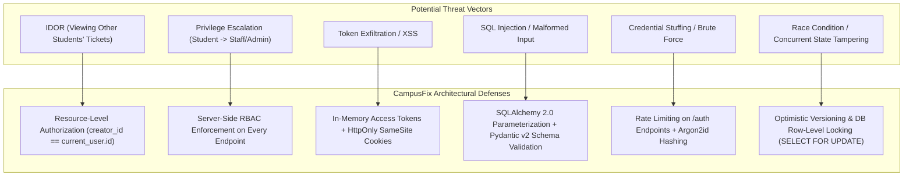

# Security Architecture & Threat Model — CampusFix

| Document Version | 1.0.0 |
| :--- | :--- |
| **Status** | Approved Baseline (Phase 0) |
| **Maintainer** | Security Engineer & Backend Architect |
| **Last Updated** | 2026-10-27 (UTC) |

---

## 1. Security Philosophy

CampusFix enforces security as an architectural property, not a superficial checklist. We adhere to the **Principle of Least Privilege**, **Defense in Depth**, and **Zero Trust for Client Input**. The backend treats all incoming headers, payloads, query parameters, and client assertions as untrusted.

> **Crucial Rule**: The system will never be described as "production-secure" merely because it implements JWT or role checks. Security is maintained through continuous verification of access boundaries, sanitized data flows, and active auditing.

---

## 2. Threat Modeling & OWASP Top 10 Mitigations

### 2.1 Broken Access Control (OWASP A01)
- **Role Verification**: Roles are stored in the database and embedded in cryptographically signed JWT tokens. The backend validates roles in FastAPI dependencies (`require_role("STAFF")`, `require_role("ADMINISTRATOR")`).
- **Resource Ownership (IDOR Prevention)**: When a student requests `GET /api/v1/tickets/{id}`, the query explicitly includes `WHERE creator_id = :current_user_id` unless the requesting user has the `STAFF` or `ADMINISTRATOR` role.
- **Role Elevation Prevention**: The public registration endpoint (`POST /auth/register`) strictly assigns the `STUDENT` role. Any role field supplied in the request body is rejected or ignored.

### 2.2 Cryptographic Failures (OWASP A02)
- **Password Storage**: Passwords are hashed using **Argon2id** (or bcrypt with a work factor >= 12). Plaintext passwords are never logged, stored, or echoed.
- **Transport Security**: HTTPS (TLS 1.3) enforced in production.
- **Secret Keys**: `SECRET_KEY` and signing keys must be 256-bit cryptographically secure strings injected via environment variables.

### 2.3 Injection & Input Sanitization (OWASP A03)
- **SQL Injection**: 100% of database interactions occur through SQLAlchemy 2.0 ORM using parameter binding. Raw string-interpolated SQL is strictly prohibited.
- **Payload Validation**: Pydantic v2 schemas strictly validate all incoming data types, lengths, and patterns (e.g. title lengths, email formats). Extra unexpected fields are stripped.

### 2.4 Session Management & Token Storage (OWASP A07)
- **Short-Lived Access Tokens**: Signed JWTs with a 15-minute expiration time stored strictly in JavaScript client application memory (React Context). Never persisted in browser `localStorage` or `sessionStorage`.
- **Secure Refresh Cookies**: Refresh tokens are stored exclusively in HTTP-only cookies with flags:
  - `HttpOnly = True` (inaccessible to JavaScript `document.cookie`, mitigating XSS exfiltration).
  - `Secure = True` (transmitted only over HTTPS in production).
  - `SameSite = Lax` (defends against Cross-Site Request Forgery).

#### Refresh-Token Lifecycle & Family-Wide Reuse Protection:
1. **Login & Family Initiation**:
   - On successful `POST /api/v1/auth/login`, the server generates a cryptographically random refresh token and mints a unique `family_id = gen_random_uuid()`.
   - The SHA-256 hash of the token (never the raw token) is persisted in `refresh_tokens` bound to `user_id`, `family_id`, and `expires_at`.
2. **Atomic Verification & Row Locking**:
   - When the client calls `POST /api/v1/auth/refresh`, the server extracts the raw token from the cookie and computes its SHA-256 digest.
   - Inside an atomic database transaction, the server executes `SELECT * FROM refresh_tokens WHERE token_hash = :hash FOR UPDATE`.
   - Acquiring the row lock serializes concurrent refresh requests and prevents race conditions.
3. **Post-Lock Validation**:
   - If the token does not exist, or `expires_at <= CLOCK_TIMESTAMP()`, the transaction commits/aborts and the server returns HTTP 401 Unauthorized.
4. **Single-Use Rotation & Replacement**:
   - If `revoked_at IS NULL` and `expires_at > CLOCK_TIMESTAMP()`, the token is valid.
   - The server marks the token as consumed (`revoked_at = CLOCK_TIMESTAMP()`).
   - A new cryptographically random refresh token is generated; its SHA-256 hash is inserted inheriting the **same `family_id`**.
   - The transaction commits atomically. The server returns a new 15-minute access token and sets the rotated refresh token cookie.
5. **Token Reuse Detection & Family Revocation**:
   - If post-lock inspection finds `revoked_at IS NOT NULL`, the token has already been consumed (replay attack/token theft).
   - The server immediately invalidates all active tokens in that session chain:
     `UPDATE refresh_tokens SET revoked_at = CLOCK_TIMESTAMP() WHERE family_id = :family_id AND revoked_at IS NULL;`
   - The transaction commits the revocation, and the server returns HTTP 401 Unauthorized with error code `TOKEN_REUSE_DETECTED`.
6. **Session Isolation**:
   - Because revocation queries filter by `family_id`, sessions on other devices belonging to the same user (such as a laptop and a mobile phone) possess distinct `family_id` values and remain active and undisturbed.
7. **Concurrency Defense**:
   - If two concurrent requests arrive with the same refresh token, Request 1 acquires the row lock, rotates the token, and commits. Request 2 blocks until Request 1 finishes, then reads `revoked_at IS NOT NULL`, triggers family revocation, and is rejected with HTTP 401. Two concurrent requests cannot both succeed.
8. **Server-Side Logout**:
   - `POST /api/v1/auth/logout` sets `revoked_at = CLOCK_TIMESTAMP()` for the active token row (or its `family_id`) and clears the cookie via `Max-Age=0`.
9. **Origin Header Validation**:
   - All cookie-authenticated state-changing endpoints (`/auth/refresh`, `/auth/logout`) strictly validate the HTTP `Origin` and `Referer` headers against the approved frontend allowlist for defense-in-depth CSRF mitigation.

### 2.5 Denial of Service & Rate Limiting
- Rate limiting is configured on sensitive endpoints (notably `/api/v1/auth/login` and `/api/v1/tickets`) to prevent brute-force attacks and ticket spamming.

---

## 3. Secret Management & Credential Policy

1. **Zero Committed Secrets**: `.env`, `.pem`, `.key`, and database credential files are explicitly ignored in `.gitignore`.
2. **Environment Template**: A fully documented `.env.example` is maintained detailing all required configuration variables without real secrets.
3. **Secret Rotation**: Production deployments must support zero-downtime secret rotation via environment variable injection.

---

## 4. Synthetic Development Data Policy

1. Real student, faculty, or staff records, institutional email addresses, or actual facility maintenance records must never be loaded into development or testing databases.
2. Development and testing rely exclusively on deterministic synthetic fixtures:
   - Fictitious test emails: `student.demo@campusfix.local`, `staff.demo@campusfix.local`, `admin.demo@campusfix.local`.
   - Fictitious locations: "Science Block A, Room 101", "Library West Wing, Floor 2".
3. Default production administrative accounts must never be seeded automatically. Production administration accounts are provisioned via secure initial setup CLI scripts.
