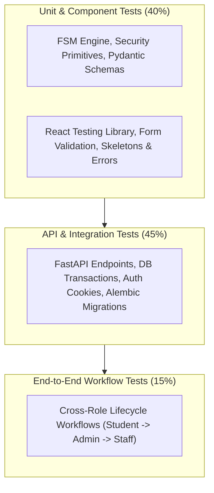

# Testing Strategy & Quality Assurance Plan — CampusFix

| Document Version | 1.0.0 |
| :--- | :--- |
| **Status** | Approved Baseline (Phase 0) |
| **Maintainer** | QA Lead & Full-Stack Architect |
| **Last Updated** | 2026-10-27 (UTC) |

---

## 1. Quality Assurance Philosophy & Golden Rules

Testing in CampusFix is treated as an engineering discipline, not an afterthought. Superficial tests that merely check if a component mounts without crashing are strictly prohibited. Every test must assert concrete business rules, state invariants, or security boundaries.

### Golden Rules:
1. **Verifiable Execution Only**: Never claim a test passed unless it was executed in the test runner and the exact exit code and test count were observed.
2. **Deterministic & Isolated**: Tests must not rely on external network calls or shared mutable database state. Each test executes inside an isolated transaction rolled back on completion or a fresh test SQLite/PostgreSQL instance.
3. **Security Boundary Coverage**: Every protected API route must have dedicated tests asserting rejection of unauthenticated requests (HTTP 401) and unauthorized roles (HTTP 403), as well as IDOR attempts.
4. **State Machine Invariants**: 100% of permitted transitions and 100% of illegal state transition attempts must be tested.

---

## 2. Testing Pyramid & Tooling



| Scope | Runner / Framework | Target Coverage | Key Responsibilities |
| :--- | :--- | :--- | :--- |
| **Backend Unit** | `pytest` (In-memory SQLite optional for pure functions) | >= 85% | FSM state transitions, password hashing, token generation, Pydantic validation. |
| **Backend API** | `pytest` + `httpx.AsyncClient` + PostgreSQL | >= 85% | Route handlers, status codes, RBAC checks, IDOR isolation, pagination metadata. |
| **Database Integration** | `pytest` + Dedicated PostgreSQL Instance | 100% of migrations | Schema integrity, constraints, triggers, Alembic upgrade/downgrade cycles. |
| **Frontend Component** | `vitest` + `@testing-library/react` | >= 80% | Form inputs, error banners, loading skeletons, conditional role controls. |
| **Frontend Workflows** | `vitest` + Mock API | Critical paths | Login flow, ticket creation submission, resolution notes submission. |

> [!IMPORTANT]
> **Roles of SQLite vs. PostgreSQL in Testing**:
> - **PostgreSQL is Mandatory for Integration**: All API endpoints, concurrency tests, and database migrations must execute against a real PostgreSQL test database (local instance or container). Critical features such as `SELECT ... FOR UPDATE` row locks, native UUID primary keys, and Alembic migrations rely on PostgreSQL-specific engine behavior. SQLite tests do **not** establish PostgreSQL integration correctness.
> - **SQLite is Restricted to Isolated Unit Logic**: SQLite in-memory may be used only for fast, database-independent unit tests of pure business logic or utility helpers where ORM/SQL dialect features are decoupled.

---

## 3. Test Suites Structure

### 3.1 Backend Test Directory (`backend/tests/`)
```text
backend/tests/
├── conftest.py                   # Pytest fixtures (DB sessions, test client, synthetic seed tokens)
├── unit/
│   ├── test_security.py          # Password hashing, JWT encode/decode, token expiration
│   ├── test_state_machine.py     # State transitions, illegal jumps, mandatory reason checks
│   └── test_schemas.py           # Pydantic validation edge cases (lengths, formats)
├── api/
│   ├── test_auth_api.py          # /login, /refresh, /logout, /me responses & cookies
│   ├── test_categories_api.py    # Category CRUD and admin access restrictions
│   ├── test_tickets_create_api.py# Ticket submission validation and creator binding
│   ├── test_tickets_query_api.py # Ticket listing, pagination, student isolation (no IDOR)
│   ├── test_tickets_assign_api.py# Assignment permissions and history logging
│   ├── test_tickets_transition_api.py # Valid and invalid status transitions via HTTP
│   └── test_admin_api.py         # Dashboard metrics and user role modifications
└── migrations/
    └── test_migrations.py       # Alembic migration upgrade/downgrade consistency
```

### 3.2 Frontend Test Directory (`frontend/tests/`)
```text
frontend/tests/
├── setup.ts                      # Vitest test setup (jest-dom matchers, mock window APIs)
├── components/
│   ├── Button.test.tsx           # Button variants, disabled and loading states
│   ├── Badge.test.tsx            # Status and priority color mapping
│   ├── TicketCard.test.tsx       # Content rendering, status badge, action triggers
│   └── ErrorBanner.test.tsx      # Error presentation and retry button callbacks
├── pages/
│   ├── Login.test.tsx            # Form validation, error alert on 401, success redirect
│   ├── TicketCreate.test.tsx     # Required field validation, API error handling
│   └── StaffWorkbench.test.tsx   # Queue switching, ticket claiming, resolution modal
└── api/
    └── client.test.ts            # Bearer token injection, 401 refresh interceptor
```

---

## 4. Specific Test Scenarios & Invariants

### 4.1 State Machine Invariants
- `SUBMITTED` → `ASSIGNED`: Passes when valid `assigned_staff_id` provided.
- `SUBMITTED` → `RESOLVED`: Fails with `422 Unprocessable Entity` (Cannot jump directly to resolved).
- `SUBMITTED` → `REJECTED`: Fails if `rejection_reason` is empty or < 10 characters.
- `IN_PROGRESS` → `CANCELLED`: Fails with `422 Unprocessable Entity` (Student cannot cancel once repair is in progress).
- `IN_PROGRESS` → `RESOLVED`: Fails if `resolution_notes` is empty or < 10 characters.
- `RESOLVED` / `REJECTED` → `ASSIGNED` / `SUBMITTED` (Reopening): Passes for `ADMINISTRATOR` with valid `reopening_reason` (>= 10 chars); fails with `403 Forbidden` if attempted by `STUDENT` or `STAFF`.
- Any transition with stale `expected_version`: Fails with `409 Conflict`.

### 4.2 Security & RBAC Scenarios
- Unauthenticated request to `/api/v1/tickets`: Returns `401 Unauthorized`.
- Student attempting to `POST /api/v1/categories`: Returns `403 Forbidden`.
- Student A attempting `GET /api/v1/tickets/{id_of_student_b}`: Returns `404 Not Found` (or `403 Forbidden`) with zero data leaked.
- Staff attempting to access Admin User Management `/api/v1/admin/users`: Returns `403 Forbidden`.
- Replay attack using previously revoked refresh token: Returns `401 Unauthorized` and revokes all user sessions.

---

## 5. Performance & Latency Verification Methodology

To verify requirement `NFR-008` (API response latency < 150ms at p95 under 50 concurrent users), a dedicated performance verification protocol is executed during Phase 5:

### 5.1 Test Environment & Configuration
- **Host**: Standard staging/test runner environment running Uvicorn with 2 worker processes.
- **Database**: Local or containerized PostgreSQL instance populated with a realistic synthetic test dataset:
  - 100 active user accounts (80 students, 15 staff, 5 admins).
  - 10 active categories.
  - 500 pre-populated tickets distributed across statuses and priorities.
- **Target Endpoint**: `GET /api/v1/tickets?page=1&page_size=20` (Authenticated read query with pagination, category joins, and creator isolation filters).

### 5.2 Workload Profile & Execution
- **Tooling**: Automated Python load test script using `asyncio` and `httpx` (or `locust -f tests/performance/locustfile.py --headless`).
- **Concurrent Users**: 50 virtual users executing continuous requests with randomized think-times (50ms–200ms).
- **Duration & Sample Size**: Sustained test window of 60 seconds with a minimum sample size of 500 completed HTTP requests.

### 5.3 Metrics & Pass/Fail Criteria
- **Pass Threshold**: 95th percentile latency (p95) < 150ms.
- **Error Rate Threshold**: 0.0% unhandled server errors (zero HTTP 5xx responses).
- **Distinction of Target vs. Claim**:
  > [!NOTE]
  > `< 150ms at p95 under 50 concurrent users` is an **architectural target and acceptance criterion** to be measured during Phase 5 hardening. It is not an experimentally verified result in Phase 0.

---

## 6. Execution Commands & Continuous Integration

All test suites will be executable locally via standard command lines:
- Backend: `pytest --cov=app --cov-report=term-missing`
- Backend Lint: `ruff check .` and `ruff format --check .`
- Frontend: `npm run test` or `npx vitest run --coverage`
- Frontend Lint: `npm run lint`

CI runs all four commands automatically on every pull request to ensure regressions are caught before merge.
