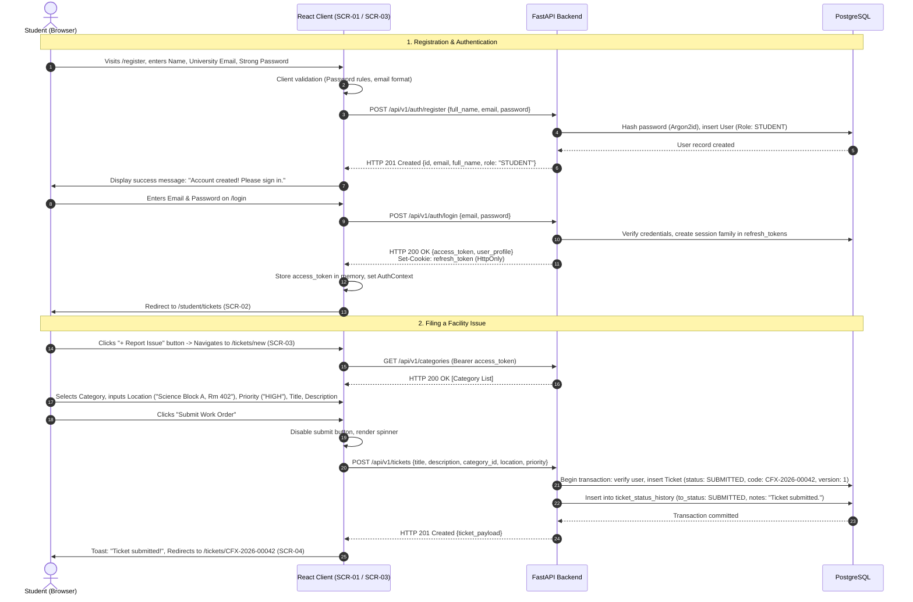

# User Journeys & Workflow Specifications — CampusFix

| Document Version | 1.0.0 |
| :--- | :--- |
| **Status** | Phase 1 Approved Deliverable |
| **Maintainer** | Senior UI/UX Designer & Systems Architect |
| **Scope** | End-to-End User Journeys Across Roles |
| **Last Updated** | 2026-10-27 (UTC) |

---

## 1. Overview & Behavioral Principles

Every user journey in CampusFix represents a deterministic path through the application. Each journey strictly conforms to:
1. **Server-Side Authorization Truth**: Client routes and navigation controls are presentation-layer conveniences; 100% of permissions and state invariants are validated on the backend.
2. **Finite State Machine (FSM) Consistency**: Every status mutation maps to the approved FSM transition rules (`SUBMITTED` -> `ASSIGNED` -> `IN_PROGRESS` -> `RESOLVED` / `REJECTED` / `CANCELLED`).
3. **Session Continuity & Token Rotation**: Background token rotation silently preserves active user sessions without data loss or jarring redirects.

---

## 2. Journey 1: Student Self-Registration, Login & Issue Submission



### Detailed Steps:
1. **Intake & Registration**:
   - The user visits `/register`. The client validates that the password contains at least 8 characters with lowercase, uppercase, and numerical characters.
   - The user dispatches registration. The server strictly assigns the `STUDENT` role.
2. **Authentication**:
   - The user enters credentials on `/login`. Upon HTTP 200, the access token (15-min life) is stored in React memory, and the refresh token is stored in an `HttpOnly`, `SameSite=Lax` cookie.
   - The user is redirected to the Student Portal (`SCR-02`).
3. **Ticket Submission**:
   - User clicks `+ Report Issue` on `SCR-02` and routes to `SCR-03` (`/tickets/new`).
   - The page fetches active categories. The user fills out Location, Category, Priority (default `MEDIUM`), Title (min 5 chars), and Description (min 10 chars).
   - Upon submission, the API creates the record with reference code `CFX-YYYY-XXXXX`, logs the initial history entry, and redirects to the Ticket Detail view (`SCR-04`).

---

## 3. Journey 2: Student Tracking an Issue, Viewing History & Cancellation

```mermaid
sequenceDiagram
    autonumber
    actor Student as Student (Browser)
    participant UI as React Client (SCR-02 / SCR-04 / SCR-06)
    participant API as FastAPI Backend
    participant DB as PostgreSQL

    Student->>UI: Navigates to /student/tickets (SCR-02)
    UI->>API: GET /api/v1/tickets?page=1&page_size=20
    API->>DB: SELECT * FROM tickets WHERE creator_id = :student_id
    DB-->>API: [Student's Tickets]
    API-->>UI: HTTP 200 OK {data: [tickets], meta: {total: 3}}
    UI->>Student: Renders ticket list with status badges & priority pills

    Student->>UI: Clicks on ticket CFX-2026-00042
    UI->>UI: Navigates to /tickets/CFX-2026-00042 (SCR-04)
    UI->>API: GET /api/v1/tickets/CFX-2026-00042
    UI->>API: GET /api/v1/tickets/CFX-2026-00042/history
    API-->>UI: HTTP 200 OK {ticket_data} & {history_entries}
    UI->>Student: Displays full incident details and chronological audit timeline

    alt Ticket is in SUBMITTED or ASSIGNED status (Cancellation Allowed)
        Student->>UI: Clicks "Cancel Ticket"
        UI->>Student: Opens Cancellation Modal (SCR-06)
        Student->>UI: Types cancellation reason ("Issue resolved by itself") and confirms
        UI->>API: POST /api/v1/tickets/{id}/transition {target_status: "CANCELLED", notes: "...", expected_version: 1}
        API->>DB: Atomic update: status = CANCELLED, version = 2; Insert history entry
        API-->>UI: HTTP 200 OK {ticket_data, status: "CANCELLED"}
        UI->>Student: Updates status badge to CANCELLED (Slate), appends timeline entry
    else Ticket is in IN_PROGRESS status
        UI->>Student: "Cancel Ticket" button is hidden/disabled; message explains repair has already commenced
    end
```

### Edge Cases & Handling:
- **IDOR Attempt**: If the student manipulates the browser URL to view a ticket ID belonging to a different student, the server responds with HTTP 404 / 403, and the client displays a clean "Ticket not found or permission denied" error screen.
- **Cancellation Conflict**: If the student confirms cancellation after a technician has already moved the ticket to `IN_PROGRESS`, the backend rejects the update with HTTP 409 Conflict. The client notifies the user: "Work has already started on this ticket and it can no longer be cancelled."

---

## 4. Journey 3: Facilities Staff Viewing Queue, Claiming & Resolving Work

```mermaid
sequenceDiagram
    autonumber
    actor Staff as Facilities Technician
    participant UI as Staff Client (SCR-05 / SCR-04 / SCR-06)
    participant API as FastAPI Backend
    participant DB as PostgreSQL

    Staff->>UI: Logs in as Staff -> Lands on /staff/queue (SCR-05)
    UI->>API: GET /api/v1/tickets?assigned_staff_id=me&status=ASSIGNED,IN_PROGRESS
    API-->>UI: HTTP 200 OK [Assigned Tickets]
    UI->>Staff: Displays "Assigned to Me" queue

    Staff->>UI: Clicks "Unassigned Triage Pool" tab
    UI->>API: GET /api/v1/tickets?status=SUBMITTED
    API-->>UI: HTTP 200 OK [Unassigned Tickets]
    UI->>Staff: Displays unassigned tickets with "Claim Ticket" action

    Staff->>UI: Clicks "Claim Ticket" on CFX-2026-00042
    UI->>API: POST /api/v1/tickets/{id}/assign {staff_id: current_user.id, expected_version: 1}
    API->>DB: Set assigned_staff_id = current_user.id, status = ASSIGNED, version = 2
    API->>DB: Insert history log: to_status = ASSIGNED, assigned_to = current_user.id
    API-->>UI: HTTP 200 OK {updated_ticket}
    UI->>Staff: Moves ticket from Unassigned to "Assigned to Me" tab

    Staff->>UI: Clicks "Start Work" button
    UI->>API: POST /api/v1/tickets/{id}/transition {target_status: "IN_PROGRESS", expected_version: 2}
    API->>DB: Set status = IN_PROGRESS, version = 3; log history
    API-->>UI: HTTP 200 OK
    UI->>Staff: Badge updates to IN_PROGRESS (Purple)

    Note over Staff,DB: Physical Repair Execution Complete
    Staff->>UI: Clicks "Resolve Work Order"
    UI->>Staff: Displays Resolution Dialog (SCR-06)
    Staff->>UI: Types resolution notes ("Replaced damaged HDMI wall connector and tested 1080p feed.")
    Staff->>UI: Clicks "Confirm & Mark Resolved"
    UI->>API: POST /api/v1/tickets/{id}/transition {target_status: "RESOLVED", notes: "...", expected_version: 3}
    API->>DB: Set status = RESOLVED, resolution_notes = "...", version = 4; log history
    API-->>UI: HTTP 200 OK {ticket_data, status: "RESOLVED"}
    UI->>Staff: Shows green success confirmation, moves ticket to "My Completed Work" tab
```

### Key Invariants Enforced:
- Staff can only resolve tickets when status is `IN_PROGRESS`.
- Resolution strictly requires `resolution_notes` >= 10 characters.
- Version incrementing prevents race conditions if an administrator reassigns the ticket simultaneously.

---

## 5. Journey 4: Administrator Triage, Category & Role Management, and Reopening

```mermaid
sequenceDiagram
    autonumber
    actor Admin as Campus Administrator
    participant UI as Admin Client (SCR-07 / SCR-08 / SCR-09 / SCR-06)
    participant API as FastAPI Backend
    participant DB as PostgreSQL

    Admin->>UI: Logs in as Admin -> Lands on /admin/dashboard (SCR-07)
    UI->>API: GET /api/v1/admin/dashboard/metrics
    API-->>UI: HTTP 200 OK {total_tickets, by_status, by_priority, avg_resolution_hours}
    UI->>Admin: Renders operational metrics & dispatch table

    Note over Admin,DB: 1. Work Order Dispatch
    Admin->>UI: In dispatch table, selects staff technician "Alex Rivera" for unassigned ticket
    UI->>API: POST /api/v1/tickets/{id}/assign {staff_id: "alex_id", expected_version: 1}
    API->>DB: Update assigned_staff_id, status = ASSIGNED; log history
    API-->>UI: HTTP 200 OK
    UI->>Admin: Ticket removed from dispatch list, metric counters update

    Note over Admin,DB: 2. Reopening a Closed Ticket
    Admin->>UI: Navigates to a RESOLVED ticket on /tickets/{id} (SCR-04)
    Admin->>UI: Clicks "Reopen Ticket" button
    UI->>Admin: Opens Reopening Modal (SCR-06)
    Admin->>UI: Selects target status "ASSIGNED" and inputs reason ("Display flickering again in afternoon session.")
    UI->>API: POST /api/v1/tickets/{id}/transition {target_status: "ASSIGNED", notes: "...", expected_version: 4}
    API->>DB: Set status = ASSIGNED, version = 5; log history with reopening reason
    API-->>UI: HTTP 200 OK
    UI->>Admin: Ticket transitions back to active ASSIGNED state

    Note over Admin,DB: 3. Managing Categories & Roles
    Admin->>UI: Navigates to /admin/categories (SCR-08)
    Admin->>UI: Clicks "+ Add Category" -> Inputs Name ("Laboratory Gas Fixtures") and Description
    UI->>API: POST /api/v1/categories {name, description}
    API-->>UI: HTTP 201 Created -> Category added to list

    Admin->>UI: Navigates to /admin/users (SCR-09)
    Admin->>UI: Searches for "Jordan Smith", clicks "Modify Role" -> Selects "STAFF"
    UI->>API: PATCH /api/v1/admin/users/{id}/role {role: "STAFF"}
    API-->>UI: HTTP 200 OK {user, role: "STAFF"}
    UI->>Admin: Role updated immediately
```

### Invariants & Role Bounds:
- Reopening is strictly authorized for `ADMINISTRATOR` accounts; students and staff do not see the Reopen action.
- Target reopen status must be either `ASSIGNED` or `SUBMITTED`.
- Category deactivation disables new selection but never breaks historical ticket FK references.

---

## 6. Journey 5: Logout, Silent Token Rotation & Session Expiry

```mermaid
sequenceDiagram
    autonumber
    actor User as Authenticated User
    participant UI as React Client (Memory)
    participant API as FastAPI Backend
    participant DB as PostgreSQL

    Note over User,DB: Normal Silent Token Rotation (Every 14 minutes)
    UI->>UI: In-memory access token approaches 15-minute expiry
    UI->>API: POST /api/v1/auth/refresh (Cookie: refresh_token)
    API->>DB: SELECT FOR UPDATE ON refresh_tokens WHERE token_hash = :hash
    DB-->>API: Token row (revoked_at IS NULL, family_id = F1)
    API->>DB: Mark old token revoked_at = CLOCK_TIMESTAMP()
    API->>DB: Insert new token (same family_id F1, fresh hash, expires in 7 days)
    API-->>UI: HTTP 200 OK {access_token}<br/>Set-Cookie: refresh_token (Rotated)
    UI->>UI: Update access_token in memory; continue uninterrupted

    Note over User,DB: Explicit User Logout
    User->>UI: Clicks "Log Out" in user profile menu
    UI->>API: POST /api/v1/auth/logout (Cookie: refresh_token)
    API->>DB: UPDATE refresh_tokens SET revoked_at = CLOCK_TIMESTAMP() WHERE family_id = :family_id
    API-->>UI: HTTP 200 OK {message: "Logged out"}<br/>Set-Cookie: refresh_token=; Max-Age=0
    UI->>UI: Clear in-memory token, reset AuthContext
    UI->>User: Redirects to /login (SCR-01) with toast: "You have been logged out."

    Note over User,DB: Session Expiry or Token Reuse Detection
    UI->>API: Request fails with HTTP 401 (TOKEN_EXPIRED or TOKEN_REUSE_DETECTED)
    UI->>UI: Interceptor detects 401, clears local auth state
    UI->>User: Displays alert: "Your session has expired. Please sign in again.", redirects to /login
```

### Security Properties:
- Refresh token rotation strictly executes under database row-level locking (`SELECT FOR UPDATE`).
- If a stale or stolen refresh token is used after rotation, the entire session family (`family_id`) is revoked immediately, forcing the attacker and user to re-authenticate.
- Client memory clear on logout ensures access tokens cannot be extracted from browser memory.
